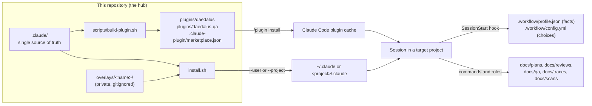
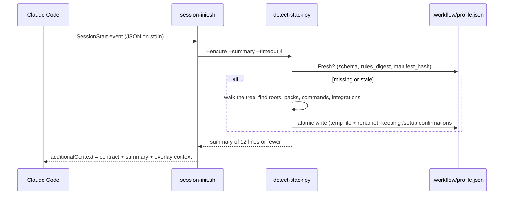
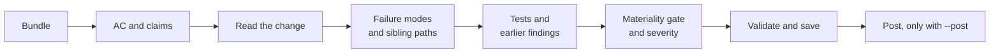

# Architecture

Daedalus is a stack-agnostic Plan → Code → Review → QA workflow for Claude Code. This repository (the **hub**) holds no application code. It contains Markdown prompts (commands, roles, skills and rules), a few standard-library Python and Bash scripts, and the tooling that ships them as a Claude Code plugin or copies them into a `.claude/` folder.

This document explains how those pieces fit together and why. [README.md](README.md) covers installing and using the workflow. [docs/plans/plug-and-play-workflow.md](docs/plans/plug-and-play-workflow.md) is the original design record; where it and the code disagree, the code is right (for example, the plan describes a single `plugin/` folder, but the build produces `plugins/daedalus` and `plugins/daedalus-qa`, per decision D8).

## 1. Big picture

The design rests on three ideas.

1. **One source tree, two distributions.** Everything is written once, under `.claude/`. The plugin is generated from it and the script install copies it, so neither output is edited by hand.
2. **Facts are detected, not configured.** A read-only detector writes each target project's roots, layers, stack packs and commands to `.workflow/profile.json`. No prompt hard-codes a stack: prompts read the profile and load the matching packs.
3. **Prompts are the program; scripts are the guardrails.** Behavior lives in Markdown: commands orchestrate, roles do the work, skills hold knowledge and rules hold the always-on contract. Scripts do only the jobs that have to be deterministic: detection, validation, building review bundles, packaging, installing, and the hub's own CI checks.

## 2. Components

### 2.1 The source tree: `.claude/`

| Path | Kind | Contents | When it loads |
|---|---|---|---|
| `rules/` | Always-on contract | `token-policy`, `compounding-dev-cycle`, `claude-code` (the mode map), `core-standards`, `stack-knowledge`, `graphify` | Every session in a script install. In a plugin install, through the `workflow-contract` skill |
| `commands/` | Entry points | One file per slash command (`/setup`, `/feature-plan`, `/project-manager`, `/argus`, …) | When the user types the command. All except `/trace-flow` set `disable-model-invocation: true`, so only the user can start them |
| `agents/` | Roles | `implementer`, `test-runner`, `argus`, `qa-tester`, `tech-stack-researcher`, `technical-writer` | Spawned by commands through the Agent tool |
| `skills/` | Knowledge | Process skills (`feature-planning`, `manual-qa`, `ui-mockup`, `trace-flow`, …), contract skills (`workflow-contract`, `project-profile`, `ticket-adapters`), the `stacks/` packs and `argus/` | On demand, by name |
| `hooks/` | Runtime glue | `session-init.sh` (SessionStart) and `audit.sh` (Bash pre/post, Stop, SessionEnd) | Registered in `settings.json` |
| `scripts/` | Deterministic helpers | `detect-stack.py`, `validate-profile.py`, `argus-bundle.sh`, `daily-git-activity.sh` | Called by hooks and commands |
| `settings.json` | Hook registration | Source for the plugin's `hooks/hooks.json` and for the installer's settings merge | — |

The prompts form layers: **command → role → skill → pack section**. A command resolves the profile and config, writes a short brief, and spawns roles. Each role loads only the skills and pack sections its job needs.

### 2.2 Roles

| Role | Mode | Tool boundary | Used by |
|---|---|---|---|
| `implementer` | AGENT (Code) | Read, Grep, Glob, Bash, Edit, Write, Skill | `/project-manager` (spawned once per layer). `/code-cleanup` and `/code-optimize` use its approach without spawning it |
| `test-runner` | AGENT (Code) | Same as implementer. Its prompt limits edits to test files | `/project-manager` |
| `argus` | AGENT (Review) | Read, Grep, Glob, Bash, Skill. No Edit or Write | `/argus`, `/argus-scan`, `/project-manager` |
| `qa-tester` | AGENT (QA) | Everything except Edit, Write and NotebookEdit. Playwright through MCP | `/manual-test`, `/project-manager` |
| `tech-stack-researcher` | PLAN | Read-only plus WebFetch and WebSearch | `/feature-plan`, `/new-task` |
| `technical-writer` | AGENT | Read, Grep, Glob, Bash, Edit, Write, Skill | `/new-task`, `/trace-flow` |

The tool list enforces "no file edits" for the read-only roles. The other limits, such as test files only or read-only shell commands, are set by the role's prompt, not by tool permissions.

### 2.3 Stack packs: `.claude/skills/stacks/`

A pack is a Markdown file with a `detect:` block in its frontmatter (`files` globs, `weak` globs, `signals`) and an `evidence` line. Every pack has the same five sections, so each role reads only the part it needs:

| Section | Read by |
|---|---|
| `## Build` | `implementer` |
| `## Review` | `argus`. It maps the universal failure modes (FM-01…FM-19 in `failure-modes.md`) onto this stack |
| `## Test` | `test-runner`, `implementer` |
| `## Commands` | `/setup`, `test-runner` |
| `## Entry points (scan mode)` | `/argus-scan` |

Packs work as both **knowledge and detection rules**: the detector parses their frontmatter to decide which packs apply to each root. Code that no pack covers gets `_generic.md` and the failure modes, plus whatever conventions the repo itself shows, and reviews name the files that had no pack. When more than one pack applies (for example `python` plus `serverless-queues`), all of them load and the more specific one wins any conflict. The repo's own rules (`house_rules`, lint config) override every pack.

### 2.4 Scripts

| Script | Role | Notes |
|---|---|---|
| `.claude/scripts/detect-stack.py` | Writes and refreshes `.workflow/profile.json` | Python 3.8+, standard library only. Reads files and runs only `git` read commands |
| `.claude/scripts/validate-profile.py` | Validates a profile against `skills/project-profile/profile.schema.json` | Covers the draft-07 subset the schema needs |
| `.claude/scripts/argus-bundle.sh` | Builds a review bundle: PR metadata, diff, checkout at the head SHA, ticket keys, earlier reviews | Needs `git`, `jq` and a signed-in `gh` |
| `.claude/scripts/daily-git-activity.sh` | Local commits and pushes for `/daily-report` | Read-only |
| `scripts/build-plugin.sh` | Generates `plugins/` and `.claude-plugin/` | `--check` for CI |
| `scripts/lint-packs.sh`, `scripts/check-generic.sh`, `scripts/test-detector.sh` | Hub quality gates | See §10 |
| `install.sh` | Script install and uninstall | See §8.2 |

## 3. Session start

- **Time budgets fit inside the hook's 10 s timeout.** The detector stops walking at 4 s (soft deadline) and is killed by an alarm at 7 s; the hook gives the subprocess 8 s. A partial profile records a gap that says to run `/setup --refresh`.
- **The hook never fails a session.** Every error path exits 0, and the summary falls back to "detection failed (or timed out); run /setup".
- **The contract depends on the install type.** A script install gets a one-line contract that points at `.claude/rules/`. A plugin install gets the `daedalus:` prefixes and a pointer to the `daedalus:workflow-contract` skill, because plugins can't ship always-on rules.
- **Overlay context:** the hook appends `hooks/context.txt` from the installed hub, or from `~/.claude/overlays/<overlay>/` when `.workflow/config.yml` names an overlay.
- **Two output formats:** `hook_event_name` selects Claude Code's `hookSpecificOutput` or Cursor's `additional_context`, so the same script serves both tools.

`audit.sh` runs on every Bash call, on Stop and on SessionEnd. It logs only the event name and a UTC timestamp, never stdin, which may contain secrets. It writes to `${CLAUDE_PLUGIN_DATA}` in plugin installs (never into the plugin root, which changes on update), or otherwise to `<project>/.claude/hooks/audit.log`. It never blocks a tool call.

## 4. Project profile and configuration

Facts and choices are kept in separate files:

| File | Holds | Written by | Committed in target repos |
|---|---|---|---|
| `.workflow/profile.json` | **Facts:** roots, layers, packs, commands, UI, data, infra, integrations, gaps | `detect-stack.py` (directly, or through `/setup`) | Yes (D5) |
| `.workflow/config.yml` | **Choices:** overlay, stacks, tickets, chat, graph, ignore, house rules, command overrides, QA, review | The user, or `/setup` for choices made there | Yes (D5) |

The hub gitignores its own `.workflow/`; target repos commit theirs so the whole team shares one profile.

### 4.1 Detection pipeline

1. **Walk** the tree, skipping vendored, build and cache folders. Depth, file count and time are all capped.
2. **Find roots.** Primary manifests (`package.json`, `pyproject.toml`, `go.mod`, `*.csproj`, `Cargo.toml`, `dbt_project.yml`, …) at depth 2 or less mark roots. When the repo root is itself a root, workspace members and `apps|packages|services|libs/*` folders are added. `.` is added when Terraform or `.github/` files would otherwise belong to no root.
3. **Describe each root:** languages by file extension, dependencies, frameworks, and packs. A pack matches strongly through a `files` glob or a `signal`; `weak` globs only extend a pack that already matched. Commands are merged from task runners (Makefile, Taskfile, justfile), package scripts, ecosystem conventions and CI lines.
4. **Pick a layer**, taking the first rule that matches: `ui` → `api` → `worker` → `data` → `cli` → `infra` → `lib`. The layer decides plan task blocks and implementer order.
5. **Integrations:** the code host from `git remote`, the ticket key pattern from recent commit history, and graphify when `graphify-out/graph.json` exists.
6. **Gaps:** whatever couldn't be found (no test command, a language without a pack, a UI without a dev command, an early stop).

### 4.2 Command trust

Each command is stored as `{cmd, source, confidence, confirmed?, unsafe?}`.

| Confidence | Source | Runs without asking? |
|---|---|---|
| `script` | A declared script or target | Yes |
| `derived` | A lockfile or tool convention | Yes |
| `user` | Set in `/setup` | Yes |
| `inferred` | A heuristic, such as a CI line | Only when `confirmed: true` |

`unsafe: true` is set when the command's name **or what it runs** matches deploy, migrate, publish, release, destroy, drop or similar. "What it runs" means the `package.json` script body (following one `npm run` hop), the Make, Task or just recipe, or known tools such as `terraform apply`, `alembic upgrade` and `dbt build`. Roles never run an unsafe command without asking, whatever its confidence.

### 4.3 Freshness and edits

- **`manifest_hash`** covers the content of every recorded manifest, plus the names of manifest files at depth 2 or less, so a new top-level manifest marks the profile stale. A new, deeper manifest needs `/setup --refresh`.
- **`rules_digest`** covers the detector's source and every pack's frontmatter. Upgrading the hub or editing a pack's `detect:` block marks every profile stale, with no version bump needed.
- **Carry-over:** when the profile is regenerated, user-set commands and confirmations are kept. `confirmed` is kept too, as long as the list of roots hasn't changed.
- **Edits** go through `detect-stack.py --set ROOT:NAME=CMD` and `--confirm ROOT:NAME`, which `/setup` uses. Nobody edits the JSON by hand.

### 4.4 Configuration chain

Precedence, from lowest to highest: detected profile → `~/.workflow/config.yml` (personal; overlay defaults merge in here) → `<workspace>/.workflow/config.yml` → `<repo>/.workflow/config.yml` → command arguments.

Files merge **key by key**, and the nearest file that sets a key wins. Mappings merge recursively and lists are replaced whole. A missing or `null` value falls through, while an explicit `none` or `[]` wins. Argus also reads the legacy `.argus.yml` files at each level. Every key is documented in [templates/workflow-config.example.yml](templates/workflow-config.example.yml).

## 5. The development cycle

| Phase | Command | Roles | Artifact (in the target project) |
|---|---|---|---|
| PLAN | `/feature-plan`, `/apply-ticket` | `tech-stack-researcher` (optional) | `docs/plans/<slug>.md`, plus `docs/plans/mockups/<slug>.html` when the UI changes and no design exists |
| Code | `/project-manager`, Phase A | `implementer` once per layer, then `test-runner` | Implementation notes (Done / Deferred / Assumptions / Env) and a test report, passed as handoffs |
| Review | `/argus --local` (Phase B) | `argus` | `docs/reviews/<repo>-<branch>-<sha7>.md` |
| Rework | `/project-manager`, Phase C | — | `docs/plans/<slug>-rework-N.md` |
| QA | `/manual-test` (Phase D) | `qa-tester` | `docs/qa/<slug>-qa-N.md` and screenshots |

- **The plan is the contract.** It has numbered acceptance criteria and one task block per affected layer (`### Layer: <layer> (<packs>)`), and every later handoff traces back to AC-n. After planning, the user runs `/clear` so plan-writing context doesn't carry into Code.
- **Layer order:** data → api / worker → ui → infra, with `lib` and `cli` before whatever uses them. Each implementer gets the plan path, its own layer block, its roots, packs and safe commands, and the contracts from earlier layers. It never gets the whole plan.
- **Gates:** Argus findings graded critical or important count as **Critical** and trigger rework; consider findings are Suggestions. Checks that couldn't run (a missing toolchain, or an unconfirmed or unsafe command) are **BLOCKED (env)**, not code failures, and go to the user. A QA FAIL triggers rework; a QA BLOCKED (sign-in, server down, missing data) goes to the user.
- **Production ready** means no Critical items, every gate passing, and QA PASS, or N/A when the profile shows no UI.

The other commands (`/scaffold`, `/test-gen`, `/code-cleanup`, `/code-optimize`, `/trace-flow`, `/argus-scan`, `/new-task`) use the same profile and packs and follow the same mode rules.

## 6. Argus: review and scan

Argus is the read-only reviewer. It has three modes:

| Mode | Started by | Input | Output |
|---|---|---|---|
| `pr` | `/argus <owner/repo#N>` | One PR at one head SHA | `docs/reviews/<repo>-<N>-<sha7>.md`. Posted to the PR only with `--post` |
| `local` | `/argus --local`, or `/project-manager` | The current branch's diff against its base, before a PR exists | The same review body. Never posted |
| `scan` | `/argus-scan <repo> [paths]` | A whole repo, or paths in it | `docs/scans/<repo>-<date>.md`. Tickets only with `--tickets`, and only after the user confirms |

### 6.1 What every run loads

1. **Config:** the chain in §4.4, plus the legacy `.argus.yml` at each level. The run records which files it read, and the saved review notes which file supplied `domain` and `tickets.system`.
2. **Stack packs:**
   - **Reviews:** the profile's packs for every root that contains a changed file, plus every pack whose `detect` globs or signals match the diff. A first `.sql` migration doesn't make the profile stale, so the diff check always runs.
   - **Scans:** the detector runs with `--stdout`, and its packs are combined with the saved profile's.
   - **Config:** `stacks:` replaces auto-detection; `extra_stacks` adds packs.
3. **Uncovered code:** files that no pack matches get `_generic.md` and the failure modes, and the output names the languages that had no pack.
4. **Domain pack and house rules:** `skills/argus/domains/<domain>.md` adds business invariants and always-critical triggers. `house_rules` files add checks but never lower the materiality gate. Only the domain template is public; real domain packs live in overlays.
5. **Ignore:** paths that match `ignore` are skipped. By default these are lockfiles and vendored, generated and minified files.

### 6.2 Review checkpoints (`pr` and `local`)

1. **Bundle.** `argus-bundle.sh` collects:
   - `pr.json`: title, body, refs, head SHA and changed files;
   - `diff.patch`, plus a checkout at the head SHA;
   - `ticket.md`: the linked ticket, if any;
   - `prior.md`: earlier Argus reviews of this PR;
   - `replies.md`: the author's replies since the last review.

   A missing input is named in the verdict, never guessed. A diff over 6,000 lines triggers a warning that lists the largest files.
2. **Acceptance criteria.** The linked ticket (fetched through `ticket-adapters`) becomes a numbered list; when `/project-manager` runs the review, the plan's AC stand in for the ticket. Each criterion is graded met, not met, or not visible.
3. **Claims.** Every behavioral claim in the PR description and test plan is listed and checked against the code.
4. **Read the change.** First the diff, then the full touched files, then callers and callees wherever a contract changes. A code graph or LSP is used for blast radius when one is available.
5. **Failure modes.** Each changed path is checked against every relevant family in §6.4, using the packs' Review sections, the domain invariants and the house rules.
6. **Sibling paths.** A fix has to reach every sibling path:
   - create, update, delete and transfer;
   - legacy and new request shapes;
   - every provider or handler variant;
   - maintenance routes and imports.
7. **Tests as evidence.** "Missing tests" is never a finding. A test that doesn't exercise the path it claims to, never runs, or contradicts the description is flagged (FM-18). Each Fix names the regression test that would fail before the fix.
8. **Re-review.** Each earlier finding id is classified as verified fixed, answered by a reply, or still open. Open findings keep their id and title, and none is raised again under a new title.
9. **Materiality gate.** A finding survives only if it has all of these:
   - a concrete scenario that leads to a wrong outcome;
   - a `path:line` location;
   - the smallest fix that closes it;
   - no style-only or duplicate content.

   Findings with the same root cause are merged into one. A "verify this" item with no failing scenario is `consider` at most.
10. **Severity.** Findings are graded by outcome, not technology (§6.3), and then any severity overrides from config apply.
11. **Output checks.** The command checks the body for:
    - the configured header;
    - a verdict of one sentence, 400 characters or fewer;
    - exactly one **Done well** item;
    - finding lines in the `[severity · category]` format, each with Fix and Where and an `argus-finding` id marker;
    - the closing review marker.

    If any check fails, it sends the reviewer one follow-up. It then saves the body with run notes and a `findings.json` block; neither block is posted.

### 6.3 Severity

| Severity | Meaning | Treated in `/project-manager` as |
|---|---|---|
| `critical` | Harm on merge, with no edge case needed: an open exploit, lost or duplicated money, silent permanent data loss, a broken deploy, an exposed live credential | Critical |
| `important` | A wrong outcome under normal use: wrong or lost data, an unmet AC that affects data, money or access, a hot-path query that grows with data, or a description that would mislead an approver | Critical |
| `consider` | A conditional edge case, a gap that only affects UX, moderate cost, or an assumption to verify | Suggestion |

Some outcomes are **critical in any stack**:
- an operator message that tells someone to take the wrong action;
- a rate limiter or claim that can grant twice;
- financial totals that mix currencies;
- a route or job that fails on every call;
- certain breakage on merge, such as an edited applied migration, invalid SQL or an invalid schedule;
- a committed live credential.

When Argus is unsure, it picks the lower level and says what would raise it. Each finding also gets one category: correctness, security, reliability, performance, cost, architecture, pattern_fit or ownership.

### 6.4 Failure-mode families

These are the universal questions both modes ask. The source of truth is `skills/stacks/failure-modes.md`, and each pack's Review section says how a family shows up in that stack.

| ID | Family | The question |
|---|---|---|
| FM-01 | Partial failure in batches | Can one bad item fail, drop, acknowledge or replay the whole batch, page, file or run? |
| FM-02 | Unknown outcome of external calls | What happens on a timeout, 5xx, dropped connection or malformed body? Is "no error raised" treated as success? |
| FM-03 | Irreversible side effects | Can a charge, purchase, order, send, publish or delete happen twice, or stop halfway? |
| FM-04 | Duplicates under at-least-once delivery | Is every handler safe when its message, event, webhook or job runs twice, or when two schedules overlap? |
| FM-05 | Unbounded loops and retries | Does every retry, re-poll, re-enqueue, follow-up chain and pagination loop end? |
| FM-06 | Time and resource budgets | Do timeouts, retries, sleeps and lock holds add up to less than the platform's limit? |
| FM-07 | Concurrency and shared state | What breaks with two requests, workers or instances at once? |
| FM-08 | Silent degradation | When something fails, will anyone know? |
| FM-09 | Destructive and scoped writes | Can a delete, void, overwrite or replace touch more than intended, or leave two systems out of step? |
| FM-10 | Contract and schema evolution | After this change, do every reader and writer, the deploy order and the stored data still agree? |
| FM-11 | Data semantics | Are values interpreted the same way everywhere? |
| FM-12 | Caching and staleness | Can stale data be shown, acted on or written back? |
| FM-13 | Authorization and trust boundaries | Is every permission enforced where the client can't bypass it? |
| FM-14 | Secrets and sensitive data | Can a credential, token, card number, personal data or full payload leak or stay live? |
| FM-15 | Configuration and environments | Will this behave correctly in every environment? |
| FM-16 | Performance and cost at scale | What does this cost per request, per row and per run as data grows? |
| FM-17 | User-facing truth | Does the UI tell the truth, and does it keep the user's work safe? |
| FM-18 | Verification that verifies | Do the tests and checks prove the claimed behavior? |
| FM-19 | Change hygiene | Does the change say what it does, and leave nothing behind? |

### 6.5 Scan checkpoints (`scan`)

1. **Checkout and config.** Argus records HEAD's `sha7` and the `owner/repo`. For an `owner/repo` argument it uses a sibling folder with that name if there is one, otherwise a temporary shallow clone that is removed afterwards. It resolves config the same way reviews do, read-only.
2. **Stacks.** The detector's packs combined with the profile's, with `stacks` and `extra_stacks` applied. Languages no pack covers are noted.
3. **Scope.** The paths given, or the whole repo minus `ignore` and build or vendor folders. Entry points come from each pack's **Entry points (scan mode)** section. For uncovered stacks, Argus walks HTTP routes, webhooks, queue consumers, scheduled jobs, CLI entry points, and IaC, CI and config files.
4. **Rule families and evidence bar.** A finding needs the evidence its family requires:

   | Family | Rule ids | Evidence required |
   |---|---|---|
   | `secrets.*` | `committed_live`, `in_logs_or_bundle` | The value grants access. Account ids, emails and queue URLs aren't secrets |
   | `infrastructure.*` | `iam_wildcard`, `secrets_in_environment`, `public_resource` | The policy, and the resources it actually reaches |
   | `injection.*` | `sql`, `command`, `template` | A path from an untrusted source to a sink built from strings. A bound parameter isn't injection |
   | `authz.*` | `idor`, `missing_server_check`, `role_bypass` | The endpoint and the missing server-side check |
   | `biz.*` | `unauthenticated_webhook`, `race_money`, `no_rate_limit`, `workflow_skip` | A reachable entry point and its business effect |
   | `supply.*` | `unpinned_dependency`, `secrets_in_environment` | The manifest or build step |

5. **Grading.** Scan findings are only `critical` or `high`. Each states its exploitability (unauthenticated remote, authenticated with low privileges, or authenticated with high privileges) and the data at risk (business data or credentials).
6. **Dedupe and redact.** One finding per location and cause. A secret appears only as its first 4 characters plus its length.
7. **Output checks.** Every finding has an Issue, Location, Rule, Exploitability, Data at risk, Evidence and Recommended fix, and none falls below its evidence bar. If any check fails, the reviewer gets one follow-up.
8. **Save and tickets.** The report is saved to `docs/scans/`. With `--tickets`, Argus proposes issue titles and creates them through `ticket-adapters` only after the user confirms.

**Calibration:** the materiality gate, the severity levels and the failure-mode catalog were tuned against a reference corpus of real review findings kept under `docs/research/`.

## 7. Integrations

- **Tickets and chat:** commands never call ticket or chat tools directly. They name an operation (get, find, list mine, create, update, comment), and the `ticket-adapters` skill maps it to Linear, Jira, GitHub Issues or none, and chat to Teams, Slack or none. `auto` resolves from the ticket key pattern and which tools are connected. If a configured tool is missing, the skill prints one line and continues as `none`. Writes happen only when the running command is itself the user's write request, and chat is read-only.
- **Code graph (optional):** with `graph: auto | graphify | none`, `rules/graphify.md` applies only when a graph exists. `addons/graphify/` ships the optional skill that builds graphs; the core workflow never asks anyone to build one.
- **Browser:** `qa-tester` drives Chrome through the Playwright MCP server. Script installs declare it in the role's `mcpServers` frontmatter. Plugin agents ignore that field, so the `daedalus-qa` plugin ships it in `.mcp.json` instead.

## 8. Packaging and installation

### 8.1 Plugin build: `scripts/build-plugin.sh`

The build reads only files that are tracked, or new and not ignored (`git ls-files --cached --others --exclude-standard .claude`), so gitignored overlays and local files can't leak into a plugin.

| Source | `plugins/daedalus` | `plugins/daedalus-qa` |
|---|---|---|
| `commands/`, `agents/`, `skills/` | Everything else | `manual-test`, `qa-tester`, `manual-qa` |
| `rules/*.md` | `skills/workflow-contract/rules/` | — |
| `hooks/*.sh`, `scripts/*` | `scripts/` | — |
| `settings.json` | `hooks/hooks.json`, with `${CLAUDE_PLUGIN_ROOT}` paths | — |
| — | — | `.mcp.json` (Playwright) |

- **Rewriting:** project-relative `.claude/<kind>/…` references become `${CLAUDE_PLUGIN_ROOT}/…` paths. A reference to the other plugin's component becomes its prefixed name, such as "the `daedalus-qa:qa-tester` role".
- **Agent frontmatter:** `mcpServers` is stripped from agents, since plugins take MCP servers from `.mcp.json`.
- **Generated metadata:** each plugin's `plugin.json` and README, plus `.claude-plugin/marketplace.json`, so this repo is its own marketplace. The version is a constant in the script.
- **CI check:** `--check` builds into a temporary folder and fails if the committed output differs.

**Why two plugins (D8):** the Playwright MCP server starts whenever its plugin is enabled. Keeping QA in a companion plugin means it runs only for projects with a UI. If QA is reached in a plugin install without the companion, `/project-manager` reports QA as BLOCKED (env).

### 8.2 Script install: `install.sh`

- **Copies** `commands/`, `agents/`, `skills/`, `scripts/`, `hooks/` and `rules/` into `~/.claude` (`--user`) or `<path>/.claude` (`--project`). `CLAUDE.md` is installed as `rules/daedalus-workflow.md`, so the user's own `CLAUDE.md` is never overwritten.
- **Merges hooks** into `settings.json` without touching other entries. It replaces older entries that point at its own `hooks/session-init.sh` or `hooks/audit.sh`, using absolute paths for `--user` and `${CLAUDE_PROJECT_DIR}` for `--project`.
- **Backs up** every file it would overwrite and records each change in `<.claude>/.daedalus-install-manifest.json`. `--uninstall` removes exactly what that manifest lists and restores the backups.
- **Asks first:** it defaults to a dry run when not attached to a terminal, shows the changes, and asks for confirmation (`--yes` skips the question).
- **Options:** `--overlay <dir>` (§9), `--addon graphify`, `--prune-legacy` (backs up and removes files from the original backend/frontend-role install), and `--cursor` (stops with a message until the Cursor layer exists; see §12).

### 8.3 Names per install type

Script installs use bare names (`/feature-plan`, `implementer`). Plugin installs use prefixes (`/daedalus:feature-plan`, `daedalus:implementer`, `daedalus-qa:qa-tester`). Commands and roles are written with bare names, and the model adds the prefix at run time, guided by the session-start context and the `workflow-contract` skill, which holds the full name table.

## 9. Overlays and keeping the hub generic

An **overlay** is a private folder that adds one team's specifics without forking the hub: an always-on context rule, an Argus domain pack, config defaults (overlay name, ticket keys, chat), session-start context lines, QA sign-in notes and daily-report sources.

| Overlay file | Installed to |
|---|---|
| `rules/*.md`, `skills/**` | `<.claude>/rules/`, `<.claude>/skills/` |
| `hooks/context.txt` | `<.claude>/hooks/context.txt` |
| `config.yml` | Merged into `~/.workflow/config.yml`; keys the user already set win |
| `overlay.yml`, `qa/auth.md`, `daily-report/sources.md` | `<.claude>/overlays/<name>/` (plugin installs read `~/.claude/overlays/<name>/`) |

Several mechanisms keep private content out of the public hub:
- `.gitignore` excludes `overlays/*` (except `_template/`), real Argus domain packs, private calibration data, the local validation matrix, and the hub's own `.workflow/`.
- `scripts/check-generic.sh` fails CI if anything other than `overlays/_template/` is tracked under `overlays/`, or if a guarded term appears in a tracked file. Guarded terms are stored only as SHA-256 hashes of their compact form, so the repo never contains the words it guards against. "Private" terms are banned everywhere; "org" terms are allowed only in the historical records under `docs/`. `docs/research/` is excluded and reported as a notice.
- The plugin build and the installer both copy only tracked or new, unignored files.

## 10. Hub quality gates

CI (`.github/workflows/check.yml`) runs on every push and pull request:

| Check | Enforces |
|---|---|
| `scripts/lint-packs.sh` | Each pack's `name` matches its file name, `detect.files` isn't empty, the `evidence` line exists, the five sections appear in order and aren't empty, the Review section cites only FM-01…FM-19, and the pack has fewer than 500 lines. `_generic.md` and `failure-modes.md` exist |
| `scripts/check-generic.sh` | The hub stays generic (§9) |
| `scripts/build-plugin.sh --check` | The committed `plugins/` and `.claude-plugin/` match a fresh build |
| `scripts/test-detector.sh` | The detector validation matrix in `docs/validation/matrix.json`: public repos pinned by SHA, synthetic cases (such as unsafe script bodies), and private rows from a gitignored `matrix.local.json`, skipped in CI. Every row runs with `--stdout`, so nothing is written into scanned repos, and each row also checks the detector's subprocess use (only read-only `git`) and its time budget |
| `scripts/test-probes.sh` | The capability-probe harness, offline (no credentials, no model, no docker): recorder modes, redaction and a leak scan over committed fixtures, case-file validation, and the isolation and cleanup logic |
| `scripts/test-bench.sh` | The benchmark harness, offline (no credentials, no model, no docker): task, arm and result schemas, scoring, safety detectors, budget accounting, and an end-to-end dry run with the fake arm |

Locally, `scripts/test-all.sh` runs every check in this table, continues past failures and prints a summary; `--skip <name>` skips one. Maintainer guide for both harnesses: [docs/guides/benchmarks.md](docs/guides/benchmarks.md).

Validation runs are recorded in `docs/validation/results-<date>.md`, and reviews of the hub itself are saved in `docs/reviews/`.

## 11. Safety model

- **Detection is read-only.** The detector reads files and runs `git remote`, `branch` and `log`. It never runs project code, installs packages or uses the network.
- **Commands are trusted by their source** (§4.2). Unsafe and unconfirmed inferred commands always need the user's approval, and roles print each command before running it.
- **Modes limit writes.** PLAN writes only `docs/plans/**`. Review and QA roles have no Edit or Write tools.
- **Git:** nothing is committed, pushed or opened as a pull request unless the user asks in that message. Argus posts only with `--post`.
- **Hooks never block.** Both hooks exit 0, and the audit log records only the event name and a UTC timestamp.
- **QA:** `qa-tester` never types credentials, never acts on identity-provider pages, and never runs against production. `qa.base_url` must be `localhost` or `127.0.0.1`.
- **Tickets and chat:** writes happen only through a command that is itself the user's request, and chat is read-only.

## 12. Extending the workflow

| Change | Steps |
|---|---|
| **New stack pack** | Copy `skills/stacks/_template.md`, fill in the `detect:` frontmatter and the five sections, and add a validation-matrix row. Run `lint-packs.sh` and `test-detector.sh`, then `build-plugin.sh`. Guide: [docs/guides/adding-a-stack.md](docs/guides/adding-a-stack.md) |
| **New command or role** | Add it under `.claude/commands/` or `.claude/agents/`. Update the command and role tables in `CLAUDE.md` and `README.md`. If it belongs to browser QA, add it to the QA sets in `build-plugin.sh`. Rebuild the plugin |
| **Detection logic** | Edit `detect-stack.py`; `rules_digest` refreshes existing profiles automatically. If the profile's shape changes, bump `SCHEMA_VERSION` and update `profile.schema.json` |
| **Team-specific behavior** | Write an overlay, never a hub change. Guide: [docs/guides/writing-an-overlay.md](docs/guides/writing-an-overlay.md) |

After any change under `.claude/`, run `scripts/build-plugin.sh` and commit the regenerated `plugins/` with it.

## 13. Key decisions

Summarized from §11 of the plan.

| ID | Decision |
|---|---|
| D1 | Ship two ways: a Claude Code plugin and `install.sh` |
| D2 | Org-specific content lives in a gitignored overlay; only the template is tracked |
| D3 | Cursor parity through a thin generated layer on top of what Cursor already imports from `.claude/`; profile and config live in the tool-neutral `.workflow/` |
| D4 | The code graph is an optional accelerator (`graph: auto`) |
| D5 | Target repos commit `.workflow/profile.json` and `.workflow/config.yml`; personal overrides go in `~/.workflow/config.yml` |
| D6 | Generic roles `implementer` and `test-runner` replace the fixed backend and frontend roles |
| D7 | Codex output from the same sources is deferred |
| D8 | Browser QA ships as the companion plugin `daedalus-qa`, so Playwright starts only where it's needed |

## 14. Status and known gaps

- **The Cursor thin layer (Phase C) isn't built yet.** There's no `cursor/` folder, and `install.sh --cursor` stops with a message. Cursor already imports `.claude/agents`, `.claude/skills` and the `.claude/settings.json` hooks, and `session-init.sh` already prints Cursor's output format. The generated always-apply rules and command skills are what's still missing.
- **Codex output** is deferred (D7).
- **Large monorepos** can produce a partial profile when the detection budget runs out. The profile records a gap, and `/setup --refresh` runs a full scan.
- **Deep manifests:** a new manifest deeper than two levels doesn't mark the profile stale; run `/setup --refresh`.
