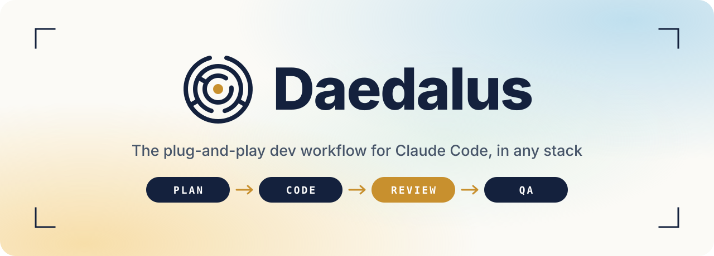
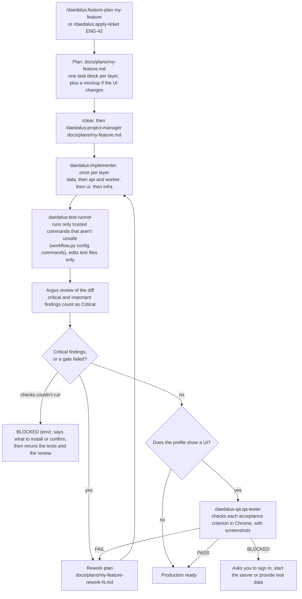
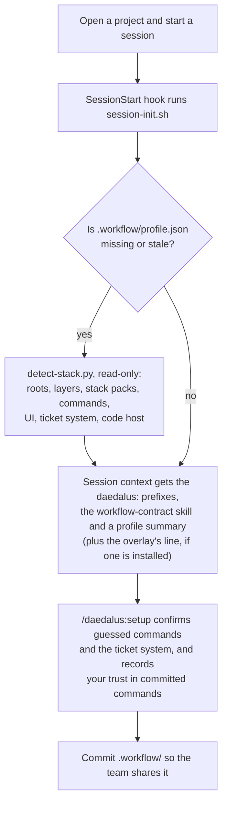

<p align="center">
  <a href="#quickstart"></a>
</p>

<p align="center">
  <a href="docs/validation/results-2026-11-25.md"></a>
  &nbsp;
  <a href="#what-argus-checks"></a>
</p>

<p align="center">
  <a href="plugins/daedalus/.claude-plugin/plugin.json"></a>
  <a href="https://github.com/iamjcabalejo/daedalus/actions/workflows/check.yml"></a>
  <a href="LICENSE"></a>
  <a href="https://claude.com/claude-code"></a>
  <a href="#requirements"></a>
  <a href="#works-with-your-stack"></a>
</p>

<p align="center">
  <a href="ARCHITECTURE.md"></a>
  <a href="docs/guides"></a>
  <a href="docs/validation/results-2026-11-25.md"></a>
</p>

<h3 align="center">Describe a change. Daedalus plans it, builds it, tests it, reviews it<br>and checks it in a real browser, in the stack your repo already uses.</h3>

<p align="center">
  <a href="#quickstart"><b>Quickstart</b></a> ·
  <a href="#see-it-work"><b>See it work</b></a> ·
  <a href="#works-with-your-stack"><b>Stacks</b></a> ·
  <a href="#what-argus-checks"><b>Argus</b></a> ·
  <a href="#commands"><b>Commands</b></a> ·
  <a href="ARCHITECTURE.md"><b>Architecture</b></a>
</p>

---

## Why Daedalus

Coding agents are fast. Left alone, they also guess at your stack, skip the parts of the process a good team never skips, and review their own work. Daedalus gives Claude Code that process: a written plan, one implementer per layer, your repo's own test commands, an independent reviewer, and a real browser check. Every phase leaves a file you can read, so nothing is a verbal handoff.

You don't configure it. When a session starts it reads the repo and works out the rest.

<table>
<tr>
<td width="33%" valign="top">

### 🧭 Learns your repo in 0.1 s

A read-only detector maps roots, layers (`ui`, `api`, `worker`, `data`, `infra`, `lib`, `cli`), stack packs and the install, test, lint, typecheck, build and dev commands into `.workflow/profile.json`. It never runs project code or touches the network.

</td>
<td width="33%" valign="top">

### 🗺️ Plans by layer

`/feature-plan` (or `/apply-ticket` from Linear, Jira or GitHub Issues) writes acceptance criteria, concrete file changes and one task block per layer, plus an HTML mockup when the UI changes and no design exists.

</td>
<td width="33%" valign="top">

### 🛠️ Builds in your idioms

An `implementer` runs once per layer, in order (data → api / worker → ui → infra), using that stack's pack and your repo's own conventions. Then `test-runner` fills test gaps and separates new failures from old ones.

</td>
</tr>
<tr>
<td width="33%" valign="top">

### 👁️ Argus, the hundred-eyed reviewer

Checks the diff against 19 universal failure modes plus the stack's packs, and against the linked ticket. Material findings only, each graded critical / important / consider with **Fix**, **Where** and **Cost**. Critical findings loop back into a rework plan automatically.

</td>
<td width="33%" valign="top">

### 🧪 Real browser QA

For projects with a UI, `qa-tester` opens the exact pages that changed in Chrome (Playwright), walks every acceptance criterion, compares against the mockup and proves each PASS or FAIL with a screenshot.

</td>
<td width="33%" valign="top">

### 🔒 Safe by default

Roles run only the commands your repo's own files reproduce or that you trusted, and never a deploy, migrate, publish or drop without asking. Review and QA roles have no write tools. Nothing is committed or pushed unless you ask.

</td>
</tr>
</table>

## Quickstart

Install the plugin from inside Claude Code:

```
/plugin marketplace add iamjcabalejo/daedalus
/plugin install daedalus@daedalus
```

Project has a UI? Add the browser-QA companion too (it carries the Playwright MCP server, so it only starts where you need it):

```
/plugin install daedalus-qa@daedalus
```

Then, in any repo:

```
/daedalus:setup                                         # once per repo: confirm what it detected
/daedalus:feature-plan refund-button                    # or /daedalus:apply-ticket ENG-42
/clear
/daedalus:project-manager docs/plans/refund-button.md   # code → test → review → QA, until production ready
```

That's the whole loop. Commit `.workflow/` so your team shares the profile.

<details>
<summary><b>No <code>/plugin</code> command?</b> (for example, the Claude desktop app's Code tab)</summary>

Install from a terminal with the `claude` CLI; new sessions in the app pick the plugin up:

```bash
claude plugin marketplace add iamjcabalejo/daedalus
claude plugin install daedalus@daedalus
claude plugin install daedalus-qa@daedalus   # UI projects only
```

The desktop app bundles the CLI at `~/Library/Application Support/Claude/claude-code/<version>/…/claude.app/Contents/MacOS/claude` if `claude` isn't on your PATH.

</details>

<details>
<summary><b>Prefer a script install?</b> (bare command names, always-on rules)</summary>

```bash
git clone https://github.com/iamjcabalejo/daedalus.git && cd daedalus
./install.sh --user
```

- `--user` installs into `~/.claude` (every project); `--project <path>` installs into `<path>/.claude` (one project or a multi-repo workspace folder).
- `--overlay <dir>` also installs a private overlay; `--addon graphify` adds the optional `/graphify` build skill.
- It shows what will change and asks first (`--dry-run` to only look, `--yes` to skip the question). Files it would overwrite are backed up, and hooks are merged into `settings.json` without touching your other entries.
- `./install.sh --uninstall --user` (or `--project <path>`) removes exactly what its manifest recorded and restores the backups.

Script installs keep bare names (`/feature-plan`, `implementer`) and load the rules as always-on `.claude/rules/*.md`. The session contract is installed as `rules/daedalus-workflow.md`, so your own `CLAUDE.md` is never overwritten.

</details>

## See it work

One feature, end to end, in a repo with a Python API and a React UI:

```text
you  /daedalus:feature-plan refund-button
     ├─ reads .workflow/profile.json        api · python      ui · web-frontend
     └─ writes docs/plans/refund-button.md  AC-1…AC-4, one task block per layer
               docs/plans/mockups/refund-button.html

you  /clear
you  /daedalus:project-manager docs/plans/refund-button.md
     ├─ implementer   api, then ui: code and tests in the repo's own conventions
     ├─ test-runner   the repo's trusted test, lint and typecheck commands
     ├─ argus         the diff vs. 19 failure modes + the python and web-frontend packs
     │                critical? → docs/plans/refund-button-rework-1.md → back to implementer
     ├─ qa-tester     every AC in Chrome, one screenshot per verdict → docs/qa/refund-button-qa-1.md
     └─ ✅ production ready
```

Under the hood:



Every phase leaves an artifact you can read, diff and share:

| Phase | Writes |
|---|---|
| Plan | `docs/plans/<slug>.md` (acceptance criteria, file changes, task blocks, Manual QA steps) and `docs/plans/mockups/<slug>.html` |
| Code | Code, tests, and implementation notes (Done / Deferred / Assumptions / Env) |
| Test | A pass/fail report per command, with new failures separated from pre-existing ones |
| Review | `docs/reviews/…` with every finding's Fix / Where / Cost; `docs/plans/<slug>-rework-N.md` when something is Critical |
| QA | `docs/qa/<slug>-qa-N.md` with PASS / FAIL / BLOCKED per acceptance criterion and a screenshot for each |

## Works with your stack

Stack knowledge lives in **packs**, each with Build, Review, Test, Commands and scan sections. Every role loads only the sections it needs.

<p>
  
  
  
  
  
  
  
  
  
  
</p>

**Anything else** (Ruby, Rust, Elixir, …) falls back to the generic pack plus the 19 universal failure modes and your repo's own conventions, and reviews say which files had no pack. Adding a stack: [docs/guides/adding-a-stack.md](docs/guides/adding-a-stack.md).

**Integrations:** tickets from **Linear**, **Jira** or **GitHub Issues**; chat from **Microsoft Teams** or **Slack** (for `/daily-report`); PR reviews on **GitHub**; optional code-graph orientation with [Graphify](https://github.com/Graphify-Labs/graphify).

## What Argus checks

Argus reviews in two layers. The **19 failure modes** are questions every diff gets asked, in any language. The **packs** say how each failure shows up in one technology. The catalog is distilled from real code review findings across Python, TypeScript, C#, Go, SQL, data-warehouse and infrastructure code.

Run it on its own against any pull request, too: `/daedalus:argus owner/repo#123`.

### The 19 failure modes

| Group | ID | Family | The question every diff gets asked |
|---|---|---|---|
| **Reliability** | FM-01 | Partial failure in batches | Can one bad item fail, drop or replay the whole batch? |
| | FM-02 | Unknown outcome of external calls | On a timeout, 5xx or malformed body, is "no error raised" treated as success? |
| | FM-03 | Irreversible side effects | Can a charge, order, send or delete happen twice, or stop halfway? |
| | FM-04 | Duplicates under at-least-once delivery | Is every handler safe when its message, webhook or job runs twice? |
| | FM-05 | Unbounded loops and retries | Does every retry, re-poll and pagination loop end? |
| | FM-06 | Time and resource budgets | Do timeouts, retries and sleeps add up to less than the platform's limit? |
| | FM-07 | Concurrency and shared state | What breaks with two requests or two workers at once? |
| | FM-08 | Silent degradation | When something fails, will anyone know? |
| **Data** | FM-09 | Destructive and scoped writes | Can a delete or overwrite touch more than intended? |
| | FM-10 | Contract and schema evolution | After this change, do every reader and writer, the deploy order and the stored data still agree? |
| | FM-11 | Data semantics | Are null vs zero, timezones and currencies read the same way everywhere? |
| | FM-12 | Caching and staleness | Can stale data be shown, acted on or written back? |
| **Security** | FM-13 | Authorization and trust boundaries | Is every permission enforced where the client can't bypass it? |
| | FM-14 | Secrets and sensitive data | Can a credential, token or personal data leak? |
| **Operations** | FM-15 | Configuration and environments | Will this behave correctly in every environment? |
| | FM-16 | Performance and cost at scale | What does this cost per request, per row and per run as data grows? |
| **Product and process** | FM-17 | User-facing truth | Does the UI tell the truth and keep the user's work safe? |
| | FM-18 | Verification that verifies | Do the tests actually prove the claimed behavior? |
| | FM-19 | Change hygiene | Does the change say what it does, and leave nothing behind? |

Linters can't see most of these, and unit tests rarely trigger them: they only happen under retries, timeouts, concurrency or partial failure. They're also where double charges, lost messages and silent outages come from.

### What the packs add

| Pack | Example of what it knows |
|---|---|
| `python` | `requests` calls with no `timeout=`; synchronous I/O inside `async def` blocking the event loop |
| `node-js` | `fetch` doesn't reject on 4xx/5xx; `Promise.all` throws away every result when one item fails |
| `go` | A webhook returning 5xx for a payload that will always fail is redelivered forever; results written after the request was cancelled |
| `csharp-dotnet` | `Thread.Sleep` in retry paths; retry decisions made on the exception message instead of the status code |
| `web-frontend` | An idempotency key regenerated when a modal reopens allows a double purchase; out-of-order responses overwrite newer ones |
| `sql-migrations` | Editing an already-applied migration breaks the next deploy; new constraints that existing rows violate |
| `data-warehouse` | `COPY … on_error = continue` silently skipping files; a MERGE whose source has duplicate keys |
| `iac` | A queue visibility timeout shorter than the function timeout; a renamed resource that destroys state |
| `ci-cd` | Production deploys runnable from any branch; secrets echoed into job logs |
| `serverless-queues` | Missing `batchItemFailures`; blind retries after a partner 5xx on a purchase |

### What a finding looks like

An illustrative finding (not from a real run), in the exact shape Argus writes:

> **1. [important · reliability] One failed email fails the whole SQS batch and re-sends the other nine**
> `Promise.all(messages.map(send))` rejects on the first failed send, so the Lambda fails the batch and SQS redelivers all 10 messages. The 9 that already succeeded send their emails again (FM-01, FM-04).
> - Fix: use `Promise.allSettled` and return `batchItemFailures` for the failed ids only; add a test with one failing message in a batch of three.
> - Where: `src/handler.ts:42`
> - Cost: one extra step mapping results back to message ids.

A generic review of the same code tends to say "consider adding error handling".

### Only findings that matter

- **Materiality gate.** A finding survives only with a concrete failure scenario, a `path:line` and the smallest fix that closes it. No naming, formatting or generic "add tests" comments, and one finding per root cause.
- **Severity by outcome.** `critical` is harm on merge (an open exploit, lost money, a broken deploy); `important` is a wrong outcome under normal use; `consider` is an edge case or an assumption to verify. In `/project-manager`, critical and important findings become a rework plan automatically.
- **Checked against the ticket.** An unmet acceptance criterion that affects data, money or access is a finding.
- **Your business rules too.** An [overlay](#make-it-yours) can add a domain pack with your own invariants.

Argus adds to your tests and human approval; it doesn't replace them. The benchmark harness in [`bench/`](bench/README.md) scores it on seeded defects from each family; results aren't published yet. Details: [ARCHITECTURE.md § Argus](ARCHITECTURE.md#6-argus-review-and-scan).

## Commands

In a plugin install, prefix each with `daedalus:` (`/daedalus:feature-plan`); browser QA is `/daedalus-qa:manual-test`. Script installs use the bare names below.

| Command | Mode | What it does |
|---|---|---|
| `/setup [--refresh \| --print]` | read-only toward code | Detect and confirm the profile; write `.workflow/config.yml` only for your choices |
| `/feature-plan <slug>` | PLAN | `docs/plans/<slug>.md` with one task block per detected layer, plus a mockup when the UI changes and no design exists |
| `/apply-ticket <id>` | PLAN | Read one ticket (Linear, Jira or GitHub Issues) and write the layered plan |
| `/refine-spec <id>` | PLAN | Tighten a ticket's spec and save it back |
| `/create-ticket` | PLAN | File one ticket in the configured system |
| `/project-manager <plan>` | AGENT | implementer per layer → test-runner → `/argus --local` → qa-tester (UI only) → rework until production ready |
| `/scaffold <kind> <name>` | AGENT (Code) | New endpoint, component, job, migration or model in the project's framework, with tests |
| `/test-gen <target>` | AGENT (Code) | Tests for a file, endpoint, component or job in the detected test framework |
| `/code-cleanup`, `/code-optimize` | AGENT (Code) | Refactor, or a measure-first performance pass |
| `/new-task <task>` | ASK | Task breakdown only |
| `/trace-flow <page or action>` | read-only | Trace a page or action from route to database to render, into `docs/traces/` |
| `/argus <owner/repo#N \| N \| --local>` | AGENT (Review) | Argus review of a PR or the current branch; saves `docs/reviews/…`; posts only with `--post` |
| `/argus-scan <repo> [paths]` | AGENT (Review) | Security scan into `docs/scans/` with rule ids and a fix brief |
| `/manual-test <plan>` | AGENT (QA) | Browser QA of every UI-observable acceptance criterion, with screenshots; N/A without a UI |
| `/daily-report [48h \| since …]` | read-only | Done / next working day / blockers from git, tickets and chat |

### Roles

| Role | Mode | Does |
|---|---|---|
| `implementer` | AGENT (Code) | One layer's plan tasks, using the Build and Test sections of that layer's packs and the repo's own conventions |
| `test-runner` | AGENT (Code) | Runs the trusted checks (`workflow.py config commands`) for the touched roots, fills test gaps (test files only), separates new failures from old ones |
| `argus` | AGENT (Review) | Read-only review of a diff, PR or repo; material findings only, each with Fix / Where / Cost |
| `qa-tester` | AGENT (QA) | Read-only browser QA with screenshot evidence; never types credentials |
| `tech-stack-researcher` | PLAN | Technology options checked against the detected stack |
| `technical-writer` | AGENT | Documentation in the project's own stack and commands |

## How it works

### Modes

Each phase runs in one mode, and the mode limits what it may touch.

| Mode | Behavior |
|---|---|
| **ASK** | No edits. Ask until scope and acceptance criteria are clear |
| **PLAN** | Write only `docs/plans/**` (and the mockup, or the ticket for `/refine-spec` and `/create-ticket`) |
| **AGENT (Code)** | `implementer` once per affected layer (data → api / worker → ui → infra), then `test-runner` |
| **AGENT (Review)** | `/argus --local`, read-only; critical and important findings are Critical, consider findings are Suggestions |
| **AGENT (QA)** | `qa-tester` in a real browser, only when the profile shows a UI |

Before any of that, each request is **refined, then handed off**: it becomes a tight brief (objective, scope, constraints, forbidden) so tokens go to the work, not to re-clarifying it.

### The project profile

`.workflow/profile.json` holds **facts** (detected, and refreshed automatically when a manifest changes); `.workflow/config.yml` holds **choices**.



<details>
<summary><b>Configuration is resolved, not merged by hand</b></summary>

`workflow.py config resolve` reads five trust levels: TL1 organization policy (a root-owned file), TL2 your `~/.workflow/config.yml`, TL3 the workspace folder, TL4 the repository's `.workflow/config.yml`, and TL5 per-run `--set` values. Each key resolves by its class: preferences such as `tickets.system` take the nearest value; security settings such as `guard.mode`, budgets and required gates can only be tightened by a repository or a run, never loosened; governance keys come from organization policy only. `workflow.py config explain <key>` shows where a value came from and which contributions were ignored, and why. Every key is in [templates/workflow-config.example.yml](templates/workflow-config.example.yml).

</details>

<details>
<summary><b>Which commands run without asking</b></summary>

A committed profile or config file can claim any confidence, so it doesn't decide. `workflow.py config commands --json` reports the effective set: a command is trusted when re-detection from the repo's own files reproduces it, when your trust store (`~/.workflow/trust.json`, outside every repo) holds its digest, or when it comes from your own or your organization's config. Roles run only trusted commands that aren't `unsafe` (deploy, migrate, publish, drop, or anything whose body does those), and ask about the rest. Today roles follow this by prompt; script enforcement arrives in hardening phase P2 ([roadmap](docs/plans/daedalus-hardening-roadmap.md)).

**Upgrading from an earlier version:** committed `user` and confirmed commands, and `commands` overrides in a committed `.workflow/config.yml`, no longer run unasked. Run `/setup` once in each repository to review and trust them; until then the session banner counts them as untrusted. Changing a command's text makes it untrusted again.

Details: [docs/guides/trust-and-policy.md](docs/guides/trust-and-policy.md), [ARCHITECTURE.md § Safety model](ARCHITECTURE.md#11-safety-model), and the `project-profile` skill for how roles read the profile.

</details>

### Why XML beats a single prose prompt

For complex work, `token-policy.md` asks for a short internal XML blueprint (`<role>`, `<task>`, `<forbidden>`, `<documents>`, `<error_handling>`, `<analysis>`, `<output_format>`). Unstructured text mixes role, task, constraints and output in one stream, so the model blends them and drifts (rules read as content, examples override instructions). Named tags give each concern its own slot, which makes negative rules (`<forbidden>`, `<error_handling>`) as visible as positive ones. Separating `<analysis>` from `<output_format>` makes the model think before it answers. Frontier models are trained heavily on XML-style instruction documents, so this format tends to be followed more reliably than a paragraph with the same words and no delimiters.

## Requirements

| Tool | For | Required |
|---|---|---|
| [Claude Code](https://claude.com/claude-code) | Running the workflow | Yes |
| Python 3.8+ (stdlib only) and `git` | Detector, hooks, scripts | Yes |
| `gh` (signed in) and `jq` | `/argus` bundles and the GitHub ticket adapter | For `/argus` and GitHub tickets |
| Linear, Jira, Microsoft 365 or Slack MCP | Ticket and chat adapters | Only for that system |
| Node.js 18+ and Chrome | Browser QA (`daedalus-qa`, or `qa-tester` in a script install) | Only for UI projects |
| Each project's own toolchain | `test-runner` runs the project's commands | Per project; a missing tool reports the check as BLOCKED, never as a code failure |
| [Graphify](https://github.com/Graphify-Labs/graphify) CLI | Optional code-graph orientation | Optional |

## Make it yours

- **Overlays.** A private folder adds one team's specifics: an always-on context rule, an Argus domain pack (business invariants), ticket keys and chat settings, sign-in notes for browser QA, and daily-report sources. Overlays are never part of this repository (`overlays/*` is gitignored; only `overlays/_template/` is tracked). Install one with `./install.sh --user --overlay overlays/<name>`, or copy it into `~/.claude/overlays/<name>/` for plugin installs. Guide: [docs/guides/writing-an-overlay.md](docs/guides/writing-an-overlay.md).
- **New stacks.** Copy `.claude/skills/stacks/_template.md`; guide: [docs/guides/adding-a-stack.md](docs/guides/adding-a-stack.md).
- **Cursor.** Cursor imports `.claude/agents`, `.claude/skills` and the `.claude/settings*.json` hooks, so a script install already gives Cursor the roles, the skills and the session-start detection, and both tools share `.workflow/`. The thin generated Cursor layer (always-apply rules, auto-attached stack-pack rules, command skills, and `readonly` overrides for Argus and QA) hasn't shipped yet; until it does, use Claude Code for the commands.

<details>
<summary><b>Migrating from the original install</b></summary>

Older installs used fixed backend/frontend roles and per-stack rules:
- `backend-architect` and `frontend-architect` → `implementer`;
- `backend-reviewer` and `frontend-reviewer` → `argus`;
- `/api-new` → `/scaffold endpoint`, and `/api-test` → `/test-gen`;
- the per-stack rules → the packs;
- `.argus.yml` → `.workflow/config.yml` (`.argus.yml` is still read).

Details and cleanup steps: [docs/guides/migrating-from-the-original-install.md](docs/guides/migrating-from-the-original-install.md).

</details>

## Contributing

<details>
<summary><b>Repository layout</b></summary>

```
CLAUDE.md                 Session contract, command table, roles (script installs load it as a rule)
.claude/                  The source tree: commands, agents (roles), skills (incl. stacks/ packs), rules, hooks, scripts
plugins/                  Generated plugins: daedalus and daedalus-qa (scripts/build-plugin.sh; don't edit)
.claude-plugin/           Generated marketplace manifest
install.sh                Script install / uninstall
templates/                workflow-config.example.yml
overlays/_template/       Overlay format and backup steps (real overlays are gitignored)
addons/graphify/          Optional /graphify build skill
scripts/                  Hub checks and builds: test-all (runs every check), the test suites, lint-packs, check-generic, build-plugin
scripts/probes/           Capability probes for the host CLI (maintainer tooling; never shipped in plugins)
bench/                    Benchmark harness and task suite (maintainer tooling; never shipped in plugins)
docs/                     Plans, validation results, reviews, guides, README assets, and the calibration corpus
.github/workflows/        CI: scripts/test-all.sh (every hub check)
```

</details>

- Change `.claude/`, then run `scripts/build-plugin.sh` and commit the regenerated `plugins/`. CI fails if it's out of date (`--check`).
- Before committing, run `scripts/test-all.sh` (every hub check, as CI runs it; `--skip <name>` skips one).
- Keep `CLAUDE.md`'s command and role tables in step with `.claude/commands/` and `.claude/agents/`.
- The counts on the README cards (`docs/assets/proof-*.svg`) come from `docs/validation/` and `.claude/skills/stacks/`; update them when those change.

Read [ARCHITECTURE.md](ARCHITECTURE.md) for how the pieces fit together and why.

## License

[MIT](LICENSE). Use it, fork it, ship it.

---

<p align="center">
  <sub>Named for <b>Daedalus</b>, the craftsman who built the labyrinth, and <b>Argus</b>, the hundred-eyed watchman who never slept.</sub>
</p>
