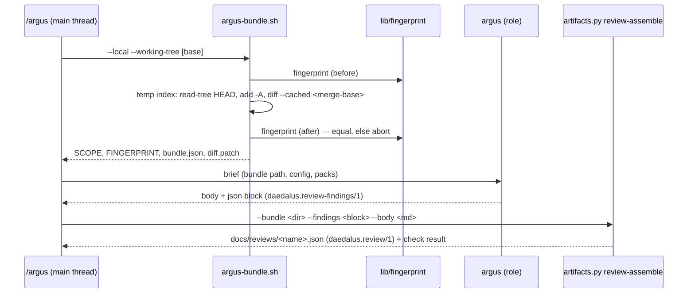

# Daedalus hardening P1b: canonical artifacts, evidence and migrations

- **Type:** Infrastructure (workflow hub): a strict schema validator, versioned artifact schemas, canonical JSON with rendered Markdown, plan contract fences, a source fingerprint, evidence records and a migration framework. Changes the shipped `.claude/` tree
- **Complexity:** Large. Four library modules, one entry point, ~20 schemas, a bundle mode for Argus, and output changes in four commands and four roles
- **Estimated effort:** 4–7 engineering days (P1 total 12–20, roadmap §14; P1a 3–5, P1c 5–8)
- **Ticket:** none
- **Program plan:** [daedalus-hardening-roadmap.md](daedalus-hardening-roadmap.md) rev 2.1: §5.4, §5.17, §6.10, §6.18, §6.22, §9 P1, D10, D11, D12. Roadmap ACs are written **R-AC-n**; this plan's are **AC-n**
- **Sibling plans:** [P1a trust and config](daedalus-hardening-p1a.md) runs **first**: this plan edits eight of the same files and extends P1a's QA-plugin script copy (§12). [P1c runtime](daedalus-hardening-p1c.md) consumes this plan's interfaces (§3.11). Order: P1a → P1b → P1c
- **Review:** revised after [the Argus review of the P1 plans](../reviews/tb-claude-custom-workflow-hardening-p0a-a663546-p1-plans.md); this plan carries the fixes for findings a663546-3, -4 and -5; [the second review](../reviews/tb-claude-custom-workflow-hardening-p0a-a663546-p1-plans-r2.md) kept -4 open (the schemas were missing from the QA plugin), and §3.1 and AC-7 now close it; [the third review](../reviews/tb-claude-custom-workflow-hardening-p0a-a663546-p1-plans-r3.md)'s -18 (verdict ranking) is fixed in §3.5, and the fourth review's -20 (command cross-check) too, limited to check commands after the sixth review's -21, with `build`'s rule fixed after the seventh's -22
- **Findings used:** [daedalus-hardening-phase0.md](daedalus-hardening-phase0.md) (C-5, C-8, C-13; probe C3's resume observation); [threat model](daedalus-hardening-threat-model.md) T14, T15
- **Metadata:** `Security: critical`. Evidence records and digests are what P1c's completion gate and P5's CI gate trust
- **Base:** `main` with P1a merged (iamjcabalejo/daedalus#2, which also renames the Argus rubric skill to `skills/argus-rubric/` and `trace-flow` to `flow-tracing`), plugin `0.4.0`. No version bump here; P1c bumps to `0.5.0`
- **Updated 2026-11-28, after P1a landed:** the base above; the renamed skill paths (T14, §6); PF-8 and AC-16 from P1a QA run 2, deviation 1
- **Graph gate:** skipped (no graph)
- **Profile:** root `.` · layer `lib` · packs `ci-cd`, `go`, `iac`, `python`; only `python` and `ci-cd` apply to the files touched (`go` and `iac` come from benchmark fixtures). Shell scripts follow the repo's conventions

---

## 1. Feature overview

**Problem.**
- **F4:** the validator silently ignores keywords it doesn't support (`.claude/scripts/validate-profile.py:4–5`, `:46–65`), so a schema using `pattern` or `minimum` looks validated but isn't.
- Plans, handoffs, test reports and QA reports have no schema (roadmap §2.1 row 8). Argus embeds `findings.json` in a `<details>` block (`.claude/commands/argus.md:93`), and nothing checks that the Markdown and the JSON agree.
- Reports are claims with nothing binding them to the tree they describe. The review gate takes the test-runner's word (`.claude/commands/project-manager.md:53`), and the QA check only confirms screenshot files exist (`.claude/commands/manual-test.md:56`) (T15).
- **C-5:** `/project-manager` runs `/argus --local` "against the working tree" (`project-manager.md:49`), but the bundle diffs only `merge-base..HEAD` and warns on a dirty tree (`.claude/scripts/argus-bundle.sh:71–72`, `:78`). The workflow never commits unless asked, so 0.4.0's local review can cover an empty diff.
- Nothing carries a format version, so an upgrade can't tell an old file from a new one (R-AC-57).

**Audience.** P1c (the runtime validates role outputs, binds evidence, checks plan divergence and freshness), P2 (`exec.py` writes evidence), P5 (`gate.py` recomputes digests), and plan authors.

**Key functionality.**
1. A **documented JSON Schema subset** that rejects any other keyword when a schema loads, with conformance tests.
2. **Versioned schemas** (`daedalus.<kind>/<major>`) and a registry; readers accept N and N-1.
3. **Canonical JSON** and digests; reports rendered from JSON with a digest marker; roles return fenced JSON that the parent validates.
4. **Plan contract fences** with `artifacts.py check` and `sync`, and an adopter for 0.4.0 plans.
5. A reproducible **source fingerprint** (§6.10), **evidence records** with classes and digests, and a freshness check.
6. A **working-tree mode** for the Argus bundle; review records carry the scope and fingerprint of the tree actually diffed (C-5).
7. A **migration framework** (`lib/migrate.py`): N-1 → N with backups, explicit refusals otherwise.

**Out of scope:** writing evidence for test runs (that's `exec.py`, P2 R-AC-62; in P1 the test report stays a claim), the CI gate (P5), finding fingerprints for convergence (P2 R-AC-6; the review schema reserves an optional field), run-store formats (P1c writes the manifest, state, event and usage schemas under this plan's registry and validator).

### 1.1 Findings made while planning

| # | Finding | Evidence | Resolution in this plan |
|---|---|---|---|
| PF-1 | **Tombstones make the §6.10 fingerprint depend on the index.** An unstaged deletion keeps the index entry (tombstone), while a staged deletion (`git rm`) removes it, so one working tree yields two fingerprints. That breaks §6.10's "staged and unstaged count the same" | Roadmap §6.10 steps 1–2 | §3.8: the fingerprint is a function of the files present in the working tree; a deleted file contributes nothing, whatever the index says. The mode comes from `lstat`, not the index |
| PF-2 | **Existing schemas use annotation keywords outside R-AC-25's list** (`$schema`, `$id`, `title`, `description`, `definitions`). Rejecting them would break the profile and benchmark schemas | Keyword scan of `.claude/skills/project-profile/profile.schema.json` and `bench/schema/*.json` (all seven use only `type`, `enum`, `required`, `properties`, `additionalProperties`, `items`, `$ref` plus those annotations) | §3.2: a fixed annotation allowlist that validates nothing; every other keyword outside the subset is still rejected |
| PF-3 | **R-AC-25 lists `bench`,** but the benchmark's schemas live in `bench/schema/`, which is never shipped | `bench/schema/result.schema.json` (`daedalus.bench/1`) | Bench schemas stay where they are and load through the shared validator (a conformance test proves it); the shipped skill doesn't copy them |
| PF-4 | **A digest needs a canonical form, and RFC 8785 needs ECMAScript number formatting,** which the standard library lacks | — | §3.4: Python's sorted-key, compact, UTF-8 serialization with `allow_nan=False`; integers preferred in digested kinds. Only Python produces and verifies these digests, locally and in CI |
| PF-5 | **The model would transcribe digests** if `/argus` assembled the review JSON by hand from bundle output | `.claude/commands/argus.md:93` (the parent writes the file) | §3.7: `artifacts.py review-assemble` merges the bundle's machine-written facts with the reviewer's claim; the model never copies a digest. The same applies to QA (`qa-assemble`) |
| PF-6 | **`/manual-test` lives in the `daedalus-qa` plugin, which has no path to `artifacts.py`.** The build rewrites a cross-plugin script reference into prose ("the daedalus plugin's scripts/…"), not a path, and the QA plugin ships no `scripts/`, so `qa-assemble` couldn't run there, and the model would hand-write the QA JSON (which PF-5 forbids) | `scripts/build-plugin.sh:60–69`; `plugins/daedalus-qa/` (review finding a663546-4) | P1a's build copies `workflow.py`, `detect-stack.py` and `scripts/lib/` into the QA plugin (P1a PF-9). This plan adds `artifacts.py` to that list **and copies the schema files** (`skills/workflow-artifacts/schemas/*.schema.json`) to `plugins/daedalus-qa/scripts/schemas/`, because `qa-assemble` validates `qa-cases` and `qa` against them; `artifacts.schema_dir()` finds either location (§3.1). `/manual-test` calls `${CLAUDE_PLUGIN_ROOT}/scripts/artifacts.py` on plugin installs. `build-plugin.sh --check` keeps the copies identical, and a test runs `qa-assemble` from the built QA plugin |
| PF-7 | **AC ids collide across plans.** A rework plan numbers its AC from AC-1 again, so bare ids in a test report can't say which plan's AC-1 a test covers | §3.6 grammar; P1c G5 (review finding a663546-5) | Every role output and test report uses **qualified ids** `<plan-slug>:AC-n` (§3.5); `test-report/1` fixes the fields P1c's gates read |
| PF-8 | **A refused `DAEDALUS_HOME` lets trust-store writes reach the real home folder.** When the variable is set but refused (for example a relative path), `wfconfig.user_folder` falls back to the home folder and reports it only as a warning. In P1a's QA, `workflow.py trust record` therefore wrote the OQ-7 entries to the maintainer's real `~/.workflow/trust.json`, although the variable exists to keep runs away from it | [P1a QA run 2](../qa/daedalus-hardening-p1a-qa-2.md), deviation 1; `.claude/scripts/lib/wfconfig.py:741–749`; `TrustStore.record` and `_write` in `.claude/scripts/lib/trust.py` | AC-16: writes under the user folder fail closed when `DAEDALUS_HOME` is set but refused; reads keep today's fallback and warning |

---

## 2. Acceptance criteria

| AC | Criterion | Roadmap | Verification |
|---|---|---|---|
| **AC-1** | **Schema subset validator** (`lib/schema.py`).<br>• Validating keywords: `type` (a name or a list; `integer` accepts a float with no fractional part and never a boolean), `enum`, `const`, `required`, `properties`, `additionalProperties` (boolean or schema), `items` (one schema; the tuple form is rejected), `minItems`, `maxItems`, `minLength` (code points), `pattern` (Python `re.search`, unanchored), `minimum`, `maximum`, and local `$ref` (`#`, `#/definitions/…`, `#/$defs/…`).<br>• Annotations that validate nothing: `$schema`, `$id`, `$comment`, `title`, `description`, `definitions`, `$defs` (PF-2).<br>• Any other keyword, a remote `$ref` or an invalid `pattern` is rejected **when the schema loads**, with `E_SCHEMA_KEYWORD` naming the JSON pointer (fixes F4).<br>• Equality for `enum` and `const` follows JSON (`false` ≠ `0`, `1` = `1.0`). | R-AC-25 | S, U (`S-schema-subset-01`…`-12`) |
| **AC-2** | **Conformance.**<br>• The draft-07 files of JSON-Schema-Test-Suite, pinned to one commit and vendored with its license, run for every supported keyword; a selector keeps only test groups whose schemas use the subset, and the selected and skipped counts are printed.<br>• Every selected case passes.<br>• `profile.schema.json` and the seven `bench/schema/*.schema.json` files load and validate their existing fixtures unchanged.<br>• `validate-profile.py` becomes a thin wrapper over `lib/schema.py` with the same arguments, output and exit codes, so `bench/run.py` and `/setup` keep working | R-AC-25 | S (`S-schema-suite-01`), U |
| **AC-3** | **Versioned schemas and registry.**<br>• Each kind in §3.3 has `.claude/skills/workflow-artifacts/schemas/<kind>.schema.json` whose `schema` property is the const `daedalus.<kind>/1`.<br>• `lib/artifacts.py` holds the registry (kind → current major, schema files, renderer, upgraders).<br>• `artifacts.load(path)` accepts majors N and N-1 (N-1 is validated against its own schema, then upgraded in memory) and refuses anything else with `E_SCHEMA_VERSION` plus a fix.<br>• **Freeze rule:** a kind's major is frozen once a shipped release writes it; before that, its `/1` draft may change (gate, waiver, escalation, capability and context are drafts until their phases) | R-AC-25, R-AC-57 | S (`S-schema-registry-01`…`-04`) |
| **AC-4** | **Canonical JSON and rendered reports.**<br>• `canonical_bytes(obj)` and `digest(obj)` (`sha256:<hex>`) follow §3.4.<br>• `artifacts.py render <json>` writes Markdown for handoff, test report and QA, opening with `<!-- daedalus:json kind=<kind> sha256=<digest> -->` and closing with `<!-- daedalus:render sha256=<digest of the body> -->`.<br>• `artifacts.py check <md>` reports `E_REPORT_STALE` when the sibling JSON's digest no longer matches the marker, and `E_REPORT_EDITED` when the body differs from a fresh render (a hand-edited report is flagged) | R-AC-26, R-AC-49 | U (`U-artifacts-canonical-01`…`-06`, `U-artifacts-render-01`…`-05`) |
| **AC-5** | **Role JSON blocks.**<br>• `implementer` returns `daedalus.handoff/1`, `test-runner` returns `daedalus.test-report/1`, `argus` returns `daedalus.review-findings/1`, and `qa-tester` returns `daedalus.qa-cases/1`, each as the last fenced `json` block of its reply, with the `schema` field set.<br>• `artifacts.py extract --kind <kind>` reads a reply on stdin and prints the validated JSON, or exits 3 with the errors.<br>• The commands that receive these replies (`/project-manager` in P1c, `/argus`, `/manual-test`) send the role **one** follow-up naming the errors (a `SendMessage` resume of the same agent; [V] C3 streams: a resume keeps the `agent_id`) and accept the second answer, failing with `E_ROLE_OUTPUT_INVALID` if it's still invalid.<br>• `tech-stack-researcher` and `technical-writer` keep prose returns: their output isn't a runtime artifact.<br>• Every AC reference in a handoff or test report is a qualified id `<plan-slug>:AC-n` (PF-7), and `daedalus.test-report/1` has the fixed fields in §3.5 (`verdict`, `failures[]` with `pre_existing`, `ac_coverage[]`) | R-AC-26 | U (`U-artifacts-extract-01`…`-17`), OQ |
| **AC-6** | **Review record and working-tree bundle (C-5).**<br>• `argus-bundle.sh --local --working-tree [base]` diffs the merge base against the working tree, untracked non-ignored files included, through a temporary index (`GIT_INDEX_FILE`), never touching the developer's index.<br>• Every bundle prints `SCOPE=head\|working-tree` and `FINGERPRINT=sha256:…` and writes `bundle.json` (repository, branch, head SHA, base ref, base SHA, merge base, scope, fingerprint). The fingerprint is computed before and after the diff, and a difference aborts with "tree changed while bundling".<br>• `artifacts.py review-assemble --bundle <dir> --findings <json> --body <md>` writes `docs/reviews/<name>.json` (`daedalus.review/1`) next to the Markdown; the model never copies a digest (PF-5).<br>• `check` on a review verifies that every finding id and severity in the JSON appears in the body's finding lines and markers, and the reverse, and that `body_sha256` matches.<br>• `/argus --local --working-tree` passes the flag through; the `head` mode keeps 0.4.0's behavior, its dirty-tree warning, and records `scope: head` | R-AC-26, R-AC-48 | U (`U-bundle-worktree-01`…`-06` in temporary repositories), OQ |
| **AC-7** | **QA record.** `artifacts.py qa-assemble` builds `docs/qa/<slug>-qa-N.json` (`daedalus.qa/1`) from the tester's `qa-cases` block plus facts the command collects (commit, dirty flag, fingerprint, UTC time, base-URL kind, auth mode, design reference). The verdict is computed, not copied: FAIL if any case fails, else BLOCKED if any is blocked, else PASS. The Markdown report is rendered from it (AC-4) and keeps the current template's layout (`.claude/skills/manual-qa/report-template.md`). On plugin installs, `/daedalus-qa:manual-test` runs `qa-assemble` from its own plugin's copy of `artifacts.py`, `scripts/lib/` and the schemas (PF-6) | R-AC-26 | U (`U-artifacts-qa-01`…`-04`, `U-build-qa-scripts-02`), OQ |
| **AC-8** | **Plan contract fences.**<br>• Plans written by `/feature-plan` and `/apply-ticket` carry the fenced sections in §3.6 (`workflow`, `ac`, `tasks` per layer, `files`, `manual_qa`, optional `tdd_waivers`) and a sibling `docs/plans/<slug>.json` (`daedalus.plan/1`, with `daedalus.task/1` items).<br>• Prose outside the fences is free and isn't part of the JSON, so prose edits don't change `plan_digest`.<br>• The `feature-planning` skill documents the grammar, the schemas and an example | R-AC-49, R-AC-26 | U (`U-plan-parse-01`…`-14`) |
| **AC-9** | **Check and sync.**<br>• `artifacts.py check <plan.md>` exits 0 when the fences and the JSON agree, 3 with `E_ARTIFACT_DIVERGED` and the differing sections, 4 when either side is invalid, and 5 with `E_PLAN_LEGACY` when the plan has no fences.<br>• `artifacts.py sync <plan.md> --from md\|json` resolves a divergence: from Markdown it rewrites the JSON; from JSON it rewrites only the fenced sections; then it revalidates and prints `{old_plan_digest, new_plan_digest}`. P1c's drift check invalidates evidence bound to the old digest (R-AC-49's invalidation clause is met through P1c AC-7) | R-AC-49 | U (`U-plan-check-01`…`-08`) |
| **AC-10** | **Adopting 0.4.0 plans.** `artifacts.py adopt <plan.md>` (dry run by default; `--write` applies) recognizes the 0.4.0 shapes: AC tables (`\| **AC-n** \| … \|`) and AC bullets (`- **AC-n…**`), `### Layer:` blocks with checkbox tasks, `## File changes` with **Create**/**Modify**/**Delete** labels and backticked paths (brace lists expanded), a Manual QA table or "N/A". It inserts fences, assigns stable task ids, writes the JSON, and backs the original up under `.workflow/backups/<UTC ts>/`. Anything it can't map is listed as `E_ADOPT_AMBIGUOUS` with the line, and nothing is written. Every plan under this repository's `docs/plans/` either adopts cleanly or fails with a list, never a crash | R-AC-57 | U (`U-plan-adopt-01`…`-08`) |
| **AC-11** | **Source fingerprint** (`lib/fingerprint.py`, §3.8).<br>• Working-tree mode and `--rev <rev>` mode; per-root and overall digests; the §6.10 exclusions only (`docs/reviews/**`, `docs/qa/**`, `docs/traces/**`, `docs/scans/**`, `.workflow/runs/**`); symlinks hashed as link text, never followed; independent of the index (PF-1).<br>• For a clean checkout, working-tree mode equals `--rev HEAD`.<br>• **Reproducible:** a fixture tree's digest is committed, computed on the maintainer's macOS machine, and CI on Linux recomputes it (`G-fingerprint-repro-01`).<br>• Git runs with `GIT_OPTIONAL_LOCKS=0` and never writes the index or refs. Unmerged entries are `E_FP_UNMERGED` | R-AC-48 | U, G (`U-fp-01`…`-14`, `G-fingerprint-repro-01`) |
| **AC-12** | **Evidence records** (`lib/evidence.py`, `daedalus.evidence/1`, §3.9).<br>• Each record carries run, step and attempt; base revision and head SHA; the source fingerprint (overall and per root); the plan, policy, commands, input and test-definition digests where they apply; the Daedalus version; declared toolchain versions; exit status and a structured result; UTC time; a class (`claim`, `local`, `ci`, `human`); and `enforcement` (`absent` in P1, because the guard arrives in P2).<br>• A review record also carries its scope and the fingerprint of the tree its bundle diffed (C-5).<br>• `evidence.write()` creates `evidence/<id>.json` once (`O_EXCL`); the class is set by the writer API, never read from input or configuration.<br>• `evidence.freshness(record, current)` lists every digest that differs; legacy and `scope: head` records over a dirty tree are stale | R-AC-48 | U (`U-evidence-digest-01`…`-08`) |
| **AC-13** | **Migration framework** (`lib/migrate.py`).<br>• Every persisted format carries a version (§3.10).<br>• `artifacts.py migrate <path> [--dry-run]` moves N-1 to N with a backup; anything newer than N, or older than N-1, is refused with recovery steps (finish on the version that wrote it, or restart).<br>• Upgraders are registered per kind and major; P1a's and P1c's formats register in the same table.<br>• Each migration has a test, including the 0.4.0 plan adopter (AC-10) and a synthetic `/1 → /2` kind that exercises the N-1 reader | R-AC-57 | U (`U-migrate-01`…`-08`) |
| **AC-14** | **Hub hygiene.**<br>• `scripts/test-artifacts.sh`, `scripts/test-fingerprint.sh` and `scripts/test-migrate.sh` are added to `scripts/test-all.sh` (after P1a's checks).<br>• `lib/version.py` holds `DAEDALUS_VERSION`; `build-plugin.sh --check` fails when it differs from the build's `VERSION`.<br>• `build-plugin.sh` adds `artifacts.py` to P1a's list of scripts copied into `daedalus-qa`, and copies `skills/workflow-artifacts/schemas/*.schema.json` to `plugins/daedalus-qa/scripts/schemas/` (PF-6).<br>• `build-plugin.sh --check`, `check-generic.sh` and `lint-packs.sh` pass; `plugins/**` is regenerated and carries the `workflow-artifacts` skill in the `daedalus` plugin.<br>• Docs: ARCHITECTURE §2.4 (scripts), §6.2 (review checkpoints: scope and fingerprint), §13 (D10–D12); the new `workflow-artifacts` skill; the `feature-planning` skill. No version bump | R-AC-42 | CI, D |
| **AC-15** | **Operational QA** (§9) on the script and plugin installs, reported in `docs/qa/daedalus-hardening-p1b-qa-N.md`. FAIL → `docs/plans/daedalus-hardening-p1b-rework-N.md`; BLOCKED → the user | R-AC-66 | OQ |
| **AC-16** | **Refused `DAEDALUS_HOME` fails closed for writes** (PF-8).<br>• When `DAEDALUS_HOME` is set and `wfconfig` refuses it, `workflow.py trust record` and every other trust-store write exit non-zero with `E_TRUST_HOME_REFUSED`, name the variable and the reason, and write nothing: no `trust.json`, no `trust.lock`, no `.workflow/` folder, in either the refused path or the real home.<br>• Reads (`config resolve`, `explain`, `get`, `commands`, `trust list`, `trust pending`) keep today's behavior: the home-folder fallback plus the warning.<br>• Unset or accepted `DAEDALUS_HOME`: unchanged | R-AC-61 (P1a AC-2 and AC-8 follow-up) | `U-trust-home-01`…`-04` |

**Roadmap coverage.** R-AC-25 → AC-1, 2, 3. R-AC-26 → AC-4, 5, 6, 7, 8. R-AC-48 → AC-6, 11, 12. R-AC-49 → AC-4, 8, 9. R-AC-57 → AC-3, 10, 13 (P1a registers config and trust-store versions; P1c registers run formats and the compatibility check, P1c AC-8). R-AC-42 → AC-14. R-AC-66 → AC-15. R-AC-61 (P1a QA follow-up) → AC-16.

---

## 3. Technical design

### 3.1 Components

| Component | Path | Kind |
|---|---|---|
| Package marker | `.claude/scripts/lib/__init__.py` | Already created by P1a (exact content `"""Daedalus runtime library (stdlib only, Python 3.8+)."""`); not edited here |
| Schema subset validator | `.claude/scripts/lib/schema.py` | Library (split from `artifacts` so the validator wrapper and the benchmark import little) |
| Canonical JSON, registry, render, check, sync, adopt, assemble | `.claude/scripts/lib/artifacts.py` | Library |
| Plan Markdown parser and writer | `.claude/scripts/lib/planmd.py` | Library (fence grammar, §3.6) |
| Source fingerprint | `.claude/scripts/lib/fingerprint.py` | Library |
| Evidence records | `.claude/scripts/lib/evidence.py` | Library |
| Migration framework | `.claude/scripts/lib/migrate.py` | Library |
| Git helpers | `.claude/scripts/lib/gitutil.py` | Library: runs `git` with `GIT_OPTIONAL_LOCKS=0`, `-c core.quotepath=off`, `-z` parsing, timeouts; `ensure_ignored(repo, entries)` appends missing lines to `.workflow/.gitignore` idempotently |
| Version | `.claude/scripts/lib/version.py` | `DAEDALUS_VERSION = "0.4.0"` (P1c sets `0.5.0`) |
| CLI | `.claude/scripts/artifacts.py` | Entry point: `validate`, `render`, `check`, `sync`, `adopt`, `extract`, `review-assemble`, `qa-assemble`, `digest`, `fingerprint`, `migrate` |
| Schemas and skill | `.claude/skills/workflow-artifacts/SKILL.md`, `.claude/skills/workflow-artifacts/schemas/*.schema.json` | Shipped in the `daedalus` plugin. The `daedalus-qa` plugin gets a copy of the schema files only (no `SKILL.md`, so no second skill appears) at `scripts/schemas/` (PF-6) |
| Schema lookup | `artifacts.schema_dir()` | The first existing of `<scripts>/../skills/workflow-artifacts/schemas/` (script installs, the `daedalus` plugin) and `<scripts>/schemas/` (the QA plugin's copy); neither → `E_SCHEMA_DIR_MISSING` with a fix ("reinstall; the plugin build is incomplete"). `<scripts>` is the entry point's own real directory |
| Tests | `scripts/test-artifacts.sh`, `scripts/test-fingerprint.sh`, `scripts/test-migrate.sh`; `scripts/fixtures/artifacts/**`, `scripts/fixtures/fingerprint/**`, `scripts/fixtures/jsonschema-suite/<commit>/**` | Hub tests |

**Conventions:** as P1a §3.1 (Python 3.8+ stdlib, `from __future__ import annotations`, `argparse`, no bare `except`, Bash wrappers around `unittest`). Every entry point inserts only its own real directory into `sys.path` and is started with `python3 -I` (P1a PF-2). CLI exit codes: 0 ok, 2 usage, 3 rejected (validation or divergence), 4 invalid input, 5 legacy input; errors print `{code, message, fix}`.

### 3.2 Schema subset

- **Load step** (`schema.load(path)`): walk the schema; every key is either a validating keyword (AC-1), an annotation (PF-2), or a property name inside `properties`, `definitions` or `$defs`. Anything else raises `E_SCHEMA_KEYWORD` with the JSON pointer (for example `/properties/name/format`). `pattern` is compiled at load time; a compile error is `E_SCHEMA_PATTERN`. A `$ref` that isn't local or doesn't resolve is `E_SCHEMA_REF`.
- **Validate step** returns every error (pointer and message), not just the first.
- **Dialect note** (in the skill): `pattern` uses Python's `re`; schema authors stay within the ECMA-262/Python common subset (no lookbehind, no named groups).
- **Conformance selector:** a test group runs only if every keyword in its schema is in the subset or the annotation list; remote-ref groups are skipped. The suite is vendored at one pinned commit with its license file (MIT [D]: the maintainer confirms the license file at vendoring time). Fetching it needs network once; if none is available, the task is BLOCKED (env) and the maintainer vendors it.

### 3.3 Kinds and owners

| Kind | Writer | Status |
|---|---|---|
| `plan`, `task` | `/feature-plan`, `/apply-ticket`, `artifacts.py sync\|adopt` | This plan |
| `handoff` | `implementer` (claim) | This plan |
| `test-report` | `test-runner` (claim in P1; backed by `exec.py` evidence from P2) | This plan |
| `review-findings` | `argus` (claim: the current `findings.json` fields, `.claude/agents/argus.md:73–77`, plus `schema`) | This plan |
| `review` | `artifacts.py review-assemble` (bundle facts + the claim + body digest) | This plan |
| `qa-cases`, `qa` | `qa-tester` (cases, claim); `artifacts.py qa-assemble` (record) | This plan |
| `evidence` | `lib/evidence.py` (P1c, then P2's `exec.py`) | This plan |
| `policy`, `trust` | P1a (`daedalus.policy/1` and `daedalus.trust/1`, shapes in P1a §3.6 and §3.7) | Schema files written here from P1a's contract |
| `run-manifest`, `run-state`, `event`, `usage` | P1c | Schema files written by P1c, in this folder and registry |
| `gate`, `waiver` (P5), `escalation` (P2), `capability` (P2), `context` (P2) | Later phases | `/1` drafts from roadmap R-AC-29, R-AC-54, §6.9, §6.6 and R-AC-64; frozen at first writer (AC-3) |
| `bench` | `bench/run.py` | Stays in `bench/schema/` (PF-3) |

### 3.4 Canonical JSON and digests

- `canonical_bytes(obj) = json.dumps(obj, sort_keys=True, separators=(",", ":"), ensure_ascii=False, allow_nan=False).encode("utf-8")`.
- Numbers: integers as is; floats via Python's shortest round-trip form (deterministic for IEEE-754 doubles). Digested kinds use integers (tokens, milliseconds, micro-dollars); floats appear only in `bench` and `usage`.
- Strings: no Unicode normalization. Keys sort by code point (they're ASCII in every Daedalus kind, so this matches RFC 8785's order).
- `digest(obj) = "sha256:" + sha256(canonical_bytes(obj)).hexdigest()`.
- `plan_digest` = digest of the plan JSON (contract only).

### 3.5 Rendered reports and role blocks

- **Rendered kinds:** `handoff` (to `handoffs/<step>.md` in the run, P1c), `test-report` (same), `qa` (`docs/qa/<slug>-qa-N.md`). Renderers are Python functions in `lib/artifacts.py` (no template engine). Markers: first line `<!-- daedalus:json kind=<kind> sha256=<digest> -->`, last line `<!-- daedalus:render sha256=<digest of the lines between> -->`.
- **Review:** the body stays model-written. The review JSON records `body_sha256`; `check` enforces id and severity agreement with the finding lines `**<n>. [<severity> · <category>] …**` and markers `<!-- argus-finding:<id> -->` (the shapes `.claude/commands/argus.md` Phase C already requires). The `<details>findings.json` block in the Markdown is replaced by a link line to the sibling JSON.
- **Role blocks:** the parent takes the **last** fenced block whose info string starts with `json` and whose object has a `schema` field equal to the expected kind and a supported major. A missing block, invalid JSON or a schema error is reported back once (AC-5).
- **Qualified AC ids (PF-7):** `<plan-slug>:AC-<n>`, where `<plan-slug>` is the plan file's stem (`user-profile`, `user-profile-rework-1`). Schema pattern: `^[a-z0-9][a-z0-9.-]*:AC-[0-9]+$`. Plan JSON keeps the bare id in `ac.items[].id` and gains `slug`; `artifacts.qualify_ac(slug, id)` builds the qualified form, and every brief, handoff (`ac_done`, `ac_deferred`) and test report uses it.
- **`daedalus.test-report/1`** (the fields P1c's gates G4, G5 and G7 read):

  ```json
  {"schema": "daedalus.test-report/1",
   "verdict": "pass|fail|blocked",
   "roots": [{"path": ".", "commands": [{"name": "test", "status": "pass|fail|blocked|skipped", "exit": 0, "summary": "…"}]}],
   "failures": [{"id": "<test id or command name>", "command": "test", "pre_existing": false, "evidence": "<how pre-existence was shown, or null>"}],
   "ac_coverage": [{"ac": "user-profile:AC-1", "tests": ["tests/test_profile.py::test_returns_409"], "status": "covered|uncovered|deferred"}],
   "tests_written": ["tests/test_profile.py"]}
  ```

  The verdict follows the order **fail > blocked > pass**, the same rule `qa-assemble` computes for QA: `fail` whenever any `failures[]` entry has `pre_existing: false`; otherwise `blocked` when any command is `blocked`; otherwise `pass`. A report whose `verdict` disagrees (for example `blocked` with a new failure, review finding a663546-18) is rejected. The check also cross-checks commands against failures (review finding a663546-20): a command with status `fail` must have a `failures[]` entry naming it (`command`); every command named in `context["runnable"]` or `context["untrusted"]` must appear in `commands[]` (a missing one is rejected); a command in `context["untrusted"]` (untrusted or `unsafe`, so never in a brief) must be reported `blocked`; and `skipped` is accepted only for a command in neither list (a runnable command that didn't run must be `blocked` too). `artifacts.extract(text, kind, context=None)` takes those two lists of `<root>:<name>` keys; P1c passes them from `admit test`, which has both from P1a's `effective_commands`. Keys carry the root, so a name runnable in one root doesn't count for another. **Both lists hold only the check commands the test step owns** (review finding a663546-21): the constant `artifacts.TEST_CHECK_COMMANDS = ("test", "lint", "typecheck")`, plus `build` when it is trusted and not `unsafe` (review finding a663546-22). The rule needs no input from the brief, which is written after `admit test` stores the lists: a trusted, safe `build` is always runnable and must be run (or reported `fail`/`blocked`), while an untrusted or `unsafe` `build` (`UNSAFE_RE` matches names like `release` or `prod`) stays outside the check and can never block the run. Every other profile command (`install`, `dev`, `format`, …; `detect-stack.py:452` lists the names) is outside the check: the report may mark it `skipped` or leave it out, and it never affects the verdict. So an `unsafe` `install` or a long-running `dev` server can't stall a run. The schema can't express that, so `artifacts.validate_obj` adds this one semantic check for the kind. `ac_coverage` lists every qualified AC the brief named.

### 3.6 Plan contract fences

Fences are HTML comments: `<!-- daedalus:contract:<section>[ key=value …] -->` … `<!-- /daedalus:contract:<section> -->`. Attribute values have no spaces; lists are comma-separated. Inside a fence, only the grammar below is allowed; prose goes outside.

| Section | Count | Grammar inside the fence | JSON |
|---|---|---|---|
| `workflow` | 1 | `- **Type:** feature` · `- **Tier:** auto\|trivial\|standard\|full\|critical` · `- **Security:** critical\|none` · `- **Performance:** critical\|none` | `workflow{type, tier, security, performance}` |
| `ac` | 1 | Either bullets `- **AC-<n>.** <text>` (continuation lines indented two spaces) or a table whose first column is `**AC-<n>**` and second column the criterion (`<br>` ↔ newline; extra columns kept by name) | `ac{format, columns?, items[{id, text, extra?}]}` |
| `tasks` | one per layer: attributes `layer=`, `roots=`, `packs=` | Task lines `- [ ] **<id>** <title>` (or `[x]`), each optionally followed by indented `- files: \`p\`, \`p\``, `- ac: AC-1, AC-2`, `- depends_on: <id>`, `- writes: \`glob\`` | `layers[{layer, roots, packs, tasks[task/1]}]` |
| `files` | 1 | `**Create**`, `**Modify**`, `**Delete**` labels, each followed by `- \`<repo-relative path or glob>\`[ — note]`; no brace lists | `files{create[], modify[], delete[]}` with `{path, note?}` |
| `manual_qa` | 1 | `- **Applicable:** yes\|no — <reason>`, optional `- **Base URL:** …`, then a table `\| AC \| Route \| Steps \| Expected \| Mockup state \|` | `manual_qa{applicable, reason?, base_url?, cases[]}` |
| `tdd_waivers` | 0–1 | `- AC-<n>: <reason>` | `tdd_waivers[{ac, reason}]` (read by P3) |

`daedalus.task/1`: `{id, layer, title, done, files[], ac[], depends_on?[], writes?[]}`. Task ids are unique across a plan; a task's `ac[]` holds bare ids of its own plan. `depends_on` and `writes` are optional now so P4 (R-AC-16) can use them without a major bump. Rework plans (`docs/plans/<feature>-rework-N.md`) use the same grammar; outside the plan, their AC are always referred to by qualified id (`<feature>-rework-1:AC-2`, §3.5).

`Tier: trivial` is valid grammar, but the P1 runtime refuses it until P3's classifier exists (P1c §3.5); the `feature-planning` skill says so.

### 3.7 Review and QA assembly



`daedalus.review/1`: `{schema, review_id, repo, branch, head_sha, base_ref, base_sha, merge_base, scope, source_fingerprint{overall, roots}, plan_ref?{path, plan_digest}, claim{<review-findings fields>}, body_path, body_sha256, legacy?}`. Each finding may carry an optional `fp` (P2's convergence fingerprint, roadmap §6.9).

The temporary index lives in the bundle's temporary folder. `git add -A` against it writes loose blob objects into the repository's object store (unreachable, removed by normal `git gc`); it doesn't touch the developer's index, refs or working tree. That's recorded in the bundle's header comment.

### 3.8 Source fingerprint

**Working-tree mode** (`fingerprint.source(repo, roots=None)`):
1. Candidates = `git ls-files -z --cached` ∪ `git ls-files -z --others --exclude-standard`.
2. Drop the exclusions (§6.10 list). Drop candidates that don't exist in the working tree (PF-1: no tombstones).
3. Mode from `lstat`: symlink → `120000`, executable → `100755`, regular → `100644`; a gitlink in the index → `160000` with the index's commit (a dirty submodule isn't captured; documented).
4. Blob: for an unchanged tracked file, the index blob (`git ls-files -s -z`); "unchanged" = not listed by `git diff-files --name-only -z` (a stat-dirty false positive is simply hashed). For everything else, `git hash-object --stdin-paths` (applies the repository's clean filters, as `git add` would). For a symlink, the blob of its link text, computed in Python.
5. Sort by path bytes; `overall = sha256` over `mode\0blob\0path\n`; each root's digest uses the same steps restricted to paths under that root.

**Rev mode** (`--rev <rev>`): entries from `git ls-tree -r -z <rev>`, then steps 2, 5. For a clean checkout, both modes agree (`U-fp-clean-equal-01`).

**Not excluded:** `docs/plans/**` (also bound through `plan_digest`), `.workflow/config.yml` (`policy_digest`), `.workflow/profile.json` (`commands_digest`). Paths are repo-relative, so canonical payload paths (C-13 [V]) don't enter the digest; the repository root itself is resolved with `realpath`.

**Helpers:** `entries(repo)` (the sorted list), `diff_entries(a, b) -> {added, modified, deleted}` (P1c's changed-path detection), `paths_digest(repo, paths)` (test-definition digest, P3).

**Performance:** reported by `test-fingerprint.sh` on the hub tree and a synthetic 5,000-file repository; target ≤ 1 s warm for 20,000 tracked files (not a CI gate).

### 3.9 Evidence

`daedalus.evidence/1`:

```json
{"schema": "daedalus.evidence/1", "evidence_id": "ev-20261201T100000Z-1a2b3c4d",
 "class": "claim", "kind": "review", "run_id": "…", "step_id": "review", "attempt": 1,
 "base_revision": "<sha>", "head_sha": "<sha>", "scope": "working-tree",
 "source_fingerprint": {"overall": "sha256:…", "roots": {".": "sha256:…"}},
 "digests": {"plan": "sha256:…", "policy": "sha256:…", "commands": "sha256:…", "input": null, "test_def": null},
 "daedalus_version": "0.5.0", "toolchain": {}, "enforcement": "absent",
 "result": {"status": "pass|fail|blocked|n/a", "exit": null, "summary": {}},
 "artifact": {"path": "docs/reviews/<name>.json", "sha256": "sha256:…"},
 "ts": "2026-12-01T10:00:00Z", "legacy": false}
```

- **Classes:** `claim` (a role's JSON), `local` (the executor, P2), `ci` (the gate's checks job, P5), `human` (a recorded decision; advisory in CI).
- **Writer:** `evidence.write(run_dir, **fields)` sets `evidence_id`, `ts`, `daedalus_version` and the class from the function used (`write_claim`, `write_human`; `write_local` is added by P2); callers can't pass a class. Files are created with `O_EXCL` and `fsync`. The writer doesn't take the run lock; P1c appends the journal event that references the record under its lock.
- **Freshness:** `evidence.freshness(record, current) -> {fresh, stale_fields[]}`, where `current` holds the overall and per-root fingerprints, the plan, policy and commands digests, and the head SHA. Fresh means every digest the record carries equals the current one (per-root when the record names roots). `legacy: true` is never fresh.
- **No content:** records hold digests, ids, statuses and counts; never source text, prompts, command text or ticket text (R-AC-28 privacy, applied early).

### 3.10 Versions and migration

| Format | Version field | Current | Owner |
|---|---|---|---|
| Profile | `schema: 1` (integer) | 1 | Detector; migrates by regeneration (`SCHEMA_VERSION`, `rules_digest`) |
| Config (YAML) | `version: 1` (optional; missing = 1) | 1 | P1a |
| Trust store | `schema: "daedalus.trust/1"` | 1 | P1a |
| Artifacts (§3.3) | `schema: "daedalus.<kind>/<major>"` | 1 | This plan |
| 0.4.0 plan Markdown | none ("plan/0") | → `plan/1` by `adopt` | This plan |
| Run manifest, state, events, usage | `schema` per file and per event | 1 | P1c |
| Capability contracts, policy | `schema` | 1 | P2, P1a |

- **Backups:** repository files go to `<repo>/.workflow/backups/<UTC ts>/<repo-relative path>` (`gitutil.ensure_ignored(repo, ["backups/"])` keeps them out of commits); user files go to `<user>/.workflow/backups/<UTC ts>/`.
- **Refusal messages** name the version found, the supported range and the fix ("written by a newer Daedalus (`/2`); upgrade Daedalus, or finish this run on that version" / "older than N-1; migrate with Daedalus <version>, or restart").
- `migrate.register(kind, from_major, fn)`; `migrate.compat(kind, major) -> "ok" | "migrate" | "refuse"`; `migrate.migrate_file(path, dry_run=False) -> report`.

### 3.11 Interfaces this plan exports (consumed by P1c, P2, P5)

| Interface | Signature or form | Consumer |
|---|---|---|
| Validator | `schema.load(path) -> Schema`; `schema.validate(instance, schema) -> list[Error]` | `validate-profile.py`, `bench/run.py`, P1c (run formats) |
| Registry and load | `artifacts.load(path, kind=None) -> dict` (N or upgraded N-1); `artifacts.validate_obj(obj, kind)`; `artifacts.register_kind(kind, major, schema_path, renderer=None)`; `artifacts.schema_dir()` (§3.1) | P1c registers `run-manifest`, `run-state`, `event`, `usage` (their files land in the same folder, so the QA-plugin copy carries them too) |
| Canonical form | `artifacts.canonical_bytes(obj) -> bytes`; `artifacts.digest(obj) -> str` | P1c journal digests, P1a test cross-check |
| Role output | `artifacts.extract(text, kind, context=None) -> dict` (`context["runnable"]` and `context["untrusted"]` for test reports) (raises `RoleOutputError` with the error list) | P1c `finish` |
| AC ids and test report | `artifacts.qualify_ac(slug, ac_id) -> str`; `daedalus.test-report/1` fields `verdict`, `failures[].pre_existing`, `ac_coverage[{ac, tests, status}]` (§3.5) | P1c `admit test` (qualified AC list), G4, G5, G7 |
| Plan contract | `artifacts.load_plan(md_path) -> (plan_json, plan_digest)`; `artifacts.check_plan(md_path) -> CheckResult{status: ok\|diverged\|invalid\|legacy, sections[]}`; error code `E_ARTIFACT_DIVERGED` | P1c `init`, `admit`, drift check |
| Reports | `artifacts.render(obj) -> str`; `artifacts.write_report(obj, json_path, md_path)` (atomic, both files) | P1c handoffs and test reports |
| Fingerprint | `fingerprint.source(repo, roots=None, rev=None, extra_exclusions=()) -> Fingerprint{overall, roots, entries}` (`extra_exclusions` are globs added to the §6.10 list for that call only; evidence always uses the default list); `fingerprint.diff_entries(a, b)`; `fingerprint.paths_digest(repo, paths)` | P1c attempts, drift, reconciliation (P1c passes `docs/plans/**` and `.workflow/profile.json` for its drift check); P5 gate |
| Evidence | `evidence.write_claim(run_dir, **f)`, `evidence.write_human(run_dir, **f)`, `evidence.freshness(record, current)`, `evidence.load_all(run_dir)` | P1c gates; P2 adds `write_local` |
| Migration | `migrate.register`, `migrate.compat`, `migrate.migrate_file` | P1c compatibility check, P1a registrations |
| Git and paths | `gitutil.run(repo, *args)`, `gitutil.toplevel(path)`, `gitutil.ensure_ignored(repo, entries)` | P1c (`runs/`) |
| Version | `version.DAEDALUS_VERSION` | P1c manifest, evidence |
| CLI | `artifacts.py extract\|check\|sync\|adopt\|review-assemble\|qa-assemble\|fingerprint\|digest\|migrate\|render\|validate` | Commands; `argus-bundle.sh` |

Interfaces are frozen at the end of T1; a later change needs a note in P1c's plan.

### 3.12 Platform facts this plan relies on

| Fact | Tag | Used for |
|---|---|---|
| A `SendMessage` resume restarts a finished agent with the same `agent_id` | [V] C3 streams (S and P: one `agent_id`, five start/stop pairs). C3's own question, `maxTurns`, is inconclusive and isn't used here | AC-5's single follow-up goes to the same agent |
| Payload paths are canonical (`/private/var/…`) | [V] J1 (C-13) | Fingerprint paths are repo-relative; the root uses `realpath` |
| `/argus --local` diffs `merge-base..HEAD` only | [I] `argus-bundle.sh:71–72`, `:78` (C-5) | AC-6's working-tree mode |

**Inconclusive probes.** None of I1, M1, C3 (`maxTurns`), C4 or L1 (script install) affects this plan: it adds no hook, matcher, turn cap or sandbox setting.

---

## 4. Layer tasks

### Layer: lib (python, ci-cd)

- **Root(s):** `.`
- **Needs:** P1a merged. This plan edits files P1a also edits (`scripts/test-all.sh`, `scripts/build-plugin.sh`, `.claude/commands/{argus,manual-test,feature-plan,apply-ticket}.md`, `.claude/agents/{implementer,test-runner}.md`, ARCHITECTURE §13) and extends P1a's QA-plugin script copy. AC-16 changes P1a's `wfconfig.py`, `trust.py` and `workflow.py`. Apart from that, it uses nothing from P1a's code at runtime; it writes `policy.schema.json` and `trust.schema.json` from P1a's shapes (P1a §3.6, §3.7).
- **Produces:** the interfaces in §3.11 (P1c, P2, P5).

**Tasks**
- [ ] **T1 Skeleton and interface freeze:** `lib/version.py`, stubs for every §3.11 signature, `artifacts.py` dispatcher (`lib/__init__.py` exists from P1a).
- [ ] **T2 Validator** `lib/schema.py` (§3.2); `validate-profile.py` rewritten as a wrapper keeping its CLI (`validate-profile.py:68–88`).
- [ ] **T3 Conformance:** vendor JSON-Schema-Test-Suite draft-07 at a pinned commit with its license; the selector; `S-schema-suite-01`. Load `profile.schema.json` and `bench/schema/*.json` under the new validator.
- [ ] **T4 Canonical JSON, registry, load** in `lib/artifacts.py` (§3.3, §3.4); N/N-1 reader.
- [ ] **T5 Schemas:** `plan`, `task`, `handoff`, `test-report`, `review-findings`, `review`, `qa-cases`, `qa`, `evidence`, `policy`, `trust`, and drafts `gate`, `waiver`, `escalation`, `capability`, `context`, under `.claude/skills/workflow-artifacts/schemas/`.
- [ ] **T6 Renderers and check** for `handoff`, `test-report`, `qa`; review body agreement check (§3.5).
- [ ] **T7 Role block extraction** `artifacts.extract` and `artifacts.py extract`; `artifacts.qualify_ac`; the `test-report` semantic check (§3.5).
- [ ] **T8 Plan grammar** `lib/planmd.py` (§3.6): parse fences to JSON, write fences from JSON, keep prose byte-for-byte.
- [ ] **T9 Check, sync, adopt** (AC-9, AC-10), with backups through `lib/migrate.py`.
- [ ] **T10 Fingerprint** `lib/fingerprint.py` and `lib/gitutil.py` (§3.8); `artifacts.py fingerprint`; the reproducibility fixture (§5).
- [ ] **T11 Evidence** `lib/evidence.py` (§3.9).
- [ ] **T12 Migration** `lib/migrate.py`, `artifacts.py migrate`, the synthetic `/1 → /2` kind and the plan adopter's registration (§3.10).
- [ ] **T13 Argus bundle:** `--working-tree` in `argus-bundle.sh` (temporary index, before/after fingerprint, `SCOPE`, `FINGERPRINT`, `bundle.json`); `head` mode prints `SCOPE=head` and the `--rev HEAD` fingerprint (PR mode: the PR head's).
- [ ] **T14 Commands and roles:**
  - `/argus`: accept `--working-tree`; call `review-assemble`; save `docs/reviews/<name>.{md,json}`; one follow-up covers both body rules and the JSON block (`argus.md` Phase C).
  - `/manual-test`: call `qa-assemble` (`${CLAUDE_PLUGIN_ROOT}/scripts/artifacts.py` on plugin installs, PF-6); render the report from JSON; write `docs/qa/<slug>-qa-N.{md,json}`.
  - `implementer.md` and `test-runner.md` also say: refer to AC by the qualified ids the brief gives (PF-7).
  - `/feature-plan`, `/apply-ticket`: write fenced plans and the JSON, then run `artifacts.py check`.
  - `implementer.md`, `test-runner.md`, `argus.md` (agent), `qa-tester.md`: return the JSON block of their kind (AC-5).
  - `feature-planning/SKILL.md`: the fence grammar, kinds and an example; `manual-qa/report-template.md` and `argus-rubric/review-template.md`: the JSON link line replaces `<details>findings.json`.
- [ ] **T15 Skill** `workflow-artifacts/SKILL.md`: kinds, the subset, canonical form, fences, evidence classes, freshness, version rules.
- [ ] **T16 Hub hygiene:** add `artifacts`, `fingerprint`, `migrate` to `test-all.sh` (after P1a's checks); `build-plugin.sh` checks `lib/version.py` against `VERSION`, adds `artifacts.py` to P1a's `QA_SCRIPTS` list, and copies the schema files to `plugins/daedalus-qa/scripts/schemas/`; regenerate `plugins/**`.
- [ ] **T17 Docs:** ARCHITECTURE §2.4, §6.2, §13 (D10–D12).
- [ ] **T19 Refused `DAEDALUS_HOME` fails closed for writes** (AC-16, PF-8), before T18: `lib/wfconfig.py` reports the refusal as data, not only as a warning string; `lib/trust.py` and `workflow.py trust record` refuse to write when it's set; tests in `scripts/test-trust.sh`.
- [ ] **T18 Operational QA** (§9) and `docs/qa/daedalus-hardening-p1b-qa-N.md`.

**Contracts:** the kinds and fields in §3.3–§3.10; the CLI and Python interfaces in §3.11; the bundle output lines `SCOPE=` and `FINGERPRINT=` and `bundle.json`.

**Tests** (Python `unittest` under Bash wrappers; git fixtures built in temporary folders):
- AC-1 → `S-schema-subset-01`…`-12` (each validating keyword, each rejection at load: unknown keyword, tuple `items`, remote `$ref`, bad `pattern`, `format`).
- AC-2 → `S-schema-suite-01`; profile and bench schemas round-trip; `validate-profile.py` output unchanged on the existing fixtures.
- AC-3 → `S-schema-registry-01`…`-04` (N, N-1 upgraded, N+1 refused, N-2 refused).
- AC-4 → `U-artifacts-canonical-01`…`-06` (key order, separators, NaN refusal, non-ASCII, float form, digest stability), `U-artifacts-render-01`…`-05` (render, stale, edited).
- AC-5 → `U-artifacts-extract-01`…`-17` (last block wins, wrong kind, invalid JSON, schema errors listed, no block, a bare `AC-1` in `ac_coverage` rejected by the pattern, `verdict: pass` with a non-pre-existing failure rejected, `verdict: blocked` with a non-pre-existing failure rejected, `verdict: pass` with a blocked command rejected, a `fail` command with an empty `failures[]` rejected, a runnable `test` command reported `skipped` rejected, a command in neither list reported `skipped` accepted, an untrusted `test` command reported `skipped` rejected, a runnable command left out of `commands[]` rejected, a trusted `dev` and an `unsafe` `install` absent from the report accepted with the verdict still `pass`, a trusted safe `build` reported `skipped` rejected, an `unsafe` `build` absent from the report accepted).
- AC-6 → `U-bundle-worktree-01`…`-06` (untracked file included, ignored file excluded, developer index untouched (`git diff --cached` identical before and after), tree changed mid-bundle aborts, head mode warns on a dirty tree, assembled JSON validates and digests match), plus `U-review-check-01`…`-03` (id/severity agreement, edited body).
- AC-7 → `U-artifacts-qa-01`…`-04` (verdict computed, not copied); `U-build-qa-scripts-02` (after a build into a temporary folder, run `artifacts.py qa-assemble` **from the built `plugins/daedalus-qa/scripts/`** on a fixture `qa-cases` block, and assert the record validates and equals the one the main plugin's copy produces; a build with the schema copy removed must fail with `E_SCHEMA_DIR_MISSING`).
- AC-8 → `U-plan-parse-01`…`-14` (every section, both AC forms, attributes, prose preserved byte-for-byte, invalid grammar inside a fence).
- AC-9 → `U-plan-check-01`…`-08`.
- AC-10 → `U-plan-adopt-01`…`-08`, including a sweep over this repository's `docs/plans/*.md` (dry run).
- AC-11 → `U-fp-01`…`-14` (staged vs unstaged deletion equal (PF-1), staged vs unstaged edit equal, untracked included, ignored excluded, exclusions, symlink not followed, executable bit, per-root, rev mode, clean equality, unmerged refusal, CRLF filter applied, index not written, `GIT_OPTIONAL_LOCKS`), `G-fingerprint-repro-01`.
- AC-12 → `U-evidence-digest-01`…`-08` (write-once, class not settable, freshness per field, per-root freshness, legacy never fresh, head scope over a dirty tree stale).
- AC-13 → `U-migrate-01`…`-08`.
- AC-14 → CI. AC-15 → OQ.
- AC-16 → `U-trust-home-01`…`-04` (a relative `DAEDALUS_HOME`: `trust record` exits non-zero with `E_TRUST_HOME_REFUSED` and creates nothing under the refused path or the real home, which the test points at a temporary folder; a missing absolute path: the same; an accepted path: the record is written there; reads under a refused value still resolve and carry the warning).

**Commands** (from `.workflow/profile.json`):
- **test:** after P1a, the hub's test command should be `bash scripts/test-all.sh`, registered and trusted through `/setup` (P1a next steps, step 2); CI already runs it (P1a's `check.yml` consolidation). **Flag:** if the maintainer hasn't registered it, the profile still says `bash scripts/test-detector.sh` and both are untrusted under P1a's rules, so the test-runner asks before running either.
- **lint:** `bash -n .claude/hooks/session-init.sh` (covers one file; P1a's `shell-syntax` check covers `argus-bundle.sh`).
- Also: `scripts/lint-packs.sh`, `scripts/check-generic.sh`, `scripts/build-plugin.sh --check`.
- No typecheck or build commands. Nothing `unsafe`. Vendoring the conformance suite needs network once (T3).

---

## 5. Integration and testing

- **Critical paths:**
  - bundle → fingerprint → review record → evidence freshness (P1c's completion gate; P5's gate);
  - plan Markdown ↔ plan JSON → `plan_digest` → P1c admission (`E_ARTIFACT_DIVERGED`) and invalidation;
  - role reply → `extract` → schema → P1c `finish`.
- **Reproducibility fixture:** `scripts/fixtures/fingerprint/tree/` (≈ 30 files: text, binary, an executable, a symlink, a CRLF file under a `.gitattributes` rule, an ignored file, an excluded `docs/reviews/` file) is turned into a git repository at test time, and its expected digest is committed in `scripts/fixtures/fingerprint/expected.json`. The maintainer computes the value on macOS; CI on Linux must match.
- **Cross-plan checks in P1c:** `daedalus.policy/1` output by P1a validates against `policy.schema.json`; `wfconfig`'s canonical serializer equals `artifacts.canonical_bytes`.

---

## 6. File changes (root `.`)

**Create**
- `.claude/scripts/lib/schema.py`, `.claude/scripts/lib/artifacts.py`, `.claude/scripts/lib/planmd.py`, `.claude/scripts/lib/fingerprint.py`, `.claude/scripts/lib/evidence.py`, `.claude/scripts/lib/migrate.py`, `.claude/scripts/lib/gitutil.py`, `.claude/scripts/lib/version.py`
- `.claude/scripts/artifacts.py`
- `.claude/skills/workflow-artifacts/SKILL.md`
- `.claude/skills/workflow-artifacts/schemas/plan.schema.json`, `task.schema.json`, `handoff.schema.json`, `test-report.schema.json`, `review-findings.schema.json`, `review.schema.json`, `qa-cases.schema.json`, `qa.schema.json`, `evidence.schema.json`, `policy.schema.json`, `trust.schema.json`, `gate.schema.json`, `waiver.schema.json`, `escalation.schema.json`, `capability.schema.json`, `context.schema.json`
- `scripts/test-artifacts.sh`, `scripts/test-fingerprint.sh`, `scripts/test-migrate.sh`
- `scripts/fixtures/artifacts/**` (valid and invalid instances per kind, plan Markdown cases, legacy plan samples, rendered reports), `scripts/fixtures/fingerprint/**` (tree and `expected.json`), `scripts/fixtures/jsonschema-suite/<commit>/**` (selected draft-07 files and `LICENSE`)
- `docs/qa/daedalus-hardening-p1b-qa-N.md` (OQ)

**Modify**
- `.claude/scripts/validate-profile.py` (wrapper)
- `.claude/scripts/argus-bundle.sh` (`--working-tree`, `SCOPE`, `FINGERPRINT`, `bundle.json`)
- `.claude/commands/{argus,manual-test,feature-plan,apply-ticket}.md`
- `.claude/agents/{implementer,test-runner,argus,qa-tester}.md` (JSON return blocks)
- `.claude/skills/feature-planning/SKILL.md`, `.claude/skills/manual-qa/report-template.md`, `.claude/skills/argus-rubric/review-template.md`
- `scripts/test-all.sh`, `scripts/build-plugin.sh` (version check against `lib/version.py`; `artifacts.py` and the schema files added to the QA-plugin copy)
- `.claude/scripts/lib/wfconfig.py`, `.claude/scripts/lib/trust.py`, `.claude/scripts/workflow.py`, `scripts/test-trust.sh` (AC-16)
- `ARCHITECTURE.md` (§2.4, §6.2, §13)
- Generated: `plugins/**`

**Not touched:** `.claude/settings.json`, `.claude/hooks/**` (including `audit.log`), `install.sh`, `bench/**` (its schemas only load through the new validator; no edit), `scripts/probes/**`, `.github/workflows/check.yml` (P1a consolidates it).

---

## 7. Dependencies / env

- **Runtime:** nothing new. Python 3.8+ standard library, `git` (≥ 2.25 for `--stdin-paths` behavior and `GIT_OPTIONAL_LOCKS`, both long available), `jq` (already required by `argus-bundle.sh`).
- **One-time network:** fetching JSON-Schema-Test-Suite at a pinned commit (T3).
- **Environment variables:** none new. `GIT_INDEX_FILE` is set only inside `argus-bundle.sh`'s working-tree mode, for its own temporary index.
- **Config changes:** none.

## 8. Design reference

No visual change.

## 9. Manual QA

N/A: no UI-observable AC. **Operational QA** (R-AC-66) replaces it, on the **script install** (project-scope `.claude/` in a throwaway repository) and the **plugin install** (`--plugin-dir`, [V] T0). Headless runs set `DAEDALUS_NONINTERACTIVE=1`, `--max-budget-usd` and `--max-turns`; no run writes the maintainer's real `~/.workflow` or `~/.claude`.

| # | Mode | Steps | Expected |
|---|---|---|---|
| OQ-1 | Headless, S and P | `/feature-plan demo` in a small throwaway repository with a two-layer change | `docs/plans/demo.md` has every fence; `docs/plans/demo.json` validates; `artifacts.py check` exits 0 |
| OQ-2 | Headless, S and P | Edit one AC's text in the Markdown fence; run `check`, then `sync --from md` | `E_ARTIFACT_DIVERGED` naming `ac`; after sync, check passes and the printed digests differ |
| OQ-3 | Headless, S and P | Make an uncommitted change plus an untracked file; run `/argus --local --working-tree` | The review JSON has `scope: working-tree`, a fingerprint equal to `artifacts.py fingerprint`, and the review covers both files; the developer's index is unchanged |
| OQ-4 | Headless, S and P | Same tree, `/argus --local` without the flag | `scope: head`, the bundle's dirty-tree warning, and a fingerprint different from the working tree's |
| OQ-5 | Headless, S and P | Run `/manual-test` against the mockup server only (no app), so cases end BLOCKED | The QA JSON's verdict is BLOCKED (computed); the Markdown renders from it; `check` passes; editing the Markdown makes `check` report `E_REPORT_EDITED` |
| OQ-6 | Headless, S and P | `artifacts.py adopt docs/plans/<an existing 0.4.0-style plan>` (dry run, then `--write` on a copy) | Fences inserted, a backup under `.workflow/backups/`, JSON valid; or a clean `E_ADOPT_AMBIGUOUS` list |
| OQ-7 | Interactive, S and P (maintainer) | Spawn `implementer` on a tiny task; make it return an invalid handoff block (brief asks for a missing field) | The parent sends one follow-up to the same agent, then accepts or fails with `E_ROLE_OUTPUT_INVALID` |

Report: `docs/qa/daedalus-hardening-p1b-qa-N.md` with PASS / FAIL / BLOCKED per scenario and the observed output. Cleanup check as in P1a §9.

---

## 10. Risks / potential issues

1. **Plan grammar friction** for authors and the planning role. *Mitigation:* `/feature-plan` writes the fences itself; prose stays free outside them; `check` names the section and line; `adopt` handles older plans.
2. **Fingerprint cost** on very large repositories. *Mitigation:* index blobs reused for unchanged files; batch hashing; the measurement in `test-fingerprint.sh`; P1c fingerprints only at admission, finish and completion.
3. **Cross-platform digest drift** (CRLF filters, executable bits, symlinks). *Mitigation:* clean filters applied the same way as `git add`; `lstat` modes; the macOS-computed, Linux-verified fixture.
4. **Schema churn before later phases use their kinds.** *Mitigation:* the freeze-at-first-writer rule; drafts are labeled in the skill.
5. **The temporary-index bundle writes loose objects.** *Mitigation:* documented; unreachable objects are removed by normal `git gc`; no refs, index or working-tree change (tested).

## 11. Open questions

None block this plan. To confirm at T3: the JSON-Schema-Test-Suite license file at the pinned commit (MIT expected [D]).

## 12. Next steps

1. After P1a has landed: `/clear`, then `/daedalus:project-manager docs/plans/daedalus-hardening-p1b.md`. Not in parallel with P1a (P1a §12 lists the shared files); if calendar time matters, develop this plan in its own git worktree and merge it after P1a.
2. P1c starts once P1a and P1b have both landed.
