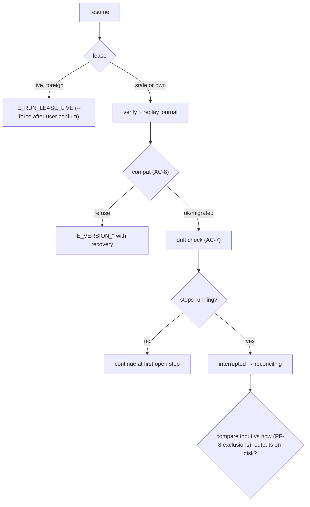

# Daedalus hardening P1c: workflow runtime, journal and recovery

- **Type:** Infrastructure (workflow hub): a CLI state machine with a write-ahead journal, crash reconciliation, digest drift checks, and `/project-manager` wired through it. Changes the shipped `.claude/` tree and releases `0.5.0`
- **Complexity:** Large. Four library modules, the runtime subcommands of `workflow.py`, nine reconciliation scenarios with crash injection, and a rewrite of `/project-manager`'s control flow
- **Estimated effort:** 5–8 engineering days (P1 total 12–20, roadmap §14; P1a 3–5, P1b 4–7). Roadmap §14 names recovery edge cases as P1's main risk; they sit here
- **Ticket:** none
- **Program plan:** [daedalus-hardening-roadmap.md](daedalus-hardening-roadmap.md) rev 2.1: §5.3, §6.2–6.4, §6.22, §9 P1, D18, D27. Roadmap ACs are written **R-AC-n**; this plan's are **AC-n**
- **Depends on:** [P1a trust and config](daedalus-hardening-p1a.md) and [P1b artifacts and evidence](daedalus-hardening-p1b.md), both landed first. §3.12 lists exactly which of their interfaces this plan consumes
- **Findings used:** [daedalus-hardening-phase0.md](daedalus-hardening-phase0.md) (A1–A3, C3 streams, H2, N1; corrections C-7, C-8, C-12, C-13); [threat model](daedalus-hardening-threat-model.md) T13, T14, T15, T20
- **Review:** revised after [the Argus review of the P1 plans](../reviews/tb-claude-custom-workflow-hardening-p0a-a663546-p1-plans.md); this plan carries the fixes for findings a663546-5, -6, -7, -8 and -12, and, from [the second review](../reviews/tb-claude-custom-workflow-hardening-p0a-a663546-p1-plans-r2.md), -14 and -15, and, from [the third](../reviews/tb-claude-custom-workflow-hardening-p0a-a663546-p1-plans-r3.md), -17 (lease ownership wording, in §3.3 and AC-1) and the end-to-end check for -19
- **Metadata:** `Security: critical`. The runtime decides when a run is complete and which evidence still counts
- **Base:** `feat/hardening-p0a` @ `a663546` plus P1a and P1b. This plan bumps the plugin to `0.5.0`
- **Graph gate:** skipped (no graph)
- **Profile:** root `.` · layer `lib` · packs `ci-cd`, `go`, `iac`, `python`; only `python` and `ci-cd` apply (`go` and `iac` come from benchmark fixtures). Shell scripts follow the repo's conventions

---

## 1. Feature overview

**Problem.**
- Run state lives in the chat. `/project-manager` can resume only from the latest QA FAIL (`.claude/commands/project-manager.md:24`), runs layers "sequentially" with handoffs passed in context (`:31`), and loops "until no Critical items" (`:59`) with nothing recording where it is.
- "Production ready" is a sentence the model writes (`project-manager.md:71–73`); nothing re-checks the gates or whether the evidence still matches the tree.
- An interrupted session loses the run. A crash mid-implementation leaves partial edits with no record of who made them or what was authorized.

**Audience.** Developers running `/project-manager`; P2, whose guard asks this runtime whether a spawn or resume is admitted, and whose budgets and caps hang off its attempts; P3, which adds tiers, types and TDD states to its tables.

**Key functionality.**
1. A **run store** under `.workflow/runs/<run-id>/` with an atomic snapshot, a `flock`, and a lease.
2. An **execution journal** (`events.jsonl`) written before the snapshot, hash-chained, replayable and repairable.
3. A **table-driven state machine** per tier; completion only through `workflow.py complete`, which re-evaluates every gate.
4. **Attempt records and reconciliation:** each attempt records its inputs, authorized write scope, checkpoint and outputs; on resume, running steps are reconciled through the nine scenarios of roadmap §6.4.
5. **Drift and invalidation:** plan, policy, command and source digests are compared at resume and before every admission.
6. **`/project-manager` runs through the runtime:** `init`, `admit`, `start`, `finish`, `transition`, `complete`, plus `--resume`, `--status` and `cancel`.

**Out of scope:** spawn admission by the guard, round caps, token budgets and reservations (P2: R-AC-2, R-AC-6–8, R-AC-50); the `Stop`-hook completion check (P2, from H2 [V]); risk classification, escalation, workflow types and TDD states (P3); isolation and parallel waves (P4); `doctor`, `report`, `gc` (P2).

### 1.1 Findings made while planning

| # | Finding | Evidence | Resolution in this plan |
|---|---|---|---|
| PF-1 | **The lease's pid can't be `workflow.py`'s own** (every call is a short-lived process), and an ancestor walk may find no host process, in which case pid-based ownership would refuse the owner's own next call as a foreign lease | Roadmap §6.3 ("pid is gone on the same host"); review finding a663546-7 | §3.3: a **lease token** proves ownership. `init` and `resume` return it, and every mutating call passes `--lease <token>`. The host-process pid (found by walking parents with `ps`; unverified whether Bash-tool commands run under it, OQ-8) is only a staleness hint and a second proof when the token was lost |
| PF-2 | **Critical tier's `red` states and the `bugfix` and `investigation` types need P3** (TDD evidence, classification) | Roadmap §6.2 tier tables; R-AC-22–24, R-AC-63 are P3 | P1's tables cover `feature` runs at all four tiers and omit `red`; P3 inserts it. `init` refuses `tdd.mode` other than `off` and any type other than `feature` with `E_UNSUPPORTED_IN_VERSION` |
| PF-3 | **Without the guard, nothing stops an agent editing `.workflow/runs/**`** | The guard is P2 (R-AC-2) | The journal's hash chain detects naive edits (R-AC-46). The docs say "integrity-checked, not tamper-proof", and P2's deny closes the Edit/Write path; for a subagent on script installs that deny is [C] until L1's `agent` half reruns (TC-05) |
| PF-4 | **"Completion only through `complete`" has two halves.** The `ready` state is reachable only through `complete` (deterministic). The model's prose claim of "production ready" is agent-followed until P2's `Stop` hook checks it (H2 [V]: a one-shot `Stop` block works) | Roadmap §6.2 "What is runtime-enforced" | AC-4 covers the state; `status --json` exposes `completion` for P2's hook; the docs label the prose half |
| PF-5 | **R-AC-14's benchmark resume probes can't run in P1:** D29 moved the benchmark to P2 | Roadmap D29, §9 P1 | Every kill point is a crash-recovery test here (AC-6), plus a real-session kill in OQ-6; the benchmark probes run in P2 |
| PF-6 | **Rework and QA rounds have no cap until P2** (R-AC-6) | Roadmap §9 P2 | The runtime counts rounds per run, and the table carries the `rework → awaiting_human` edge with a guard that P2's budget module implements (always false in P1) |
| PF-7 | **Write-scope enforcement is P4** (R-AC-51), but R-AC-47 records the authorized scope | Roadmap §5.8 | `finish` records changed paths outside the scope, and `complete` refuses until a human accepts them (`E_COMPLETE_SCOPE_UNDECIDED`) |
| PF-8 | **The project-manager's own writes would look like drift:** rework plans and mockups under `docs/plans/**`, and the profile regenerated by the session hook (findings §8.2) | Roadmap §6.10 keeps `docs/plans/**` and the profile in the fingerprint | The drift and scope checks pass `extra_exclusions=("docs/plans/**", ".workflow/profile.json")` (P1b §3.11); those files are bound through `plan_digest` and `commands_digest` instead. Evidence freshness always uses the full fingerprint |
| PF-9 | **A declared `Tier: trivial` would skip review and QA.** With no classifier in P1, taking the declared tier lets a plan lower itself below what 0.4.0 always ran; roadmap §6.11 says a declared tier can only raise the computed one | Roadmap §6.11 (`daedalus-hardening-roadmap.md:1137`); review finding a663546-6 | §3.5: in P1 the computed tier is `standard`, so the tier is max(standard, declared, critical if security). `init` refuses a declared `trivial` with `E_UNSUPPORTED_IN_VERSION` until P3's classifier exists; the trivial table stays in `lib/machine.py` and its tests |
| PF-10 | **A BLOCKED (env) step had no way back.** `block` lets the run move on, G2 sends `complete` to `awaiting_human`, and no edge re-admits the blocked step once the blocker clears. P1a makes this common: an untrusted committed test command stays BLOCKED until `/setup` | Review finding a663546-8 | §3.5: a `rerun_blocked` decision returns the run to the blocked step's phase, `admit` of a BLOCKED step opens attempt + 1, and a rerun that passes without changing the tree returns to where the run was. A test report with `verdict: blocked` arriving through `finish` records the step BLOCKED (env) too, and G1 counts a blocked step as attempted, so G2, not G1 or G4, decides (finding a663546-14) |
| PF-11 | **"Running" needs a definition.** The project-manager spawns a role synchronously and learns its agent id only when the spawn returns, so a step marked running by `start` would leave a crash mid-implementer as "admitted", which reconciliation skips | §3.11 A1; review finding a663546-12 | §3.7: `admit` opens the attempt in state `running`; `start` only binds `agent_id` and `agent_type`, and is optional |
| PF-12 | **AC ids repeat across attached plans** (each rework plan restarts at AC-1), so bare ids let a test for one plan's AC-1 satisfy another's | Review finding a663546-5 | Qualified ids `<plan-slug>:AC-n` everywhere (P1b §3.5): `admit test` passes them, G5 and the reopening in §3.9 key on them |

---

## 2. Acceptance criteria

| AC | Criterion | Roadmap | Verification |
|---|---|---|---|
| **AC-1** | **Run store.** `workflow.py init` creates `.workflow/runs/<UTC-ts>-<slug>/` with `run.lock`, `manifest.json`, `state.json`, `events.jsonl`, `usage.json` (a P2 skeleton), `handoffs/`, `evidence/`, `checkpoints/` and `artifacts/`.<br>• `state.json` is replaced atomically: temporary file, `fsync`, rename, folder `fsync` (`F_FULLFSYNC` on macOS where available).<br>• Every mutating call holds `flock` on `run.lock`, and its critical section never calls out to an agent.<br>• The lease (§3.3): `init` and `resume` return a token, and every mutating call passes `--lease <token>`. A call is own with the matching token, or without one when its ancestor `host_pid` is live (§3.3), whether or not the lease is stale; any other call is refused while the lease is live (review finding a663546-17). The host pid and the heartbeat detect stale owners; taking a stale lease is journaled; taking a live one needs `--force` and a user confirmation.<br>• `.workflow/.gitignore` gets `runs/` (via `gitutil.ensure_ignored`).<br>• Schemas `run-manifest`, `run-state`, `event` and `usage` (`/1`) are written under P1b's registry | R-AC-13, R-AC-25 (run kinds) | U, CR (`U-store-01`…`-13`, `CR-state-atomic-01`) |
| **AC-2** | **Execution journal.**<br>• **Event fields:** `schema`, `event_id`, `seq` (contiguous from 1), `ts` (UTC), `run_id`, `step_id`, `attempt`, `role`, `agent_id` when known, `type`, `data`, `evidence_refs`, `prev_digest`.<br>• **Write order:** the event is appended (`O_APPEND`) and synced before the snapshot changes; replaying the journal rebuilds `state.json` byte-identically.<br>• **Chain:** `prev_digest` = SHA-256 of the previous line's bytes (the first event uses a genesis value from the run id).<br>• **Repair:** a torn last line is truncated, a copy kept as `events.jsonl.torn-<ts>`, and a `journal_repaired` event records the byte count. A bad line before the last, or a broken chain, is `E_JOURNAL_CHAIN`: the run accepts no writes until `workflow.py repair --truncate-to <seq> --confirm` (journaled, original backed up) or the run is abandoned.<br>• **Idempotency:** a mutating call with `--idempotency-key K` that was already applied returns the original result without appending.<br>• **Claims:** the docs say "integrity-checked, not tamper-proof" | R-AC-46 | U, CR (`U-journal-01`…`-08`, `CR-journal-torn-01`, `CR-journal-tamper-01`, `CR-state-behind-01`, `CR-state-ahead-01`) |
| **AC-3** | **Deterministic transitions.**<br>• `lib/machine.py` holds one transition table per tier (trivial, standard, full, critical) for `feature` runs (§3.5; `red` and other types arrive in P3, PF-2).<br>• **Tier in P1:** max(standard, declared, critical if `Security: critical`); `init` refuses a declared `trivial` with `E_UNSUPPORTED_IN_VERSION` until P3 (PF-9). The trivial table is still tested.<br>• Any event outside the table returns `{code, message, fix}` (`E_TRANSITION_INVALID`, `E_ADMIT_PHASE`, `E_ADMIT_ORDER`, …) and changes nothing.<br>• `awaiting_human` can be left only by `workflow.py decide <option>`, with an option from the pending decision.<br>• A BLOCKED (env) step can be rerun: the `rerun_blocked` decision returns to its phase, and `admit` opens attempt + 1 (PF-10).<br>• `ready` and `cancelled` are terminal (`E_RUN_TERMINAL`).<br>• Table-driven tests cover every (state, event, tier) combination, and a human-reviewed list of allowed edges per tier must equal the table's edges | R-AC-43 | SM (`SM-table-01`: all combinations; `SM-edges-01`: golden edges; `SM-guard-01`…`-12`, including `SM-guard-11` (declared `trivial` refused) and `SM-guard-12` (BLOCKED test rerun returns to `verifying`)) |
| **AC-4** | **Completion.** `workflow.py complete` is the only path to `ready`. It recomputes the current fingerprint and digests, then checks gates G1–G12 (§3.6) and follows the table for the first failing gate: back to the phase of a stale step, to `rework`, or to `awaiting_human`. Each refusal returns one `E_COMPLETE_*` code with the fix | R-AC-43 | SM, U (`SM-complete-01`…`-14`, one per gate plus the qualified-AC and blocked-report cases) |
| **AC-5** | **Attempt records.** Each admission creates an attempt **in state `running`** (`start` only binds the agent id and `agent_type`, PF-11). The attempt records: the input fingerprint (overall, per root, and the full entry list in `checkpoints/<step>.<n>.entries.json.gz`); the plan-set, policy, commands and brief digests; the expected outputs; the role, plus the agent id and `agent_type` when known; the authorized write scope (§3.7); a checkpoint with copies of in-scope files (capped at 50 MB, else no discard option); then, at `finish`, the produced artifacts, the changed paths, the paths outside the scope and the evidence ids | R-AC-47 | U (`U-attempt-01`…`-06`) |
| **AC-6** | **Reconciliation before rerun.** On `resume`, every `running` step (admitted and not finished, whether or not `start` was called) becomes `interrupted` then `reconciling`, and is resolved by the nine scenarios in §3.8, each with a crash-injection test (`CR-recover-01`…`-09`; `CR-recover-02` kills a role that was admitted but never `start`ed). External steps are two-phase (`external intent`, then `external outcome`): an intent with no outcome is never repeated; the user is asked to check it | R-AC-47 | CR |
| **AC-7** | **Drift and invalidation,** checked at `resume` and before every `admit`:<br>• a plan Markdown/JSON divergence refuses admission with `E_ARTIFACT_DIVERGED` until `artifacts.py sync`;<br>• a changed `plan_digest` invalidates evidence bound to the old digest and reopens the steps whose tasks or AC changed, plus test, review and QA;<br>• a changed `policy_digest` invalidates gate evidence (test, review, QA) and reopens those steps; a changed `commands_digest` invalidates test evidence;<br>• an unexplained source change (the fingerprint minus PF-8's exclusions differs from the last recorded one, with no step running) moves the run to `awaiting_human` with a changed-path report and the options `adopt_baseline` (invalidates evidence) or `abort`;<br>• a Daedalus or schema version change runs the compatibility check (AC-8) | R-AC-15 | U, CR (`U-drift-01`…`-08`) |
| **AC-8** | **Compatibility on upgrade.** A run records the Daedalus version and its format majors. On resume, `migrate.compat` decides per format: same → continue; N-1 → migrate the run's files (backed up under the run's `backups/<ts>/`, journaled as `run_migrated`); anything else → refuse with `E_VERSION_NEWER` or `E_VERSION_TOO_OLD` and the recovery (finish on the version that wrote it, or start a new run). A synthetic `/2` run format proves the N-1 path | R-AC-15, R-AC-57 (run formats) | U, CR (`U-compat-01`…`-04`, `CR-recover-09`) |
| **AC-9** | **CLI.** `workflow.py` gains `init`, `admit`, `start`, `finish`, `fail`, `block`, `transition`, `rework`, `decide`, `external`, `complete`, `resume`, `reconcile`, `cancel`, `status`, `repair` and `migrate` (§3.10), all with `--json`.<br>• `status` is read-only: no file in the run changes, the heartbeat included.<br>• `cancel` stops admissions and leaves the working tree untouched (fingerprint equal before and after; no git command but reads).<br>• With `DAEDALUS_NONINTERACTIVE=1`, any call that needs a human returns `E_NEEDS_HUMAN` with the pending decision (C-12) | R-AC-14 | U (`U-cli-01`…`-10`) |
| **AC-10** | **`/project-manager` runs through the runtime** (§3.11):<br>• Phase 0 calls `init` (or `resume`), adopting a 0.4.0 plan only after the user confirms (`artifacts.py adopt`), and passes the returned lease token on every later runtime call;<br>• briefs and the test step use qualified AC ids (PF-12); a BLOCKED (env) step is rerun through `rerun_blocked` once the user clears it (PF-10);<br>• every role spawn is preceded by `admit` and followed by `finish` (or `fail` / `block`), and role outputs reach the runtime on stdin, never through files the model writes into `.workflow/runs/`;<br>• rework plans are attached with `rework`; rounds are counted (caps come in P2);<br>• "production ready" is declared only after `complete` returns `ok`, and every refusal's `fix` is relayed verbatim;<br>• `/project-manager --resume [run-id]` reconciles, then continues with the saved handoffs; `--status` runs `status`; "cancel the run" runs `cancel`;<br>• the 0.4.0 "resume from the latest QA FAIL" rule remains only for repositories with no run store | R-AC-14, R-AC-43 | OQ, U (grep test `U-pm-wiring-01`) |
| **AC-11** | **Role outputs at `finish`.** `finish` validates the role's JSON (`artifacts.extract`) and writes `handoffs/<step>.<n>.{json,md}` before journaling. The single follow-up of P1b AC-5 belongs to the same attempt: it's recorded as a `role_followup` event against the same `agent_id` ([V] C3 streams: a `SendMessage` resume keeps the `agent_id`), so P2 can count tool calls per agent across resumes (C-7, C-8). A second invalid answer fails the attempt with `E_ROLE_OUTPUT_INVALID` | R-AC-26 (consumer), R-AC-47 | U (`U-finish-01`…`-05`) |
| **AC-12** | **Privacy and size.** Event `data` follows typed per-type schemas: ids, codes, digests, counts and repo-relative paths only; never source text, prompts, command text or ticket text (applying R-AC-28's rule early). Lists of changed paths live in checkpoints, and events hold their count and the checkpoint reference | R-AC-46 | S, U (`U-journal-privacy-01`) |
| **AC-13** | **Performance.** `workflow.py` calls that don't fingerprint (`status` without drift, `start`, `fail`, `block`, `transition`, `decide`, `cancel`) take ≤ 150 ms p95 on the fixture runs (roadmap §13). Calls that fingerprint (`init`, `admit`, `finish`, `complete`, `resume`) are measured and reported against P1b's fingerprint target | — (roadmap §13) | U (timing test, reported; fails only above 2× the target) |
| **AC-14** | **Integration and hub hygiene.**<br>• `scripts/test-state.sh`, `scripts/test-recovery.sh` and `scripts/test-runtime-e2e.sh` are added to `scripts/test-all.sh`. The end-to-end test drives a fake run (no model) from `init` to `ready` with canned role outputs and a fake bundle, and checks the cross-plan contracts (§5).<br>• `VERSION = "0.5.0"` in `build-plugin.sh` and `lib/version.py`; `plugins/**` and `.claude-plugin/marketplace.json` regenerated; `build-plugin.sh --check`, `check-generic.sh`, `lint-packs.sh` pass.<br>• Docs in the same phase: ARCHITECTURE §5, §11, §13 (D18, D27), §14; README (Commands, "Running a change", an "Upgrading to 0.5.0" note covering P1a's trust prompts, P1b's plan fences and this run store); `CLAUDE.md` (the `/project-manager` row); `workflow-contract`; `.claude/rules/compounding-dev-cycle.md` (production ready = `workflow.py complete`); a new `docs/guides/recovery.md` | R-AC-42 | CI, D |
| **AC-15** | **Operational QA** (§9) on the script and plugin installs, including a real-session kill and resume, reported in `docs/qa/daedalus-hardening-p1c-qa-N.md`. FAIL → `docs/plans/daedalus-hardening-p1c-rework-N.md`; BLOCKED → the user | R-AC-66, R-AC-14 (resume, until P2's benchmark probes) | OQ |

**Roadmap coverage.** R-AC-13 → AC-1. R-AC-14 → AC-9, 10, 15 (the benchmark's resume probes move to P2 with D29, PF-5). R-AC-15 → AC-7, 8. R-AC-43 → AC-3, 4, 10. R-AC-46 → AC-2, 12. R-AC-47 → AC-5, 6, 11. Also: R-AC-25 (run kinds) → AC-1; R-AC-57 (run formats) → AC-8; R-AC-42 → AC-14; R-AC-66 → AC-15.

---

## 3. Technical design

### 3.1 Components

| Component | Path | Kind |
|---|---|---|
| Run store, lease, locking | `.claude/scripts/lib/state.py` | Library |
| Journal | `.claude/scripts/lib/journal.py` | Library |
| State machine and gates | `.claude/scripts/lib/machine.py` | Library (tables are data) |
| Attempts, scope, reconciliation | `.claude/scripts/lib/runtime.py` | Library (the orchestration of `state`, `journal`, `machine`, P1a and P1b; keeps `workflow.py` thin) |
| CLI groups | `.claude/scripts/workflow.py` | Adds the runtime groups to P1a's static table |
| Run schemas | `.claude/skills/workflow-artifacts/schemas/{run-manifest,run-state,event,usage}.schema.json` | Registered with `artifacts.register_kind` |
| Tests | `scripts/test-state.sh`, `scripts/test-recovery.sh`, `scripts/test-runtime-e2e.sh`; `scripts/fixtures/state/**` (golden edge list, canned role outputs, fenced fixture plans) | Hub tests |

Conventions as P1a §3.1 (stdlib Python 3.8+, `python3 -I`, own-directory `sys.path` insert, `argparse`, no bare `except`, `unittest` under Bash). `fcntl` limits the runtime to POSIX (macOS, Linux, WSL2), as roadmap §6.3 states.

### 3.2 Run store and write order

```
.workflow/runs/<YYYYMMDDTHHMMSSZ>-<slug>/
  run.lock                         flock target (empty)
  manifest.json                    daedalus.run-manifest/1
  state.json                       daedalus.run-state/1 (snapshot)
  events.jsonl                     daedalus.event/1, one per line
  usage.json                       daedalus.usage/1 (skeleton; P2 fills it from SubagentStop, G1 [V])
  handoffs/<step>.<n>.{json,md}    validated role outputs, rendered (P1b)
  evidence/<id>.json               P1b writer
  checkpoints/<step>.<n>.json      attempt record copy, input digests, scope
  checkpoints/<step>.<n>.entries.json.gz   input fingerprint entries
  checkpoints/<step>.<n>/files/…   copies of in-scope files at admission (for discard)
  artifacts/                       partial patches, reconcile reports
  backups/<ts>/                    run-file backups before a migration
```

**Every mutating call:** take `flock(run.lock)` → verify the journal tail and chain → check the lease → evaluate → append the event (one `os.write` of `line + "\n"` with `O_APPEND`, then `fsync`) → write `state.json.tmp`, `fsync`, rename, `fsync` the folder → refresh the heartbeat (manifest replaced the same way) → release. A crash between the event and the snapshot leaves the snapshot behind by known `seq` numbers; the next call replays them.

**Manifest:** run id, Daedalus version, format majors, attached plans (path, JSON path, `plan_digest`), plan-set digest, `policy_digest`, `commands_digest`, tier, type, `isolation: none`, base revision (HEAD SHA and the baseline fingerprint), repository identity (P1a), and the lease.

**Run discovery:** without `--run`, commands act on the single non-terminal run; with more than one, they refuse with `E_RUN_AMBIGUOUS` and list them. `init` refuses while a non-terminal run with a live lease exists (`E_RUN_ACTIVE`, fix: `--resume` or `cancel`).

### 3.3 Lease

`owner = {token, host, host_pid, started, heartbeat}`:
- `token`: random, made at `init` or takeover.
- `host`: `socket.gethostname()`.
- `host_pid`: the nearest ancestor whose executable name is the host CLI (`claude`), found by walking parents with `ps -o ppid=,comm= -p <pid>` (at most 12 levels); `null` when none is found (PF-1, unverified until OQ-8).
- `heartbeat`: refreshed by every mutating call.

**Own** when the call passes `--lease <token>` equal to the manifest's token (PF-1). As a second proof, for a project-manager that lost the token (for example after its context was compacted), a call is also own when `host_pid` is set, alive, and an ancestor of the calling process. `status` never prints the token.

**Stale:**
- With `host_pid` set on the same host: stale only when that process is gone. While it's alive the lease is live **whatever the heartbeat says**, because no runtime call refreshes the heartbeat during a long synchronous role (an implementer or QA pass can exceed 30 minutes).
- With `host_pid: null`, or on another host: stale when the heartbeat is older than `runtime.lease_ttl_minutes` (default 30, P1a key). Before reconciling a `running` attempt admitted less than 2 × that TTL ago, `resume` asks the user (`awaiting_human` with "another session may still be working on `<step>`": `reconcile_now` or `wait`; non-interactive: `E_NEEDS_HUMAN`), so a slow role isn't reconciled under its own feet.
- Staleness doesn't decide ownership: a matching token is own whether or not the lease is stale, and so is a call that passes the host-pid proof above (a live ancestor `host_pid`), which is what lets a compacted project-manager continue without `--force` (review finding a663546-17).

This departs from roadmap §6.3 (`daedalus-hardening-roadmap.md:855`), which makes any heartbeat older than the TTL stale; the change is review finding a663546-15. Its cost: when no host pid is found, a crashed session's young attempt waits for the user's confirmation instead of the TTL.

Anything that isn't own and isn't stale is **foreign and live** → `E_RUN_LEASE_LIVE`; `--force` takes it over, and the project-manager passes `--force` only after the user confirms (non-interactive: `E_NEEDS_HUMAN`). Taking over a stale or forced lease issues a new token; takeovers are journaled (`lease_taken`, with the reason, never the token).

The token coordinates sessions; it isn't a security boundary. It sits in `manifest.json`, which any local process can read, and local run state is "integrity-checked, not tamper-proof" (T14).

### 3.4 Journal

- **Line:** canonical JSON (P1b `canonical_bytes`), one event per line.
- **Genesis:** `prev_digest` of event 1 = `sha256("daedalus.journal/1\n" + run_id)`.
- **Verification** on every open: parse each line, check `seq` contiguity and the chain. Only the last line may be torn (no trailing newline, or invalid JSON): truncate it, keep the copy, append `journal_repaired`. Anything else is `E_JOURNAL_CHAIN`.
- **Replay:** `state = fold(events)` with pure reducers per event type (in `lib/machine.py`), so `state.json` is derived data. `state.seq` < the last `seq` → replay the tail. `state.seq` > the last `seq` (impossible under the write order, so a sign of tampering or disk loss) → rebuild from the journal and journal `state_rebuilt`.
- **Event types:** `run_initialized`, `lease_taken`, `step_admitted`, `step_started`, `role_followup`, `step_finished`, `step_failed`, `step_blocked`, `step_interrupted`, `step_reconciling`, `step_reconciled`, `state_transitioned`, `rework_attached`, `decision_requested`, `decision_recorded`, `evidence_recorded`, `evidence_invalidated`, `drift_detected`, `baseline_adopted`, `external_intent`, `external_outcome`, `completion_refused`, `run_completed`, `run_cancelled`, `run_migrated`, `journal_repaired`, `journal_truncated`, `state_rebuilt`. Each has a typed `data` schema in `event.schema.json` (AC-12).
- **Crash injection** for tests: `DAEDALUS_CRASH_AT=<point>` makes the process `os._exit(137)` at a named point (`after_event_append`, `before_state_rename`, `after_state_rename`, `after_handoff_write`, `before_finish_event`, `mid_checkpoint`, …). A repository that sets it through a settings `env` block [D] can only crash the runtime, which the journal recovers from by design; it can't skip a check.

### 3.5 State machine

States: `planned`, `implementing`, `testing`, `reviewing`, `rework`, `qa`, `verifying`, `awaiting_human`, `ready` (terminal), `cancelled` (terminal). `applied` (isolation) comes with P4.

Steps (stable ids; each admission is a new attempt with a `round` number): `implement:<layer>` (one per layer in plan order: data → api/worker → ui → infra, with lib and cli before their consumers), `test`, `review`, `scan` (critical tier: `/argus-scan` on the touched paths), `qa`, `approve` (critical tier: a human decision).

**Standard tier** (rows are state + event [guard] → next):

| From | Event [guard] | To |
|---|---|---|
| planned | `admit implement:L` [L is the first pending layer] | implementing |
| implementing | `admit implement:L` [earlier layers done, no step running] · `finish implement:L` [layers pending] | implementing |
| implementing | `finish implement:L` [all layers done] | testing |
| testing | `finish test` [verdict pass, or failures all pre-existing] | reviewing |
| testing | `finish test` [verdict blocked] | reviewing; the step is recorded `blocked` (env) exactly as `block` would, with the reason built from the report's blocked commands (finding a663546-14) |
| testing | `finish test` [verdict fail] | rework |
| reviewing | `finish review` [Critical items > 0: critical or important findings] | rework |
| reviewing | `finish review` [none; UI-observable AC and a UI root] | qa |
| reviewing | `finish review` [none; no UI AC] | verifying |
| qa | `finish qa` [FAIL] | rework |
| qa | `finish qa` [PASS or N/A] | verifying |
| qa | `finish qa` [BLOCKED] | awaiting_human (resume to `qa`; options include `rerun_blocked`) |
| rework | `rework --plan P` [round under cap: always true in P1, PF-6] | rework (round + 1) |
| rework | `rework --plan P` [cap reached or stalled: P2] | awaiting_human |
| rework | `admit implement:L` [L is in the attached rework plan's layers] | implementing |
| verifying | `complete` [all gates pass] | ready |
| verifying | `complete` [a stale step] | the phase of the earliest stale step (testing, reviewing or qa) |
| verifying | `complete` [Critical open, tests failing or AC uncovered] | rework |
| verifying | `complete` [BLOCKED (env), scope undecided] | awaiting_human (resume to `verifying`; a BLOCKED step adds the `rerun_blocked` option) |
| awaiting_human | `decide rerun_blocked` [a step is BLOCKED (env)] | the blocked step's phase (`testing` or `qa`), with `return_to` = the state the run left |
| testing, qa | `admit <step>` [the step is BLOCKED] | same state (attempt + 1) |
| testing | `finish test` [rerun of a BLOCKED attempt, verdict pass, post fingerprint equals the attempt's input fingerprint] | `return_to` (later evidence is still fresh) |
| testing | `finish test` [rerun of a BLOCKED attempt, verdict pass, the tree changed] | reviewing (as a first pass) |
| testing | `finish test` [rerun of a BLOCKED attempt, verdict blocked again] | `return_to`, the step still `blocked` (G2 asks again) |
| qa | `finish qa` [rerun of a BLOCKED attempt, PASS or N/A] | verifying |
| testing, reviewing, qa, verifying | `transition --to rework` (the project-manager's judgment, for example the user asked for changes) | rework |
| any non-terminal | `transition --to awaiting_human --reason R` · reconciliation needs a human · drift needs a decision | awaiting_human |
| awaiting_human | `decide <option>` [option in the pending decision] | the decision's target: `resume_to`, `rework`, `verifying`, or `cancelled` for `abort` |
| any non-terminal | `cancel` | cancelled |

Within a state, `fail <step>` marks the attempt failed and allows a new `admit` of the same step (attempt + 1); `block <step> --reason env:<what>` marks it BLOCKED (env) and lets the run move on, and gate G2 stops completion until a `rerun_blocked` decision reruns the step (PF-10). The rows above with [verdict fail] still apply to a rerun.

**Step and attempt states:** `pending` → `running` (set by `admit`; PF-11) → `done` | `failed` | `blocked`; on resume, `running` → `interrupted` → `reconciling` → one of the §3.8 outcomes. A reopened step goes back to `pending`. `start` changes no state; it records `agent_id` and `agent_type` on the running attempt.

**Tier modifiers:**
- **trivial:** `testing → verifying` on `finish test` [pass]; `reviewing` and `qa` are unreachable (`E_ADMIT_PHASE`). In P1 no run gets this tier (PF-9); the table exists for P3 and is covered by the SM tests.
- **full:** identical to standard in P1; P3 adds `red` for bugfix-type tasks.
- **critical:** `reviewing` requires both `review` and `scan` done before leaving; `verifying → awaiting_human` until an `approve` decision is recorded after the latest evidence (G10). P3 adds `red`.

**Tier in P1 (PF-9):** with no classifier yet, the computed tier is `standard`, and roadmap §6.11 lets a declared tier only raise the computed one. So the tier is `max(standard, plan workflow.tier, critical if workflow.security is critical)`; `auto` means standard. A declared `trivial` is refused at `init` (`E_UNSUPPORTED_IN_VERSION`, fix: "declare `Tier: auto` or `standard`; trivial runs need P3's classifier"). A TL5 option can raise the tier, never lower it.

**Reason codes** (all `{code, message, fix}`): `E_TRANSITION_INVALID`, `E_ADMIT_PHASE`, `E_ADMIT_ORDER`, `E_ADMIT_ACTIVE` (a step is running; P1 is sequential), `E_ARTIFACT_DIVERGED`, `E_DRIFT_SOURCE`, `E_RUN_ACTIVE`, `E_RUN_AMBIGUOUS`, `E_RUN_LEASE_LIVE`, `E_RUN_TERMINAL`, `E_NEEDS_DECISION`, `E_NEEDS_HUMAN`, `E_ROLE_OUTPUT_INVALID`, `E_UNSUPPORTED_IN_VERSION`, `E_JOURNAL_CHAIN`, `E_VERSION_NEWER`, `E_VERSION_TOO_OLD`, the `E_COMPLETE_*` codes (§3.6), and P1a's `E_CONFIG_*` passed through. Exit codes: 0 ok, 2 usage, 3 rejected (reason on stdout), 4 integrity error, 1 internal error.

### 3.6 Completion gates

`complete` computes the current full fingerprint (P1b), the plan-set digest (digest of the sorted attached plan digests), `policy_digest` and `commands_digest` (P1a), then checks, in order:

| Gate | Check | On failure |
|---|---|---|
| G1 | Required steps attempted to an end for the tier: every `implement:<layer>` of every attached plan, `test`, `review` (standard and up), `scan` and `approve` (critical), `qa` (UI-observable AC and a UI root). A step counts when it is `done` **or `blocked`**; a blocked step is left to G2 | `E_COMPLETE_STEPS_OPEN` → that step's phase |
| G2 | No step BLOCKED (env) | `E_COMPLETE_BLOCKED_ENV` → awaiting_human with options `rerun_blocked` (once the blocker is cleared) and `abort` (PF-10) |
| G3 | The latest review has no critical or important findings | `E_COMPLETE_CRITICAL_OPEN` → rework |
| G4 | The latest test report's `verdict` is `pass`: every entry in `failures[]` has `pre_existing: true` (P1b §3.5) | `E_COMPLETE_TESTS_FAILING` → rework |
| G5 | Every AC of every attached plan, by **qualified id** `<plan-slug>:AC-n` (PF-12), has an `ac_coverage` entry with `status: covered`, or is deferred by a recorded decision. A bare id never matches | `E_COMPLETE_AC_UNCOVERED` → rework |
| G6 | The review evidence is fresh: same full fingerprint, plan-set, policy and commands digests; scope `working-tree`, or `head` over a clean tree | `E_COMPLETE_REVIEW_STALE` → reviewing |
| G7 | The test evidence is fresh | `E_COMPLETE_TESTS_STALE` → testing |
| G8 | QA evidence fresh with verdict PASS, or QA N/A | `E_COMPLETE_QA_STALE` → qa; FAIL → rework |
| G9 | No attempt has out-of-scope changes without an `accept_scope` decision (PF-7) | `E_COMPLETE_SCOPE_UNDECIDED` → awaiting_human |
| G10 | Critical tier: an `approve` decision recorded after the latest evidence, bound to the current fingerprint | `E_COMPLETE_APPROVAL_MISSING` → awaiting_human |
| G11 | The journal chain verifies end to end | `E_JOURNAL_CHAIN` (no transition) |
| G12 | No unresolved drift (AC-7) | `E_COMPLETE_DRIFT` → awaiting_human |

In P1 the test and review evidence is class `claim` (P1b §3.9): the gates check that it is present, consistent and fresh, not that a trusted executor produced it. P2's `exec.py` upgrades test evidence to `local`, and the guide says so.

### 3.7 Attempts and write scope

- **Opening:** `admit` creates the attempt in state `running` and records its input in the same locked call (PF-11). The project-manager spawns the role right after; `start` later adds the agent id and `agent_type` if the spawn's result showed them.
- **Input** at `admit`: fingerprint entries (P1b `fingerprint.source`), plan-set, policy, commands and brief digests.
- **Authorized write scope:**
  - `implement:<layer>`: the `files` and `writes` of that layer's tasks in the attached plans (the rework plan's for a rework round), or the plan-level `files` under the layer's roots when tasks list none; plus the roots' test patterns (`roots[].test.patterns`).
  - `test`: the touched roots' test patterns.
  - `review`, `scan`, `qa`, `approve`: empty (read-only).
- **Checkpoint:** copies of the in-scope files that exist at admission (≤ 50 MB total), so `discard_partial` can restore them; new files created by the attempt are deleted on discard.
- **At `finish`:** `changed = diff_entries(input, now)` with PF-8's exclusions; `out_of_scope = changed − scope`. Both are stored in the checkpoint; the event holds their counts.
- **Order inside `finish`:** validate the output → write `handoffs/<step>.<n>.{json,md}` (atomic) → compute the post fingerprint → write the evidence record (P1b) → under the lock, append `step_finished` and `evidence_recorded`, and update the snapshot (including `last_post_fingerprint`). A crash before the event leaves files that reconciliation completes (§3.8, scenario 3).

### 3.8 Reconciliation (roadmap §6.4)



| # | Scenario | Detection | Outcome |
|---|---|---|---|
| 1 | Crash before any change | `changed` is empty | Attempt `failed (interrupted)`; step pending; next `admit` is attempt + 1 |
| 2 | Crash after a partial implementation | `changed` ⊆ scope, no valid handoff | `awaiting_human` with `continue` (the next brief gets `artifacts/<step>.<n>.partial.patch`), `discard_partial` (scoped restore from the checkpoint, after confirmation; offered only when the checkpoint fit the cap), `keep_for_human` |
| 3 | Crash after implementation, before the state was saved | `handoffs/<step>.<n>.json` exists and validates, no `step_finished` | Finish completed: `step_finished` appended with the recorded outputs; evidence is still required at the gates. If the handoff is missing, as scenario 2 |
| 4 | Crash during testing | Test step running; `changed` ⊆ test patterns | Rerun automatically (attempt + 1); edits outside test patterns → scenario 6's handling. P2 adds discarding executor intents with no outcome |
| 5 | Crash during review or QA | Review step running → read-only | Rerun. A QA attempt with an `external_intent` and no outcome (the plan allowed mutations) → `awaiting_human`: "check whether <intent> happened", never replayed |
| 6 | External changes between sessions | No step running; fingerprint (PF-8 exclusions) ≠ `last_post_fingerprint`; or changes outside an attempt's scope | `awaiting_human` with a changed-path report: `adopt_baseline` (invalidates evidence bound to the old fingerprint) or `abort` |
| 7 | Plan changed after start | `check_plan` diverged → `E_ARTIFACT_DIVERGED`; or `plan_digest` changed | Divergence blocks until `sync`; a digest change invalidates and reopens (AC-7) |
| 8 | Policy changed after start | `policy_digest` changed | Gate evidence stale; test, review and QA reopen; admission re-evaluated with the new policy |
| 9 | Plugin upgraded mid-run | Version or format major differs | Compatibility check (AC-8): migrate N-1, otherwise refuse with guidance |

Each scenario's test kills a real `workflow.py` (and a fake role process that edits files) at the matching `DAEDALUS_CRASH_AT` point inside a temporary git repository, then runs `resume` and asserts the outcome, the journal and the tree.

### 3.9 Drift check

Run before every `admit` and at `resume`, under the lock, in this order: version compatibility → plan divergence and digest → policy digest → commands digest → source (only when no step is running). Each detected change appends `drift_detected {kind, old, new}` and, where it applies, `evidence_invalidated {ids}`. Reopening a step sets it `pending` and moves the state to the earliest reopened phase. AC-level reopening compares plan JSON by qualified AC id and by task id (PF-12): a layer reopens when any of its tasks, or an AC its tasks cite, changed.

### 3.10 CLI

```text
workflow.py init --plan <plan.md> [--tier T] [--set KEY=VALUE …]   → {run_id, lease, …}
workflow.py admit <step> --lease TOKEN [--run ID] [--role R]       → {step_id, attempt, brief inputs, write_scope}
workflow.py start <step> --lease TOKEN [--agent-id ID] [--agent-type T]   (binds the agent only)
workflow.py finish <step> --lease TOKEN --output -|<file>          (role reply on stdin; kind from the step)
workflow.py fail <step> --lease TOKEN --reason CODE | block <step> --lease TOKEN --reason env:<what>
workflow.py transition --lease TOKEN --to rework|awaiting_human --reason R
workflow.py rework --lease TOKEN --plan <rework.md>
workflow.py decide <option> --lease TOKEN [--confirm] [--note TEXT]   (options include rerun_blocked)
workflow.py external intent <step> --lease TOKEN --descriptor JSON | external outcome <step> --lease TOKEN --intent ID --result ok|failed|unknown
workflow.py complete --lease TOKEN
workflow.py resume [run-id] [--lease TOKEN] [--force]              → {lease, …} | reconcile --lease TOKEN
workflow.py cancel --lease TOKEN [--reason R]
workflow.py status [run-id] [--drift]                              (read-only; no token, never prints it)
workflow.py repair --lease TOKEN --truncate-to SEQ --confirm
workflow.py migrate [run-id] --lease TOKEN [--dry-run]
```

Every mutating command takes `--lease` (or proves ownership through `host_pid`, §3.3) and accepts `--idempotency-key`. `admit` returns the facts a brief needs: the plan path, the layer's fence attributes and tasks, its AC with text and **qualified ids** (PF-12; for `admit test`, every AC of every attached plan), the earlier handoff paths, the runnable commands for the layer's roots (P1a `effective_commands`, trusted and not `unsafe`), and the write scope. Writing the brief stays the project-manager's job. `status --json` includes `completion: {state, eligible, blocking: [codes]}` for P2's `Stop` hook. `decide` records a human decision event (evidence class `human`, advisory in CI); the project-manager calls it only with the user's answer.

### 3.11 `/project-manager` through the runtime

| Phase | 0.4.0 (`project-manager.md`) | 0.5.0 |
|---|---|---|
| 0 Load | Read the profile and plan; check sections (`:17–25`) | `artifacts.py check <plan>`. Legacy plan → show `adopt`'s dry run, ask, then `adopt --write`. Diverged → ask which side wins, `sync`. Then `workflow.py init --plan …` (or `resume`); keep the returned `lease` token and pass `--lease` on every later runtime call. Relay any refusal's `fix` |
| A1 Code | Spawn `implementer` per layer, sequentially (`:29–39`) | Per layer: `admit implement:<layer>` (the attempt is now running) → brief from its output, AC by qualified id → spawn → `start` with the agent id when the tool result shows one (optional) → reply → `finish implement:<layer> --output -` (heredoc). Invalid output: one follow-up (P1b AC-5), then `finish` again or `fail` |
| A2 Test | Spawn `test-runner` (`:41–45`) | `admit test` (qualified AC list) → spawn → `finish test`. A report with `verdict: blocked` records the step BLOCKED (env) and the run moves on to review; `complete` later offers `rerun_blocked` with the blocker named. The project-manager doesn't call `block` separately for the test step |
| B Review | `/argus --local` "against the working tree" (`:47–55`) | `admit review` → `/argus --local --working-tree` (P1b) → `finish review --output docs/reviews/<name>.json`; critical tier: also `admit scan` → `/argus-scan <touched paths>` → `finish scan` |
| C Rework | Write a rework plan, loop (`:57–61`) | The state is `rework` after a failing finish; write `docs/plans/<feature>-rework-N.md` with fences (P1b) → `workflow.py rework --plan …` → admit only the layers it names |
| D QA | `/manual-test` (`:63–69`) | `admit qa` → `/manual-test` (for planned mutations: `external intent` before, `external outcome` after) → `finish qa --output docs/qa/<slug>-qa-N.json` |
| Ready | Declare when no Critical and gates pass (`:71–73`) | `workflow.py complete`; declare production ready only on `ok`; else relay `fix` and follow the new state |
| Status, resume, cancel | Resume from the latest QA FAIL (`:24`) | `--status` → `status`; `--resume [id]` → `resume`, then continue at the reported step with the saved handoffs; "cancel" → `cancel`. The QA-FAIL rule is kept only when the repository has no run store |

`awaiting_human`: the project-manager asks the user with the decision's options (`AskUserQuestion`), then calls `decide`. For a BLOCKED (env) step it names the blocker and its fix (install the tool, record trust with `/setup`, start the service) and offers `rerun_blocked` once the user says it's cleared. Under `DAEDALUS_NONINTERACTIVE=1` it stops and reports the `E_NEEDS_HUMAN` payload instead (C-12).

**Lost token:** after a context compaction or in a new session, the project-manager calls `workflow.py resume`; ownership then comes from `host_pid` when the ancestry check works, from staleness otherwise, or from `--force` after the user confirms (§3.3).

### 3.12 Interfaces consumed from P1a and P1b

| From | Interface | Used for |
|---|---|---|
| P1a | `wfconfig.resolve(repo, workspace, run_options)` | `init` (`tdd.mode`, `runtime.lease_ttl_minutes`, TL5 `--set`), every drift check |
| P1a | `Resolved.policy_digest()` | Manifest, drift (AC-7), evidence binding, G6–G8 |
| P1a | `trust.effective_commands(repo, profile, resolved)` and `trust.commands_digest(records)` | `admit` (runnable commands in brief inputs), manifest, drift, G7 |
| P1a | `trust.repo_identity(repo)` | Manifest |
| P1a | `wfconfig.ConfigError` codes | Passed through unchanged |
| P1a | `workflow.py` dispatcher's static group table | This plan adds its groups |
| P1b | `artifacts.check_plan`, `artifacts.load_plan` (→ `plan_digest`), `E_ARTIFACT_DIVERGED` | `init`, `admit`, drift |
| P1b | `artifacts.extract(text, kind, context)` and `RoleOutputError`; for the test step `context["runnable"]` and `context["untrusted"]` = the `<root>:<name>` keys of the test roots' **check commands** (`artifacts.TEST_CHECK_COMMANDS`, plus `build` when it is trusted and not `unsafe`; findings a663546-21, -22), split into trusted and not `unsafe`, and untrusted or `unsafe`, from P1a's `effective_commands` at `admit test` (stored on the attempt, so `finish` uses the same lists). The brief names the untrusted check commands (names only, never their text), so the test-runner reports them `blocked` | `finish` (AC-11) |
| P1b | `artifacts.qualify_ac(slug, ac_id)`; `daedalus.test-report/1` fields `verdict`, `failures[].pre_existing`, `ac_coverage[{ac, tests, status}]` (P1b §3.5) | `admit` brief inputs (qualified ids), G4, G5, §3.9 reopening |
| P1b | `artifacts.write_report`, `artifacts.render` | `handoffs/<step>.<n>.{json,md}` |
| P1b | `artifacts.canonical_bytes`, `artifacts.digest` | Journal lines, chain, plan-set digest |
| P1b | `artifacts.register_kind`, `schema.load`, `schema.validate` | Run kinds and event data schemas |
| P1b | `fingerprint.source(…, extra_exclusions=…)`, `fingerprint.diff_entries` | Attempts, drift, reconciliation, gates |
| P1b | `evidence.write_claim`, `evidence.write_human`, `evidence.freshness`, `evidence.load_all` | `finish`, `decide approve`, G6–G8, G10 |
| P1b | `migrate.register`, `migrate.compat`, `migrate.migrate_file` | AC-8 |
| P1b | `gitutil.toplevel`, `gitutil.ensure_ignored` | Store location, `.workflow/.gitignore` |
| P1b | `version.DAEDALUS_VERSION` | Manifest; bumped to `0.5.0` here |

A change to any of these after P1a or P1b lands needs this table updated first.

### 3.13 Platform facts this plan relies on

| Fact | Tag | Used for |
|---|---|---|
| A `SendMessage` resume keeps the `agent_id` and emits a new `SubagentStart`, without an `Agent` `PreToolUse` | [V] C3 streams on S and P (C-8). C3's `maxTurns` result itself is inconclusive and isn't used here | Attempt identity: a follow-up is the same attempt (AC-11); P2 keys counts on `agent_id` |
| Subagent tool calls carry `agent_id` and `agent_type`; the main thread carries neither | [V] A1, A2 (parallel), A3 | `start --agent-id` is optional in P1; P2's guard binds it from payloads |
| `agent_type` carries the plugin prefix (`daedalus:<role>`); a bare name is a project agent | [V] A1/P, N1 | The runtime stores the normalized role and the raw `agent_type` |
| A `Stop` hook can block once (`stop_hook_active`) | [V] H2 | P2's completion-claim check reads `status --json`'s `completion` (PF-4) |
| The payload can't reveal `-p`; the host already turns `ask` into deny there | [V] A3, F1–F4 (C-12) | `DAEDALUS_NONINTERACTIVE=1` drives `E_NEEDS_HUMAN` |
| Payload paths are canonical | [V] J1 (C-13) | Run-store paths use the repository's `realpath` |
| Bash-tool commands run as descendants of the host CLI process | **Unverified** | Only the lease's staleness hint and its second ownership proof (PF-1); the token is the primary proof, so the design doesn't depend on it. OQ-8 checks it |
| A hook can deny Edit/Write of `.workflow/runs/**` | [V] L1 on P and S's main thread; S subagent [C] (TC-05; L1 `agent` half rerun pending) | P2, not this plan (PF-3) |

**Inconclusive probes.** C3 (`maxTurns`): not used; only its resume observation is. L1 on the script install (subagent half): affects P2's protection of the run store, flagged in PF-3. C4: no enforcement lives in agent frontmatter (C-9). I1, M1: no dependency.

---

## 4. Layer tasks

### Layer: lib (python, ci-cd)

- **Root(s):** `.`
- **Needs:** P1a and P1b merged (§3.12).
- **Produces:** the runtime CLI and library for P2 (admission queries, attempts keyed for caps, `completion` status), P3 (tables to extend), P4 (write scopes to enforce).

**Tasks**
- [ ] **T1 Schemas and skeleton:** `run-manifest`, `run-state`, `event` (with per-type `data` schemas) and `usage` under P1b's registry; `lib/{state,journal,machine,runtime}.py` stubs; `workflow.py` groups registered.
- [ ] **T2 Journal** `lib/journal.py` (§3.4): append, verify, chain, torn-line repair, replay hooks, idempotency keys, crash points.
- [ ] **T3 Store and lease** `lib/state.py` (§3.2, §3.3): run creation and discovery, atomic snapshot, `flock`, lease with token, ancestor walk and heartbeat, `.workflow/.gitignore`.
- [ ] **T4 State machine** `lib/machine.py` (§3.5): four tier tables as data, reducers per event type, guards, reason codes; `scripts/fixtures/state/allowed-edges.txt` (golden edges, written from §3.5 by hand and reviewed).
- [ ] **T5 Attempts and scope** in `lib/runtime.py` (§3.7): admission facts, checkpoints (entries, file copies, cap), `finish` order, out-of-scope recording.
- [ ] **T6 Gates** (§3.6) and `complete`.
- [ ] **T7 Drift** (§3.9) and invalidation.
- [ ] **T8 Reconciliation** (§3.8): the nine scenarios, `discard_partial`, external intents.
- [ ] **T9 Compatibility** (AC-8): register run formats with `lib/migrate.py`; the synthetic `/2` format for the test.
- [ ] **T10 CLI** (§3.10): every subcommand, `--json`, exit codes, `E_NEEDS_HUMAN`, read-only `status`.
- [ ] **T11 `/project-manager`** rewrite per §3.11; `CLAUDE.md`'s command row; `compounding-dev-cycle.md` production-ready line.
- [ ] **T12 Tests:** `test-state.sh` (SM, store, journal, CLI), `test-recovery.sh` (CR scenarios with real process kills), `test-runtime-e2e.sh` (fake run to `ready`; cross-plan checks in §5); add all three to `test-all.sh`.
- [ ] **T13 Release:** `VERSION = "0.5.0"` (`scripts/build-plugin.sh:23`) and `lib/version.py`; regenerate `plugins/**` and the marketplace file.
- [ ] **T14 Docs:** ARCHITECTURE §5, §11 (run state integrity-checked, not tamper-proof; what is deterministic and what is agent-followed in P1), §13 (D18, D27), §14; README; `workflow-contract`; `docs/guides/recovery.md` (resume, status, cancel, repair, the nine scenarios, decisions, what to do on `E_JOURNAL_CHAIN`).
- [ ] **T15 Operational QA** (§9) and `docs/qa/daedalus-hardening-p1c-qa-N.md`; register `bash scripts/test-all.sh` as the hub's test command if P1a's step wasn't done.

**Contracts:** the CLI and its JSON outputs (§3.10), the run formats (§3.2, §3.4), the reason codes (§3.5, §3.6), `status --json`'s `completion` (P2), attempts keyed by step, attempt and `agent_id` (P2 caps), the write scope per attempt (P4).

**Tests:**
- AC-1 → `U-store-01`…`-13` (no token, a live ancestor `host_pid` and a heartbeat older than the TTL count as own; creation, discovery, ambiguity, lease stale by pid, stale by heartbeat, live foreign refused, `--force` journaled with a new token, `.gitignore` idempotent, `host_pid: null` with the right token counts as own, a wrong or missing token on a live lease is refused, a live `host_pid` with a heartbeat older than the TTL is not stale, and with `host_pid: null` a `resume` over a running attempt younger than 2 × TTL asks before reconciling), `CR-state-atomic-01`.
- AC-2 → `U-journal-01`…`-08`, `CR-journal-torn-01`, `CR-journal-tamper-01` (an edited middle line and a recomputed-but-broken chain are both caught; a fully recomputed chain is not, which the test documents as the stated limit, T14), `CR-state-behind-01`, `CR-state-ahead-01`.
- AC-3 → `SM-table-01` (every state × event × tier), `SM-edges-01` (golden list), `SM-guard-01`…`-12` (including a declared `trivial` refused at `init`, and a BLOCKED test rerun that passes on an unchanged tree returning to `verifying`).
- AC-4 → `SM-complete-01`…`-14` (one per gate; `SM-complete-13`: plan `demo` and its rework plan `demo-rework-1` each with an AC-1, only `demo:AC-1` covered → `E_COMPLETE_AC_UNCOVERED`; `SM-complete-14`: a `verdict: blocked` test report goes through `finish`, then `complete` returns `E_COMPLETE_BLOCKED_ENV` with `rerun_blocked` offered, never rework).
- AC-5 → `U-attempt-01`…`-06`.
- AC-6 → `CR-recover-01`…`-09` (`CR-recover-02` kills a role process that was admitted but never `start`ed, and resume still finds the step running).
- AC-7 → `U-drift-01`…`-08`.
- AC-8 → `U-compat-01`…`-04`.
- AC-9 → `U-cli-01`…`-10` (including `status` leaves every run file's digest and mtime unchanged; `cancel` leaves the fingerprint unchanged).
- AC-10 → `U-pm-wiring-01` (grep: `project-manager.md` calls `init`, `admit`, `finish`, `complete`, `resume`, `status`, `cancel`, and never declares production ready without `complete`), OQ.
- AC-11 → `U-finish-01`…`-05`. AC-12 → `U-journal-privacy-01` (event schemas reject free-text fields; a fixture with command text in `data` fails).
- AC-13 → timing test. AC-14 → CI and `test-runtime-e2e.sh`. AC-15 → OQ.

**Commands** (from `.workflow/profile.json`):
- **test:** `bash scripts/test-detector.sh` (`user`, confirmed). **Flags:** after P1a it needs the maintainer's trust record before the test-runner may run it without asking; the umbrella `bash scripts/test-all.sh` should be registered by then (P1a next steps) — if not, T15 registers it.
- **lint:** `bash -n .claude/hooks/session-init.sh`; P1a's `shell-syntax` and `py38-syntax` checks cover the new files.
- Also: `scripts/lint-packs.sh`, `scripts/check-generic.sh`, `scripts/build-plugin.sh --check`.
- No typecheck or build commands. Nothing `unsafe`. Crash tests kill only processes they started.

---

## 5. Integration and testing

- **Critical paths:**
  - plan → `init` → `admit` → role → `finish` → evidence → `complete` (the end-to-end test drives it with canned outputs);
  - crash at any point → `resume` → reconciliation → the same final state as an uninterrupted run (`CR-recover-*`);
  - P1a and P1b digests → drift → invalidation → reopened steps;
  - blocked test → `/setup` records trust → `rerun_blocked` → `complete` returns `ok` **without** a new review or QA (the end-to-end test drives it; it depends on P1a's unchanged-profile rule, AC-10, review finding a663546-19).
- **Cross-plan checks** (in `test-runtime-e2e.sh`):
  - P1a's `config resolve --json` output validates against P1b's `policy.schema.json`;
  - `wfconfig`'s canonical serializer equals `artifacts.canonical_bytes` on shared fixtures;
  - a fake `argus-bundle.sh --working-tree` run's `bundle.json` feeds `review-assemble`, and `finish review` accepts it;
  - a committed-but-untrusted command (P1a fixture) never appears in `admit`'s runnable commands.
- **Equivalence check:** for each CR scenario, the run's final `state.json` after resume equals the one from an uninterrupted fake run, apart from attempt numbers and repair events.

---

## 6. File changes (root `.`)

**Create**
- `.claude/scripts/lib/state.py`, `.claude/scripts/lib/journal.py`, `.claude/scripts/lib/machine.py`, `.claude/scripts/lib/runtime.py`
- `.claude/skills/workflow-artifacts/schemas/run-manifest.schema.json`, `run-state.schema.json`, `event.schema.json`, `usage.schema.json`
- `scripts/test-state.sh`, `scripts/test-recovery.sh`, `scripts/test-runtime-e2e.sh`
- `scripts/fixtures/state/**` (golden edge list, canned role outputs per kind, fenced fixture plans and a rework plan, a fake bundle)
- `docs/guides/recovery.md`
- `docs/qa/daedalus-hardening-p1c-qa-N.md` (OQ)

**Modify**
- `.claude/scripts/workflow.py` (runtime groups added to the static table)
- `.claude/scripts/lib/version.py` (`0.5.0`), `scripts/build-plugin.sh` (`VERSION = "0.5.0"`)
- `.claude/commands/project-manager.md` (§3.11)
- `.claude/rules/compounding-dev-cycle.md` (production ready = `workflow.py complete`)
- `.claude/skills/workflow-contract/SKILL.md` (run store, resume, completion line)
- `.claude/skills/workflow-artifacts/SKILL.md` (run kinds section)
- `scripts/test-all.sh`
- `ARCHITECTURE.md` (§5, §11, §13, §14), `README.md` (Commands, Running a change, Upgrading to 0.5.0), `CLAUDE.md` (the `/project-manager` row)
- Generated: `plugins/**`, `.claude-plugin/marketplace.json`

**Not touched:** `.claude/settings.json` and `hooks/hooks.json` (no new hooks in P1; the `Stop`, `SubagentStop` and guard hooks are P2), `.claude/hooks/**` (including `audit.log`), `install.sh`, `bench/**`, `scripts/probes/**`, P1a's and P1b's library modules (consumed, not edited; a needed change goes back to that plan's interface table first).

---

## 7. Dependencies / env

- **Runtime:** nothing new. Python 3.8+ standard library (`fcntl`, `gzip`, `socket`), `git`, `ps` (POSIX).
- **Environment variables:**

| Name | Purpose | Example | Required |
|---|---|---|---|
| `DAEDALUS_NONINTERACTIVE` | Decisions return `E_NEEDS_HUMAN` instead of expecting a question (C-12) | `1` | Optional (set by benchmark, CI and `-p` runs) |
| `DAEDALUS_CRASH_AT` | Crash-injection point for `test-recovery.sh` | `after_event_append` | Tests only (harmless otherwise: it can only crash the runtime) |

- **Config keys read:** `runtime.lease_ttl_minutes` (P), `tdd.mode` (refused unless `off`), `tiers.default` (P1a registry).

## 8. Design reference

No visual change.

## 9. Manual QA

N/A: no UI-observable AC. **Operational QA** (R-AC-66) replaces it, on the **script install** and the **plugin install** (`--plugin-dir`, [V] T0), in throwaway repositories with a small two-layer fenced plan. Headless runs set `DAEDALUS_NONINTERACTIVE=1`, `--max-budget-usd` and `--max-turns`; `DAEDALUS_HOME` points at a temporary folder (P1a), so no run writes the maintainer's real `~/.workflow` or `~/.claude`.

| # | Mode | Steps | Expected |
|---|---|---|---|
| OQ-1 | Headless, S and P | `/project-manager docs/plans/demo.md` end to end | The journal shows `run_initialized` … `run_completed`; the final reply quotes `complete`'s `ok`; `status` reports `ready` |
| OQ-2 | Headless, S and P | Same, but edit a source file by hand after the review finishes, then let the run reach `complete` | `E_COMPLETE_REVIEW_STALE` (or `E_DRIFT_SOURCE` at the next admission); the run goes back to `reviewing` or asks; never `ready` on stale evidence |
| OQ-3 | Headless, S and P | A plan whose AC isn't covered by the test report | `E_COMPLETE_AC_UNCOVERED` → rework; the reply relays the `fix` verbatim |
| OQ-4 | Headless, S and P | Edit an AC in the plan's Markdown mid-run without syncing | The next admission refuses with `E_ARTIFACT_DIVERGED` |
| OQ-5 | Headless, S and P | Corrupt the middle of `events.jsonl` | `status` reports `E_JOURNAL_CHAIN`; every mutating call refuses; `repair --truncate-to N --confirm` recovers |
| OQ-6 | Headless, S and P | Kill the `claude -p` process while the implementer is editing; start a new session with `/project-manager --resume` | The step is reconciled (scenario 2): the run asks (non-interactive: `E_NEEDS_HUMAN` with the options); nothing is rerun blindly |
| OQ-7 | Interactive, S and P (maintainer) | Resume OQ-6 interactively; choose `continue`, then complete the run | The question shows the decision's options; the next brief includes the partial patch; the run reaches `ready` |
| OQ-8 | Interactive, S and P (maintainer) | Run `workflow.py status --json` from the session's Bash tool and read `owner.host_pid` | Record whether `host_pid` names the session's `claude` process (PF-1). Either way: later calls with the session's `--lease` token succeed, and a second session without the token sees a live lease until the TTL or `--force` |
| OQ-9 | Interactive (maintainer) | `/project-manager --status`, then "cancel the run" | `status` changes no file; `cancel` leaves `git status` identical |

Report: `docs/qa/daedalus-hardening-p1c-qa-N.md`, PASS / FAIL / BLOCKED per scenario with the observed output. Cleanup check as in P1a §9.

---

## 10. Risks / potential issues

1. **Recovery edge cases** (roadmap §14's main P1 risk). *Mitigation:* reducers are pure and replay is tested for equivalence; every scenario kills a real process; reconciliation never repeats an external step and asks when in doubt.
2. **The project-manager skips the runtime.** *Mitigation:* in P1 it's agent-followed (stated in the docs); `ready` is reachable only through `complete`; P2's admission makes a skipped runtime stall the run instead of bypassing it, and its `Stop` hook checks the claim (H2 [V]).
3. **Lease misjudgment** (PF-1). *Mitigation:* the token proves ownership; the heartbeat decides staleness when no host pid is found; takeovers need `--force` and a user confirmation; OQ-8 measures the ancestry.
4. **Latency from fingerprinting** at each admission. *Mitigation:* P1b reuses index blobs; only five subcommands fingerprint; measured in AC-13.
5. **A dense prompt rewrite** in `project-manager.md`. *Mitigation:* the runtime returns brief facts so the prompt doesn't compute them; `U-pm-wiring-01` checks the calls; OQ-1–7 exercise it on both installs.

## 11. Open questions

1. **Does the host run Bash-tool commands as descendants of the `claude` process** on both installs? Unverified; OQ-8 answers it. Ownership rests on the lease token either way; without the ancestry, a project-manager that lost its token needs a stale lease or `--force`.
2. **Should a run survive a branch switch?** P1 treats it as an unexplained source change (scenario 6). If users switch branches mid-run often, P2 could record the branch and offer a dedicated decision. No change proposed now.

## 12. Next steps

1. Confirm P1a and P1b have landed and their interface tables (P1a §3.9, P1b §3.11) match §3.12.
2. `/clear`, then `/daedalus:project-manager docs/plans/daedalus-hardening-p1c.md`.
3. After it lands, P2 planning starts from roadmap §9 P2, with its P0 reruns (C3, C4, I1, L1/S, M1) each before the AC that depends on it.
