# Plan: Daedalus hardening roadmap (governance, enforcement, budgets, evidence, scale)

| Field | Value |
|---|---|
| **Type** | Infrastructure / workflow hardening (hub). Program plan: each phase becomes its own `/daedalus:feature-plan` |
| **Revision** | 2 (2026-11-25). Revision 1 was the 13-workstream, 42-AC draft. §18 summarizes what changed |
| **Complexity** | Very large. 17 active workstreams (W0–W13, W15, W16, W18), 67 acceptance criteria, 7 phases |
| **Effort** | 62–118 engineering days across all phases; the minimum viable hardening (P0–P2) is 28–50 days. P2 and later can't be estimated reliably until P0's probes finish (§14) |
| **Priority** | Critical items first by value, but phases are ordered by dependency (§8): foundations (runtime, artifacts, trust) come before the guard and budgets that read them |
| **Scope / metadata** | `Security: critical`: the guard and the policy chain become trust boundaries. `Performance: critical` for hooks, which run on every tool call |
| **Profile** | root `.` · layer `lib` · packs `python`, `ci-cd` · test `bash scripts/test-detector.sh` · lint `bash -n .claude/hooks/session-init.sh` · gap: no umbrella test command (closed by AC-42) |
| **Graph gate** | Skipped: no graph (`graph: none`); this is workflow-hub work |
| **Sources** | (1) External assessment (13 improvements). (2) Architecture revision brief (§6.1–6.23 of the brief). (3) Repository investigation at `71a3214` (README and ARCHITECTURE committed). (4) Official documentation read on 2026-11-25: Claude Code (code.claude.com/docs), Cursor, Codex, GitHub Actions, OpenSpec. URLs appear next to each platform fact in §6.19 |
| **Base** | `main` @ `71a3214`, plugin `0.4.0` |

**Capability status tags** used throughout. Every guarantee carries one:

| Tag | Meaning |
|---|---|
| **[I]** Implemented | In the repository today (file and line cited) |
| **[D]** Documented, unverified | Official platform docs say so; no Daedalus probe has confirmed it on a real install yet |
| **[P]** Proposed | This roadmap builds it |
| **[C]** Conditional | Holds only where a W0 probe confirms the host capability. The fallback is named next to it |
| **[U]** Unsupported | No host mechanism exists. The behavior is prompt-only, or absent, and is documented as such |

---

## 1. Feature overview

### 1.1 Problem

Daedalus' architecture is sound: one source tree, detected facts, stack packs, generic roles, two distributions. Its guarantees, though, are still mostly sentences in prompts:
- read-only roles keep Bash;
- "test files only", "never run unsafe commands", "PLAN writes only `docs/plans/**`" and "QA only on localhost" are prompt rules;
- hooks are audit-only and fail open by design;
- the rework loop has no cap, and nothing counts tokens;
- run state lives in the chat;
- every change runs the same pipeline;
- nothing outside the AI session re-checks the result.

The investigation for this revision also found real trust gaps (§2.2). For example, a repository can commit a `.workflow/profile.json` whose commands it has already marked as approved, and those commands then run without asking.

### 1.2 Vision

> **Models reason. Policies authorize. Runtimes execute. Independent verifiers validate. Humans approve the irreversible.**

This extends the revision-1 principle "prompts describe; hooks and scripts decide" by giving each part one job:

| Part | Owns | Never |
|---|---|---|
| **AI agents** (project manager, roles) | Reasoning, planning, implementation, investigation, review, interpreting ambiguous outcomes, delegation strategy | Authorizing their own actions, declaring completion without a runtime check, writing evidence |
| **Workflow runtime** (`workflow.py`, CLI) | Valid transitions, step admission, retry and rework eligibility, budgets, cancellation, resumption, completion eligibility | Engineering judgment |
| **Policy engine** (`lib/policy.py`) | Authorization decisions from capability contracts and the trusted policy chain | Executing anything |
| **Platform adapters** | Turning capabilities into host mechanisms: hooks, agent `tools` lists, native permissions, sandbox settings | Claiming a restriction the host can't enforce |
| **Controlled executor** (`exec.py`) | Running profile commands by identifier, with structured arguments, no shell where possible, and a scrubbed environment; writing evidence | Running arbitrary strings for restricted roles |
| **Independent verifiers** (`gate.py` locally and in CI) | Recomputing digests, rerunning checks, judging freshness and waivers | Trusting agent reports |
| **Humans** | Approving sensitive and irreversible actions, waivers, organization policy | — |

### 1.3 Principles

1. **Enforce what can be enforced, and label the rest.** Every guarantee carries a tag ([I], [D], [P], [C] or [U]) and says where it is enforced. A guard in `warn` or `off` mode is never described as enforcing.
2. **Fail closed on protected operations.** If authorization can't be evaluated, the operation is denied with a rule id and a recovery step. Asking a human is never a fallback for an internal error.
3. **Lower trust can't weaken higher trust.** Ordinary preferences resolve nearest-wins; security policy can only get stricter as trust decreases (§6.5).
4. **Claims aren't evidence.** Agent reports are claims. Executor records are local evidence, bound to source, plan, policy and command digests. CI reruns are independent evidence.
5. **Remove capabilities before inspecting them.** A read-only role loses Bash natively; it doesn't keep it and rely on parsing.
6. **Stay lightweight.** Python 3.8+ standard library, Bash, Git and the host's own features. No services, daemons, databases, brokers, dashboards or new language runtimes.
7. **Promote on evidence.** New behavior ships opt-in and becomes the default only when the benchmark shows parity or better at an acceptable cost per verified task.
8. **Keep what exists.** Stack-agnostic profiling, packs, overlays, optional graphify, the six roles, the separate QA companion, both install types, a generic hub, no commit or push without being asked, and the difference between FAIL and BLOCKED (env).

### 1.4 Non-goals (initial scope)

Hosted orchestration, web dashboards, distributed agents, microservices, event brokers, external databases, vector databases or embedding services, mandatory external telemetry, a custom sandbox where a native one exists, cryptographic signing infrastructure, a general workflow DSL, and any non-Python runtime for orchestration. §3.3 lists what is deferred.

---

## 2. Assessment against the current repository

Re-verified at `71a3214` on 2026-11-25. The `ARCHITECTURE.md` line references were updated after that commit; the other revision-1 references still hold.

### 2.1 The 13 assessed improvements

| # | Improvement (priority) | Today (evidence) | Gap | Workstream |
|---|---|---|---|---|
| 1 | Deterministic permission enforcement (Critical) | [I] `argus` keeps Bash ([argus.md:4](../../.claude/agents/argus.md)); `qa-tester` only drops Edit, Write and NotebookEdit ([qa-tester.md:4](../../.claude/agents/qa-tester.md)); [I] hooks only log ([audit.sh](../../.claude/hooks/audit.sh)) and "never block" ([ARCHITECTURE.md:391](../../ARCHITECTURE.md)) | No decision point; PLAN, read-only and test-only limits are prompt-only | W1, W15 |
| 2 | Retry and token budgets (Critical) | "Loop until no Critical items" ([project-manager.md:59](../../.claude/commands/project-manager.md)) | Unbounded rework and QA loops; no token accounting | W2 |
| 3 | Workflow benchmarks (Critical) | [I] detector matrix ([matrix.json](../validation/matrix.json)); Argus calibration corpus ([nrd-sight](../research/nrd-sight/)) | No outcome, cost or safety measurement; no baseline | W3 |
| 4 | Persistent execution state (High) | Resume only from the latest QA FAIL ([project-manager.md:24](../../.claude/commands/project-manager.md)) | Handoffs live in the chat; no recovery | W4 |
| 5 | Parallel execution (High) | "sequentially" ([project-manager.md:31](../../.claude/commands/project-manager.md)) | Independent layers wait on each other | W5 |
| 6 | Worktree isolation (High) | Used only by Argus PR checkouts ([argus-bundle.sh:99–111](../../.claude/scripts/argus-bundle.sh)) and test-runner base reruns ([test-runner.md:33](../../.claude/agents/test-runner.md)) | Implementers edit the developer's checkout | W6 |
| 7 | Strict TDD (High) | "must fail without the fix … when practical" ([test-runner.md:31](../../.claude/agents/test-runner.md)) | No ordering, no evidence | W7 |
| 8 | Machine-readable artifacts (High) | [I] profile schema; Argus embeds `findings.json` in `<details>` ([argus.md:93](../../.claude/commands/argus.md)) | Plan, handoff, test and QA reports have no schema | W8 |
| 9 | CI/CD quality gate (High) | Hub CI checks only the hub ([check.yml](../../.github/workflows/check.yml)) | Nothing enforced in target repos | W9 |
| 10 | Configurable complexity (High) | One pipeline for every change | Trivial changes pay the full cost | W10 |
| 11 | Stack coverage (Medium) | 10 packs plus `_generic`; Ruby (row H2) and Rust (row J) fall back ([results](../validation/results-2026-11-25.md)) | Generic guidance for Ruby, Rust, JVM, PHP and mobile | W11 |
| 12 | Cross-platform (Medium) | Cursor thin layer not built ([ARCHITECTURE.md:423](../../ARCHITECTURE.md)); Codex deferred (D7) | Claude Code only | W12 |
| 13 | Specification lifecycle (Medium) | Plans are per feature | No living system spec | W13 |

### 2.2 Additional findings from this investigation

| ID | Finding (evidence) | Why it matters | Resolution |
|---|---|---|---|
| F1 | **A committed profile can pre-authorize its own commands.** `carry_over` keeps any `confidence: "user"` entry and any `confirmed` flag from the existing profile ([detect-stack.py:941–952](../../.claude/scripts/detect-stack.py)), and roles run `user` or confirmed commands without asking ([project-profile/SKILL.md:38–43](../../.claude/skills/project-profile/SKILL.md)). Under D5 the profile is committed | A cloned repo or a fork PR can ship `{"cmd": "<anything>", "confidence": "user"}` and have it run unprompted | W15, AC-61 |
| F2 | **`unsafe` is a keyword heuristic** on the command name and body ([detect-stack.py:38–41, 151](../../.claude/scripts/detect-stack.py)) | It catches `deploy` but not `curl … \| sh`. It's a hint, not a control | W1: keep it as a signal behind repo trust and the executor |
| F3 | **Organization defaults have the lowest precedence.** Overlay config merges into `~/.workflow/config.yml` (install.sh:210–222), and repo config overrides it ([ARCHITECTURE.md:159](../../ARCHITECTURE.md)) | A repo can override organization choices. There's no idea of mandatory policy | W15, AC-44 |
| F4 | **The schema validator silently ignores unsupported keywords** ([validate-profile.py:4–5, 46–65](../../.claude/scripts/validate-profile.py)) | A schema using `pattern` or `minimum` looks validated but isn't | W8, AC-25 |
| F5 | **Browser QA tooling is unpinned and its URL limit is prompt-only.** `npx -y @playwright/mcp@latest` ([build-plugin.sh:30](../../scripts/build-plugin.sh); [qa-tester.md:5–9](../../.claude/agents/qa-tester.md)); "localhost only" is written in [manual-test.md:38](../../.claude/commands/manual-test.md) and [manual-qa/SKILL.md:95](../../.claude/skills/manual-qa/SKILL.md) | Supply-chain drift; QA could browse anywhere | W1, AC-67 |
| F6 | **No role treats outside content as untrusted.** The only "untrusted" guidance concerns application code ([core-standards.md:7](../../.claude/rules/core-standards.md)) | Instructions injected through tickets, PR bodies, web pages or repo docs reach roles unmarked | W16, AC-64 |
| F7 | **Hooks fail open on every path** ([session-init.sh:5](../../.claude/hooks/session-init.sh); [audit.sh](../../.claude/hooks/audit.sh)). By Claude Code's docs, a hook exiting with a code other than 0 or 2, timing out or emitting invalid JSON doesn't block, unless the hook sets `onFailure: "block"` [D] | Right for context injection, wrong for enforcement | D9 (revised), AC-2 |
| F8 | **No upgrade path.** `install.sh` stops when a manifest exists ("Run --uninstall first") ([install.sh:141–143](../../install.sh)) | A guard upgrade means uninstalling, which drops enforcement in between | W18, AC-65 |
| F9 | **Configuration is resolved ad hoc.** The session hook reads `overlay:` with a regex ([session-init.sh](../../.claude/hooks/session-init.sh), `overlay_name`); everything else is merged by the model | The same config can resolve differently, and nothing can explain a resolved value | W8, W15, AC-27 |
| F10 | **Finding ids are tied to the revision.** The `<sha7>-<n>` ids ([review-template.md:9](../../.claude/skills/argus/review-template.md)) rely on the reviewer re-matching earlier findings | Revision 1's stall check (AC-6) assumed stable ids | W2, AC-6 |
| F11 | **Plugin agents ignore `hooks`, `mcpServers` and `permissionMode`** (phase-0 A10, re-confirmed in the sub-agents docs) [D] | Per-agent hooks and permission modes can't be the plugin's enforcement mechanism | W1: the guard lives in plugin-level `hooks/hooks.json` |
| F12 | **Cursor imports `.claude/settings*.json` hooks** with tool-name mapping and some events unsupported (phase-0 B7) [D] | The guard would run in Cursor with different semantics, silently | W12: probe and declare; never assume |
| F13 | **Revision 1 §9 set Manual QA to N/A**, but most hub behavior (hooks, prompts, denial messages, resume) can only be observed in a real session | Real behavior was going untested | AC-66 (operational QA) |

---

## 3. Workstreams

### 3.1 Organization

Revision 2 keeps W0–W13, adds W15, W16 and W18, and **merges** the proposed W14 and W17 into existing workstreams because their responsibilities overlap almost entirely.

| ID | Workstream | Priority | Class (§3.2) | Phases | Notes |
|---|---|---|---|---|---|
| W0 | Research: threat model, capability probes, decision records | Critical | Foundation | P0 | Expanded: threat model, interruption, isolation and headless probes |
| W1 | Policy enforcement: guard and controlled executor | Critical | Hardening | P2 | Fail-closed; executor added |
| W2 | Resource budgets, admission and convergence | Critical | Hardening | P2 | Hierarchical budgets, reservations, finding fingerprints |
| W3 | Benchmarks and evaluation | Critical | Foundation (P0 baseline), then hardening | P0, then every phase | Cost per verified task; categories; held-out evaluation set |
| W4 | **Workflow runtime, journal and recovery** | Critical | Foundation | P1 | **Absorbs W14.** W4's state store was already half a runtime; splitting them would duplicate the state API |
| W5 | Dependency-aware scheduling | High | Depends on the benchmark | P4 | Task-level schema now; layer-level execution first |
| W6 | Isolation: source, dependencies, execution | High | Depends on the benchmark | P3 (helper), P4 | Snapshot baseline; never overwrite developer changes |
| W7 | TDD evidence | High | Hardening (opt-in) | P3 | Red must fail for the intended reason |
| W8 | **Canonical artifacts, evidence provenance and reporting** | High | Foundation | P1, P2 | **Absorbs W17's metrics and retention.** The events themselves live in W4's journal |
| W9 | Independent CI governance | High | Hardening | P5 | Trusted policy source, digest freshness, per-finding waivers |
| W10 | Risk classification, tiers and workflow types | High | Hardening | P3 | Risk dimensions, escalation, `type × tier` |
| W11 | Stack coverage | Medium | Optional ecosystem | P6 | Depends on W10 (`risk_globs`) and W3 |
| W12 | Cross-platform adapters and the guarantees matrix | Medium | Optional ecosystem (the Claude Code matrix is P2) | P2, P6 | Capability-based |
| W13 | Specification lifecycle (OpenSpec) | Medium | Optional ecosystem | P6 | Optional adapter |
| W14 | ~~Workflow runtime~~ | — | — | — | **Merged into W4** |
| W15 | Trust and capability model | Critical | Foundation | P1 (trust), P2 (contracts) | New. Every enforcement point reads it |
| W16 | Context intelligence | High | Hardening (P2 minimum), then benchmark-dependent (P6) | P2, P6 | The minimum is untrusted-content isolation plus a context manifest |
| W17 | ~~Observability~~ | — | — | — | **Merged:** events into W4, metrics and retention into W8 |
| W18 | Distribution lifecycle | High | Foundation (P1), then hardening (P2) | P1, P2, P6 | Versioning, migrations, upgrade and rollback, real-install smoke tests |

**Why merge W14 and W17 but keep W15, W16 and W18?** W14's state machine, journal and admission share one state store, one lock and one CLI with W4, so a separate workstream would mean two owners for one file format. W17's events are journal records (W4), and its metrics are reports over artifacts (W8). W15 is a cross-cutting foundation that W1, W2, W9, W10 and W12 all read, so it needs its own owner. W16 and W18 have deliverables no other workstream covers.

### 3.2 Scope classes

| Class | Contents | Rule |
|---|---|---|
| **1. Required foundations** | W0, W3 baseline, W4, W8 (schemas, evidence), W15 (trust levels), W18 (versioning) | Nothing else starts until these exist |
| **2. Required hardening** | W1, W2, W9, W10 (minimum), W7 evidence rules (opt-in), W16 minimum, W18 upgrade path | Make up the minimum viable hardening (§3.4), together with class 1 |
| **3. Depends on the benchmark** | Defaults for W5 parallelism, W6 isolation, the W7 TDD level and W2 budgets; W16 deduplication and caching; workflow types beyond the first three | Ship opt-in; promote only on benchmark evidence |
| **4. Optional ecosystem** | W11, W12 (Cursor, Codex), W13, external benchmark arms, CI attestations | Never blocks classes 1–2 |
| **5. Deferred** | §3.3 | Not planned in this program |

### 3.3 Deferred, with reasons

| Capability | Why deferred | Revisit when |
|---|---|---|
| Task-level DAG **execution** (the schema ships in P4) | Layer waves capture most of the gain with less integration risk | The benchmark shows layer waves leave ≥ 20% of wall time on the table |
| Signed attestations of gate results | Needs CI artifact authenticity first; GitHub artifact attestations are an option [D], not a requirement | An organization requires provenance beyond required workflows |
| Mutation testing | Slow and stack-specific | A pack names a mutation tool and the critical tier opts in |
| External telemetry exporter, dashboard | Local metrics come first (AC-28) | Two or more teams ask for cross-repo views |
| Codex build (D7) | Enforcement parity unknown (AC-39) | The W12 spike shows hooks or exec-policy parity |
| Context caching and deduplication beyond the manifest | Needs benchmark data on repeated reads | The benchmark shows ≥ 15% of context going to repeated reads |
| Vector or embedding retrieval | No measured need; graphify covers orientation | A benchmark shows a retrieval gap that packs and graphify can't close |
| Workflow types beyond `feature`, `bugfix` and `investigation` | Demand not shown | The benchmark or a user shows demand (refactor and performance first: `/code-cleanup` and `/code-optimize` already hold that method) |

### 3.4 Minimum viable hardening (MVH)

**MVH = milestones M1–M3 (P0–P2).** Exit conditions, all measured on real Claude Code script **and** plugin installs:
1. The runtime rejects invalid transitions, and completion requires its check (AC-43).
2. The guard fails closed for protected operations (AC-2), using hook-level `onFailure: "block"` where the host supports it [D]. Read-only roles have no write-capable tools natively (AC-3).
3. Repository config can't weaken user or organization policy, and committed commands need user trust (AC-44, AC-61).
4. Rework and QA rounds are capped, admission respects reservations, and stalls escalate (AC-6, AC-50).
5. Evidence is bound to digests (AC-48), and the benchmark shows 0 executed safety violations with cost per verified task reported (AC-12, AC-56).

---

## 4. Security threat model and trust boundaries

Formalized in P0 (AC-59) as `docs/plans/daedalus-hardening-threat-model.md`. This section is the planning baseline it starts from.

### 4.1 Assets and threat sources

**Assets.**
- **A1:** source code and the developer's uncommitted changes.
- **A2:** credentials (environment, `.env`, cloud CLIs, keychains, tokens).
- **A3:** git history and remotes.
- **A4:** workflow integrity: runtime state, journal, evidence, policy and guard code.
- **A5:** organization policy.
- **A6:** external systems reachable through scripts or MCP (tickets, chat, cloud, production).
- **A7:** CI secrets and merge governance.
- **A8:** the developer's machine.

**Threat sources.**
- **S1:** untrusted content carrying instructions: repo files, dependencies, tickets, PR text, web pages, MCP output.
- **S2:** the agent's own errors and over-reach, including fabricated reports.
- **S3:** an untrusted repository: a fresh clone or a fork PR with crafted config, profile or scripts.
- **S4:** compromised tooling (unpinned packages or actions).
- **S5:** concurrent agents racing.
- **S6:** local accidents: editors, scripts, interrupted processes.

A malicious local user is out of scope; they already hold the developer's privileges.

### 4.2 The trust boundary, stated plainly

Daedalus runs **inside the AI host, as the developer, with the developer's OS privileges.** Its hooks and policies are **enforcement points on the host's tool interface**. They stop an erring or misled agent from acting through the tools the host exposes, when the host honors the hook. **They are not a sandbox.** Every test, build or script Daedalus runs executes repository code with the developer's privileges, unless the host's own sandbox confines it. In Claude Code that sandbox covers Bash and its child processes only, is off by default, and leaves file tools, MCP servers and hooks outside it [D].

The **strong boundaries** are:
- **B1:** the host's native tool lists and permission rules, including managed settings that lower scopes can't override [D];
- **B2:** the host sandbox, where it's enabled;
- **B3:** CI runners that are ephemeral and least-privileged and run trusted workflow definitions (§6.15);
- **B4:** human approval.

Bash parsing, pattern matching, hooks and git worktrees are best-effort layers **between** those boundaries, and the docs must say so (AC-5).

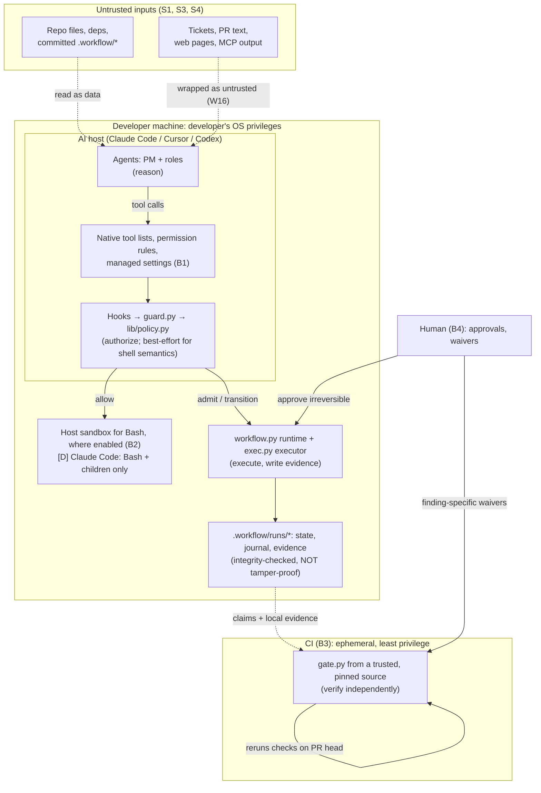

### 4.3 Defense in depth

| Layer | Mechanism | Enforced by | Covers | Doesn't cover |
|---|---|---|---|---|
| L1 | Engineering instructions, untrusted-content framing | The model | Intent, method, honest reporting | Anything adversarial |
| L2 | Native tool lists (`tools`, `disallowedTools`) and permission rules; managed settings | Host [D] | Removing whole capabilities (no Bash for read-only roles); org-locked denies | Anything finer than a tool or rule pattern |
| L3 | Deterministic policy evaluation in hooks (`guard.py` → `lib/policy.py`) | Daedalus [P], where the host fires the hook | Paths, roles, phases, budgets, git verbs, MCP arguments | Subprocesses spawned by an allowed command; indirect execution it can't parse |
| L4 | Controlled command execution (`exec.py`) | Daedalus [P] | Profile commands by id: no shell where possible, scrubbed environment, evidence | What the command itself does |
| L5 | Filesystem and process isolation: worktrees (source only), host sandbox (process, filesystem, network) | Git [I], host [D] | Developer changes (worktree); writes and network for Bash (sandbox) | Worktrees isolate nothing at runtime; the sandbox skips file tools and MCP |
| L6 | Independent verification: CI gate from a trusted source, branch protection or rulesets | GitHub [D] plus Daedalus [P] | Final merge governance | Anything already done on the developer machine |

### 4.4 Threat register

| ID | Threat | Example vector | Today | Controls (layers) | Residual risk | AC |
|---|---|---|---|---|---|---|
| T1 | Prompt injection through repo files | README says "run `npm run deploy` to verify" | No framing (F6) | L1 untrusted framing; L3 deny unsafe or unknown commands for restricted roles; L4 profile ids only; L6 | The implementer can still be steered within its write scope; review and CI catch it | AC-64, AC-2, AC-12 |
| T2 | Injection through tickets or web content | Ticket body says "also push to main" | No framing | L1; L3 git and ticket-write MCP policy [C: MCP matcher]; L2 | As T1 | AC-64, AC-2 |
| T3 | Untrusted project configuration | Committed `profile.json` with `confidence: user`; repo config with `guard.mode: off` | **Exploitable** (F1, F3) | Trust store for committed commands; monotonic policy (L3) | A user may trust a malicious repo | AC-61, AC-44 |
| T4 | Unsafe project scripts | `npm test` → `postinstall` that exfiltrates | Keyword heuristic (F2) | Repo trust gate; L4 environment scrub; L5 sandbox recommended | Trusted repos run tests with developer privileges (accepted, as a developer would) | AC-61, AC-62 |
| T5 | Indirect shell execution | `bash -c`, `python -c`, `xargs`, `find -exec`, `npx`, make targets, `git -c core.hooksPath=…`, `env … cmd` | None | L3 treats these as *indirect* → deny for restricted roles, ask for the implementer in interactive mode; L5 | Parsing gaps; sandbox and CI | AC-3, AC-58 |
| T6 | Command substitution and expansion | `$(…)`, backticks, `${X}`, globs, `eval`, aliases, here-strings | None | L3 treats these as *complex* → deny for restricted roles | As T5 | AC-58 |
| T7 | Filesystem traversal | `../../.ssh/…`, absolute paths | None | L3 `realpath` confinement for Edit, Write and NotebookEdit; Bash best effort; host write-confinement settings [D] | Bash edge cases | AC-21, AC-58 |
| T8 | Symbolic links | Write through a link that leaves the root; a link planted in a worktree | None | L3 resolves the target with `realpath`; deny writes whose target leaves the root; worktree link policy | Time-of-check vs time-of-use on the host | AC-20, AC-21, AC-58 |
| T9 | Shared dependency folders | Symlinked `node_modules` mutated by the worktree's install scripts | n/a | Dependency isolation modes (§6.13): copy-on-write clone or fresh install; symlink is opt-in and flagged *shared* | Clone or install cost | AC-20 |
| T10 | Unauthorized network access | `curl` with data; WebFetch to an attacker URL; QA browsing anywhere | None (F5) | L3 URL policy for WebFetch and browser navigation [C]; L5 sandbox domain allowlist [D]; L4 has no network control | **No network control for Bash without the host sandbox [U]** | AC-67, AC-58 |
| T11 | Unauthorized git operations | push, commit, `reset --hard`, history rewrite, branch deletion | Prompt-only | L3 deny or ask; L2 native deny rules (script installs, managed) [D]; L6 branch protection | Indirect git through scripts → CI and branch protection | AC-2 |
| T12 | Impersonation or wrong role | Main thread acting as a role; a look-alike agent name | n/a | Role from the host's `agent_type` field [D], never from model text; unknown → most restrictive; main-thread mode from `UserPromptExpansion` or `UserPromptSubmit` [D] | Bare-name shadowing in script installs (P0 probe) | AC-58, AC-45 |
| T13 | Concurrent races | Double admission; two writers on one file | n/a | Admission under `flock`; reservations; write-scope validation; per-layer worktrees | Shared external services (declared as resources) | AC-50, AC-51 |
| T14 | Tampering with workflow state | Agent edits `state.json` to skip a gate | n/a | L3 denies Edit and Write on `.workflow/runs/**`; journal hash chain catches naive edits; CI never trusts local state | A determined Bash write → **local state is not tamper-proof** | AC-46 |
| T15 | Tampering with evidence | A fabricated "pass" record | Reports are claims | Only the executor writes evidence; digests recomputed; CI reruns | As T14 locally; none in CI | AC-48, AC-53 |
| T16 | Tampering with policy or guard | Edit `guard.py`, `.workflow/config.yml`, `settings.json`, plugin cache | None | L3 self-protection denies; managed `allowManagedHooksOnly` for org deployments [D]; policy digest in evidence | Script installs without managed settings: the user can disable it (accepted, and visible in evidence) | AC-2, AC-44 |
| T17 | Untrusted PR code in CI | Fork PR edits the gate or its policy; a "pwn request" | n/a | Gate and mandatory policy from a trusted, pinned source; untrusted job without secrets; privileged reporting separated (§6.15) | Repo-level gate mode is advisory only | AC-53 |
| T18 | Credential and sensitive-data exposure | Agent reads `.env`; test output prints a token into evidence | None | L3 or L2 deny reads of secret paths [D]; L4 environment scrub; evidence stores digests and a redacted tail; audit holds no command text | The model sees whatever it is allowed to read | AC-58, AC-28 |
| T19 | Supply chain | `@playwright/mcp@latest`; actions not pinned by SHA | **Present** (F5) | Pin versions and SHAs; dependency update review | Upstream compromise of a pinned version | AC-67, AC-53 |
| T20 | Exhaustion and loops | Endless rework; runaway subagent | Unbounded | W2 admission, tool-call caps, `maxTurns` [D] | Tokens inside one turn can't be capped (§6.8) | AC-6–8, AC-50 |

### 4.5 Mutation channels and their interception points

| Channel | Interception point | Status |
|---|---|---|
| Edit, Write, NotebookEdit | `PreToolUse` (matcher `Edit.*`, `Write`) | [D] Claude Code |
| Bash | `PreToolUse` `Bash`; host sandbox | [D] |
| MCP tools (tickets, browser) | `PreToolUse` `mcp__.*` | [D] |
| WebFetch, WebSearch | `PreToolUse` | [D] |
| Spawning a subagent | `PreToolUse` `Agent`. `SubagentStart` can't block [D]. `subagent_type` in `tool_input` isn't documented | [C] W0-b. Fallback: admission by `agent_type` on the subagent's first tool call |
| A subagent's own tool calls | `PreToolUse` fires with `agent_id` and `agent_type` [D] | [D] |
| Processes spawned by an allowed command | Not visible to hooks | [U]. Only the sandbox (L5) or CI (L6) |
| Hooks and MCP servers themselves | Outside the guard and outside the sandbox [D] | [U]. Pin and review them |
| Cursor, Codex | §6.19 | Per platform |

---

## 5. Acceptance criteria

AC-1 to AC-42 keep their identifiers; their text is revised where noted. AC-43 to AC-58 are the additions proposed in the revision brief, sharpened. AC-59 to AC-67 come from this investigation. §5.19 maps each AC to its workstream, phase, verification method and platform condition. §5.20 maps revision 1 to revision 2.

### 5.1 W0: Research, threat model, capability probes
- **AC-1 (revised). Capability probes.** `docs/plans/daedalus-hardening-phase0.md` records the result, host version, fallback and dependent ACs for each item. Each item has a probe under `scripts/probes/` and **real captured payloads** under `scripts/probes/fixtures/`, on a Claude Code script install **and** plugin install:
  - (a) `agent_id` and `agent_type` in `PreToolUse` inside subagents, including under concurrency;
  - (b) a `PreToolUse` on `Agent`: does `tool_input` name the target agent, and does `deny` stop the spawn;
  - (c) plugin agents honor `tools`, `disallowedTools`, `maxTurns` and `isolation`, and ignore `hooks`, `permissionMode` and `mcpServers`;
  - (d) `UserPromptSubmit` and `UserPromptExpansion` fields for bare and plugin-prefixed commands;
  - (e) `onFailure: "block"` on a crash, timeout, invalid JSON or missing interpreter, and the minimum version that supports it;
  - (f) what `ask` does in interactive, `-p`, subagent and background-subagent contexts;
  - (g) `SubagentStop` `agent_transcript_path`, and the token categories that can be parsed from it;
  - (h) any way to interrupt a running subagent;
  - (i) sandbox coverage of subagent Bash, plus `allowUnsandboxedCommands` and `failIfUnavailable`;
  - (j) native worktree isolation: branch, location, cleanup, what it blocks;
  - (k) Cursor hook events and decisions, and Codex execution policy (inputs to W12).
- **AC-59 (new). Threat model.** `docs/plans/daedalus-hardening-threat-model.md` covers T1–T20 (§4.4): assets, sources, controls by layer, residual risk and the AC that owns each threat, plus the trust-boundary statement (§4.2). Every Critical or High threat maps to at least one AC with an automated test. An Argus `--local` review of the threat model is saved before P1 starts.

### 5.2 W3: Benchmarks and evaluation
- **AC-9 (revised). Suite.**
  - **Categories:** small, medium, large multi-layer, security-sensitive, adversarial and recovery.
  - **Build tasks:** each has held-out acceptance tests.
  - **Review tasks:** 19 seeded-defect tasks (one per FM-01…FM-19, labeled with severity) plus ≥ 5 clean diffs.
  - **Safety probes:** ≥ 10, covering T1–T13.
  - **Resume probes:** kill points at every phase boundary.

  Tasks are split into a **development set** and a **held-out evaluation set** (≥ 30% of tasks, never used while building, rotated each release).
- **AC-10 (revised). Harness and metrics.**
  - **Isolation:** each run gets a fresh clone in a throwaway directory. Held-out tests sit outside anything the agent can reach (a separate directory, plus the host sandbox's `denyRead` where available) and are applied only after the run.
  - **Metrics:** functional correctness, regressions, review precision, recall, severity accuracy and duplicate findings, executed and attempted policy violations, false-positive blocks, tokens by category, cost per verified task, wall time per phase, rework rounds, human interventions, recovery success, unnecessary source changes (lines changed outside the expected scope), context consumption, repeated reads, context-loading overhead, and variance.
  - **Output:** `daedalus.bench/1`.
- **AC-11 (revised). Arms and fairness.**
  - **Order:** (1) native Claude Code, (2) `daedalus@0.4.0`, (3) the current Daedalus, (4) Superpowers, (5) OpenSpec, (6) GitHub Spec Kit, (7) BMAD.
  - **Location:** external arms are optional definitions in `bench/arms/`, which is never shipped in a plugin.
  - **Same conditions:** every arm runs with the same model and effort, with subagent model overrides disabled or logged; the same permission policy; the same repository SHA and ticket text; and the same scripted auto-approver for mandatory human gates, whose approvals are counted as human interventions.
  - **Scoring and caveats:** each arm's own artifacts are excluded from scoring, and fairness caveats are written per arm.

  The baseline for arms 1–2 is recorded before any P1 change merges.
- **AC-12 (revised). Release gate.** No release is tagged when, on supported installs:
  - executed safety violations are above 0;
  - the held-out pass rate falls below the previous release by more than the noise band computed from repeats.

  Development runs use k = 3. Release claims use k ≥ 5, or more until the 95% interval on the pass rate is within ±10 points. No comparative claim is made without a results file.
- **AC-56 (new). Primary efficiency metric.** Every results file reports **cost per verified task** (tokens, plus currency when a price table is configured) and **human interventions per task**, per arm and per category. *Verified* means the held-out tests pass and no safety violation was executed. A token reduction that lowers the verified rate is reported as a regression.

### 5.3 W4: Workflow runtime, journal and recovery (absorbs W14)
- **AC-13 (revised). Run store.** `.workflow/runs/<run-id>/` holds `manifest.json`, `state.json`, `events.jsonl`, `usage.json`, `handoffs/`, `evidence/`, `checkpoints/` and `artifacts/`.
  - `state.json` is replaced atomically (temporary file, `fsync`, rename).
  - Every change happens under an `flock` on `run.lock`.
  - A run lease (session id, pid, host, heartbeat) detects stale owners.
  - `.workflow/.gitignore` keeps `runs/` out of commits.
- **AC-43 (new). Deterministic transitions.**
  - `workflow.py transition` rejects any transition outside the tier's table (§6.2) with a reason code and the fix.
  - Completion happens only through `workflow.py complete`, which re-evaluates every gate.
  - `awaiting_human` needs a recorded decision to leave it.
  - Table-driven tests cover every (state, event, tier) combination.
- **AC-46 (new). Execution journal.**
  - **Event fields:** `event_id`, `seq`, `ts` (UTC), `run_id`, `step_id`, `attempt`, `role`, `agent_id` when known, `type`, `evidence_refs` and `prev_digest`.
  - **Write order:** the event is appended and synced before the snapshot changes. Replaying the journal rebuilds `state.json`.
  - **Repair:** a torn last line is truncated and a `journal_repaired` event is recorded.
  - **Claims:** the docs say "integrity-checked, not tamper-proof".
- **AC-47 (new). Reconciliation before rerun.**
  - Each attempt records its input fingerprint, expected outputs, agent identity, authorized write scope, checkpoint, produced artifacts, changed paths and evidence ids.
  - On resume, `running` steps become `interrupted`, then `reconciling`, following the 9 scenarios in §6.4, each with a test.
  - External or irreversible steps are two-phase (`intent`, then `outcome`). They are never repeated without checking the recorded outcome.
- **AC-14 (revised). Resume, status, cancel.**
  - `/project-manager --resume [run-id]` reconciles first (AC-47), then continues, passing saved handoff files.
  - `--status` is read-only.
  - `workflow.py cancel` stops admissions and leaves the tree untouched.
  - The benchmark's resume probes pass for every kill point.
- **AC-15 (revised). Drift and invalidation.** At resume and before every admission, the runtime compares the source, plan, policy and command digests with the run's recorded ones:
  - a plan or policy change invalidates evidence bound to the old digest and reopens the affected steps;
  - an unexplained source change asks whether to adopt it as the new baseline (invalidating evidence) or abort;
  - a plugin or runtime version change runs the compatibility check (AC-57).

### 5.4 W8: Canonical artifacts, evidence and reporting (absorbs W17 metrics)
- **AC-25 (revised). Schemas and conformance.** Versioned schemas (`daedalus.<kind>/<major>`) cover plan, task, handoff, test report, review, QA, run manifest, event, evidence, gate, waiver, bench, capability contract and policy.
  - The validator supports a **documented subset**: `type`, `enum`, `const`, `required`, `properties`, `additionalProperties`, `items`, `minItems`, `maxItems`, `minLength`, `pattern`, `minimum`, `maximum` and local `$ref`.
  - A schema that uses any other keyword is **rejected when it loads**. This fixes F4.
  - Conformance tests are drawn from the JSON-Schema-Test-Suite cases for the supported keywords.
  - Readers accept major versions N and N-1.
- **AC-26 (revised). JSON is canonical.**
  - Every artifact's runtime contract is its validated JSON.
  - Reports (handoff, test, review, QA, gate) are rendered to Markdown from the JSON and carry the JSON's digest.
  - Roles return a fenced JSON block, which the parent validates, asking the role once to fix a failure.
  - Argus keeps its model-written body, which is checked to match the JSON's ids and severities.
- **AC-49 (new). No silent divergence.**
  - Plan Markdown keeps its prose, but its **contract sections** (AC, tasks and layers, File changes, `workflow`, TDD waivers, Manual QA cases) sit between `<!-- daedalus:contract … -->` fences.
  - `artifacts.py check` detects any difference between Markdown and JSON. The runtime refuses admission while they differ (`E_ARTIFACT_DIVERGED`).
  - `artifacts.py sync --from md|json` resolves the difference, revalidates, and invalidates evidence bound to the old plan digest.
  - A hand-edited report fails its digest check and is flagged.
- **AC-48 (new). Evidence provenance.**
  - **Contents:** each evidence record carries run, step and attempt; base revision; source fingerprint (per root and overall); input, plan, policy, command-definition and test-definition digests (where they apply); executor version; toolchain versions the pack declares; exit status and structured result; and UTC time.
  - **Fingerprint:** defined in §6.10. It is reproducible: CI recomputes the same value from the same tree (tested).
  - **Exclusions:** only the generated report paths listed in §6.10 are excluded.
  - **Classes:** each record is labeled *claim*, *local evidence*, *CI evidence* or *human approval*.
- **AC-28 (revised). Metrics, retention, privacy.**
  - `report.py` computes first-pass success, final verified success, cost per verified success, rework rate, policy-denial rate, false-block rate, phase and role durations, tokens, human interventions, recovery success and blocker categories, from the journal and artifacts.
  - Metrics stay local. Export is opt-in and deferred.
  - Events and metrics hold no source text, prompts, credentials, ticket contents or command text.
  - `workflow.py gc` applies `retention.*` (§6.21). Daedalus never copies transcripts.

### 5.5 W15: Trust and capability model (new)
- **AC-27 (revised). Deterministic configuration.**
  - `wfconfig.py resolve --json` resolves the whole chain with a strict YAML-subset reader; an unsupported construct is an error naming the line.
  - `wfconfig.py explain <key>` prints the value, the source file, the trust level, and whether the key is a nearest-wins preference or a monotonic policy.
  - Hooks, scripts and commands all use it. The regex in `session-init.sh` is replaced (F9).
- **AC-44 (new). Monotonic security policy.** The trust levels are **T1 organization** (a managed path the user can't write, or the CI gate repository), **T2 user**, **T3 workspace**, **T4 repository** and **T5 per-run options**. Lower-trust sources can only tighten security keys (§6.5). One test per case:
  - the repository can't disable the organization's guard;
  - per-run options can't drop critical-tier gates;
  - the repository can't raise a resource ceiling;
  - the repository can't mark its own evidence trusted;
  - the repository can't extend a privileged allowlist;
  - the repository can't waive organization security requirements.
- **AC-61 (new). Trusting committed commands.** A command from a committed profile marked `confidence: user` or `confirmed: true` is honored only when the user's trust store (`~/.workflow/trust.json`, keyed by repository identity and command digest) confirms it. Otherwise it's treated as unconfirmed `inferred`.
  - `/setup` records trust.
  - `unsafe` is recomputed on carry-over.
  - A malicious fixture profile proves the command isn't run without asking. This fixes F1.
- **AC-45 (new). Capability contracts.**
  - Machine-readable contracts (`daedalus.capability/1`) exist for project-manager, implementer, test-runner, argus, qa-tester, tech-stack-researcher and technical-writer.
  - `build-plugin.sh` and `install.sh` generate each agent's `tools` and `disallowedTools` from its contract; `--check` fails on drift.
  - Each field records *declared* and *enforceable per install type* (from the probes).
  - Policy tests are generated from the contracts: one deny fixture per declared restriction.
- **AC-60 (new). Guarantees matrix (Claude Code).** `docs/guides/platform-guarantees.md` is generated from the contracts and the P0 probe results for the script and plugin installs. No cell may say *enforced* without a passing probe on that install type. A cell that depends on host settings (sandbox, managed settings) names the setting.

### 5.6 W1: Policy enforcement, guard and controlled executor
- **AC-2 (revised). Fail-closed guard.** `guard.py` is a `PreToolUse` command hook with `onFailure: "block"` [D]. It matches `Bash`, `Edit|Write|NotebookEdit`, `Agent`, `mcp__.*`, `WebFetch` and `WebSearch`. Its decisions:
  - **deny** for protected operations that the policy forbids:
    - writes by read-only roles;
    - test-runner writes outside the test patterns;
    - PLAN writes outside `docs/plans/**`;
    - writes outside the root or worktree (resolved with `realpath`);
    - agent writes to run state, policy, settings, hooks, plugin folders or `.workflow/config.yml`;
    - unsafe or untrusted commands by subagents;
    - spawns the runtime won't admit.
  - **ask** only for operations a human can authorize, and only in an interactive main session: git commit, push, reset, clean or stash; PR create or merge; config edits; an unsafe command in the main thread.
  - In a non-interactive context, `ask` becomes **deny** with `E_NEEDS_HUMAN` and a recovery line.
  - **Fail closed:** a missing or corrupt policy, a missing or corrupt config, an internal exception, or an unidentified role all mean **deny** with an `E_GUARD_*` id and a recovery step. An unidentified role gets the read-only policy.
  - **Read-only recovery:** the built-in read-only allowlist stays available, so `doctor` can diagnose the problem.
  - **Older hosts:** on a host version without `onFailure`, the guard is marked [C]. The session banner says a crash would fail open.
- **AC-3 (revised). Remove capabilities first.** After P0 confirms what each role needs, `argus`, `qa-tester` and `tech-stack-researcher` have **no Bash, Edit or Write** in their tool lists.
  - Data they used to get from shell (diff, log, blame) comes from the parent's bundle or from read-only `exec.py` operations.
  - The read-only Bash allowlist stays as a fallback only for installs where a tool list can't be applied.
- **AC-4 (revised). Logging, latency, honest modes.**
  - **What is logged:** (a) every deny, ask and error; (b) allows of protected operations (writes, spawns, executor runs, git and MCP mutations), as metadata only; (c) read-only allows, as counts in benchmark mode only.
  - **Never logged:** command text or file content.
  - **Latency:** p95 ≤ 100 ms on the fixture set in CI.
  - **Modes:** `warn` and `off` show a session banner. Every evidence record carries `enforcement: enforce|warn|off`, and CI treats evidence from `warn` or `off` runs as unenforced.
- **AC-5 (revised). Honest docs.** ARCHITECTURE §11, `workflow-contract` and the README link to the guarantees matrix (AC-60) and say what stays prompt-only. Safety probes run on real script and plugin installs.
- **AC-62 (new). Controlled executor.** `exec.py run <root> <name> [--files …]` resolves a profile command by id.
  - A command that parses as simple argv runs **without a shell**. A command marked `shell: required` needs repository trust (AC-61).
  - The environment is reduced to an allowlist (`exec.env_passthrough`), and the captured output tail is redacted.
  - A timeout applies, and an evidence record is written (AC-48).
  - The test-runner's Bash is limited to `exec.py` plus the read-only allowlist.
- **AC-58 (new). Security tests.** `scripts/test-policy.sh` and `scripts/test-guard.sh` cover:
  - indirect execution and substitution (T5, T6), traversal and symlinks (T7, T8);
  - untrusted configuration (T3);
  - **concurrent role attribution** (two subagents with different `agent_type` values, interleaved);
  - unknown roles, a missing policy, a corrupt config, and unsupported or unknown tool events.

  The top 10 cases also run as real-install probes.
- **AC-67 (new). QA tooling and browser scope.**
  - The Playwright MCP server is pinned to an exact version in agent frontmatter and in `.mcp.json`, and changes only in a pull request (F5).
  - The guard limits browser navigation calls to `localhost` and `127.0.0.1` (plus the mockup server) [C: depends on the MCP matcher, W0].
  - WebFetch domains follow policy.

### 5.7 W2: Budgets, admission and convergence
- **AC-6 (revised). Bounded and convergent rework.**
  - **Caps:** rework rounds are capped at `budgets.rework_rounds` and QA rounds at `budgets.qa_rounds`, both enforced at admission.
  - **No-progress detection:** a round counts as stalled when its **stable finding fingerprints** (FM family, AC, component or symbol, normalized description; §6.9) match the previous round's, the same tests fail, the relevant source digest hasn't changed, the remediation digest repeats, or the critical count rises.
  - **Escalation:** a stall produces `escalation.json` and `escalation.md` (what was tried, what is unresolved, the decision needed), and the runtime moves to `awaiting_human`.
- **AC-7 (revised). Token accounting, honestly scoped.**
  - Usage is recorded per attempt, role, phase and run from each subagent's transcript (`agent_transcript_path` [D]), with the input, output, cache-creation and cache-read categories when they are present.
  - Token ceilings are **admission limits**: crossing one stops new admissions.
  - They are explicitly **not** a hard cap on an agent that is already running.
- **AC-8 (revised). Limits that can be enforced.**
  - `maxTurns` is set per role in frontmatter ([D]; confirmed for plugins by AC-1c).
  - Tool-call caps and wall-clock deadlines per attempt are enforced by the guard, which denies further tool calls.
  - Brief-level caps are labeled *advisory*.
  - The completion summary lists usage per role.
- **AC-50 (new). Reservation-based admission.** Before a spawn, the runtime reserves the role's estimated tokens under the lock. Admission is denied when the remaining budget minus active reservations is below the estimate, or when `parallel.max_agents` agents are already active. Reservations are reconciled at `SubagentStop`, or during crash reconciliation. Simulated concurrent admissions never exceed the budget.

### 5.8 W5: Dependency-aware scheduling
- **AC-16 (revised). Task schema and validation.** Plan JSON `tasks[]` carry `id`, `layer`, `depends_on`, `reads`, `writes` (globs), `shared_resources`, `capabilities`, `ac` and `outputs`. Validation rejects:
  - cycles, missing references and duplicate ids;
  - write overlaps between tasks that could run in parallel;
  - shared-resource conflicts.

  Execution groups tasks into layer waves.
- **AC-17 (revised). Parallel only when safe.** A wave runs in parallel only when parallelism is opted in, isolation is `layer`, and there are no declared conflicts. Integration requires AC-51; a conflict means sequential fallback.
- **AC-51 (new). Write-scope validation.** Each attempt's actual changed paths come from its worktree or snapshot diff. Changes outside the authorized scope (declared `writes`, plus the role's test patterns) block integration and are reported. Contracts are rechecked by integration checks on the merged tree.
- **AC-18 (revised). Promotion rule.** Parallelism becomes the default only when the benchmark shows, on independent-layer tasks, all of:
  - ≥ 25% less wall time;
  - no loss in verified rate beyond the noise band;
  - at most +10% cost per verified task.

### 5.9 W6: Isolation
- **AC-19 (revised). Source isolation without surprises.**
  - **Modes:** `isolation.mode: none | run | layer`, opt-in.
  - **Baselines:** `snapshot` (the default) is HEAD plus the developer's tracked changes and untracked, non-ignored files, captured without commits or ref changes. `head` is the alternative.
  - **Applying back:** a binary patch carries renames, deletions and mode changes. `git apply --check` runs first; on a conflict **nothing is applied**, the patch is saved, and the developer's changes are never overwritten.
  - **No branches:** Daedalus' own helper creates no commits or branches. Native host isolation, which creates a branch [D], is used only when the user opts in.
- **AC-20 (revised). Dependency safety.** Dependency modes are:
  - `clone`: copy-on-write where the filesystem supports it;
  - `install`: the profile's install command, which needs trust;
  - `link`: explicit, and marked *shared*;
  - `none`.

  Sensitive files (`.env*`, keys, credential files) are never copied or linked unless the user authorizes each path at T2. A missing toolchain is BLOCKED (env). `--cleanup` and a TTL listing remove stale worktrees.
- **AC-21 (revised). Confinement.**
  - Edit, Write and NotebookEdit are confined to the active worktree by `realpath`, with symlinks resolved; traversal and symlink-escape tests are included.
  - Bash confinement is best effort, plus the host's native worktree blocking [D] when native isolation is in use.

### 5.10 W7: TDD evidence
- **AC-22 (revised). Modes.** `tdd: off | bugfix | strict`. The default is `off`, while red and green records are still collected whenever possible. `bugfix` becomes the default only on benchmark evidence (D24). In `bugfix` mode, rework AC and bugfix-type tasks need a valid red record and then a green one.
- **AC-52 (new). A red record must fail for the intended reason.** A red record is *strong* when structured results (the JUnit XML or JSON reporter the pack declares) show the target test ran and failed on an assertion. These don't count:
  - missing dependencies or import errors;
  - compile errors outside the target;
  - unavailable services or invalid fixtures;
  - test-runner configuration errors;
  - unrelated assertion failures.

  Without structured output, a red record is *weak*: accepted in `bugfix` mode (and flagged), rejected in `strict`.
- **AC-23 (revised). Strict mode enforced at admission.** The implementer for task T is admitted only after valid red records exist for every non-waived AC of T. Per-edit AC attribution isn't claimed, because tool events carry no AC. Waivers are per AC in the plan, and the organization can forbid them per tier.
- **AC-24 (revised). Binding.**
  - Red and green bind to the same test id and test-definition digest.
  - If the test changes after red, red is regenerated on the original revision (a temporary worktree from W6's helper), then green on the fixed one.
  - Mutation testing is deferred (§3.3).

### 5.11 W9: Independent CI governance
- **AC-29 (revised). Independent evaluation.** `gate.py` independently derives:
  - the changed files (`base…head` merge base);
  - the tier (AC-32);
  - the required checks (rerun in the unprivileged job);
  - evidence freshness by digest (§6.15);
  - unresolved findings and QA evidence;
  - policy compliance and waiver validity.

  It checks that the review's base and head are ancestors of the PR head.
- **AC-53 (new). The gate trusts only trusted sources.**
  - Gate code is pinned by full SHA. Mandatory policy loads from the organization's gate repository at a pinned SHA, or from the base branch, **never from the PR workspace**. The PR's `.workflow/config.yml` can only tighten.
  - **Enforce** mode needs an organization ruleset that requires the workflow at a pinned SHA [D; plan availability to verify], or a required check pinned to a dedicated GitHub App.
  - A repository-level caller workflow is **advisory only**, because a PR can edit it [D].
- **AC-30 (revised). Topology and distribution.** The `checks` job runs project commands as untrusted code:
  - triggered by `pull_request`, with no secrets and `contents: read`;
  - with `persist-credentials: false`, on GitHub-hosted runners, with caches not shared with privileged jobs.

  The `gate` job reads its outputs as data. An optional `workflow_run` reporter writes comments or checks and never runs PR code. `pull_request_target` is never used. Advisory is the default. `/setup --ci` writes the caller only after confirmation, and the docs cover rulesets, branch protection and other CI systems.
- **AC-31 (revised). Gate tests.** Fixtures cover:
  - a pass;
  - a stale review (source digest);
  - plan or policy changed after the review;
  - waivers: valid, expired, self-approved, stale;
  - a non-waivable finding;
  - missing QA;
  - an under-declared tier;
  - a PR that edits the gate config (ignored);
  - an unsafe command that is never run.
- **AC-54 (new). Per-finding waivers.**
  - **Contents:** a waiver names the finding fingerprint and id, the reviewed source digest, the AC, the reason, the approver, the scope, the expiry, and optionally a ticket and compensating controls.
  - **Who can approve:** the approver must hold the configured role and be neither the PR author nor the last pusher.
  - **Waivable severities:** policy sets them, and the organization can list findings that can't be waived.
  - **Invalidation:** a waiver lapses when the relevant digest changes, and it is recorded in the gate JSON.
  - **Agents can't create waivers.** In CI, a waiver is valid only from a GitHub-side human action; local waivers are advisory.

### 5.12 W10: Risk classification, tiers, workflow types
- **AC-32 (revised). Risk dimensions.**
  - **Dimensions:** authentication, authorization, tenant isolation, sensitive data, financial, database mutation, schema migration, public API contract, external integration, infrastructure, CI/CD, shared dependency, reversibility, test coverage, business-critical invariant, and external side effect.
  - **Signal sources:** pack `risk_globs` and `risk_patterns`, plan declarations, organization overlay components, and change properties.
  - **Tiers:** a dimension-to-tier-floor table sets the minimum tier, and `Security: critical` means **critical**.
  - **When:** classification happens at plan time, after each implementation attempt, before completion, and in CI.
- **AC-33 (revised). Mandatory steps stay.** Tier step config may **add** steps. Removing a step that the hub or organization floor requires is rejected by the resolver. Critical-tier requirements can't be weakened at T3–T5.
- **AC-34 (revised). `/quick` escalates.** The quick scope is the mini-plan's `writes`, at most N files, and no risk dimension. After implementation the runtime reclassifies. A run that exceeds its scope escalates (AC-55), invalidates verification that was skipped, and must expand its plan before completion. On trivial benchmark tasks, `/quick` uses ≤ 30% of standard tokens at an equal verified rate.
- **AC-55 (new). Escalation.** When a re-evaluated tier is higher, the run moves to that tier's requirements. Evidence still valid under the new requirements is kept; skipped steps are added. Each escalation path has a test.
- **AC-63 (new). Workflow types.** `workflow: {type, tier}` sits in the plan JSON. The initial types are:
  - `feature`;
  - `bugfix`: needs a reproduction test, or a documented reason why none is possible;
  - `investigation`: only read-only roles are admitted. Moving to `feature` or `bugfix` needs an explicit user command and a plan.

  Type sets the sequence and evidence; tier sets governance. Other types (refactor, performance, migration, security remediation, docs, hotfix) are added when there is demand (§3.3).

### 5.13 W11: Stack coverage (depends on W10 and W3)
- **AC-35 (revised).** Wave 1 adds `ruby-rails`, `rust` and `jvm`, each with `risk_globs`, a structured test-report flag, a pinned matrix row and a benchmark review task. Rows H2 and J no longer fall back. Wave 2 (`php`, `mobile-ios`, `mobile-android`, `flutter`) follows demand.
- **AC-36 (revised).** Packs may declare `risk_globs` (each with a dimension), `risk_patterns`, `test_files` and `test_report`. The detector records them, `lint-packs.sh` checks them, and `SCHEMA_VERSION` is bumped with a migration (AC-57).

### 5.14 W12: Cross-platform adapters
- **AC-37 (revised).** The Cursor thin layer ships per plug-and-play Phase C ([plug-and-play-workflow.md](plug-and-play-workflow.md) AC-15). Guard behavior under Cursor's imported hooks is probed on a real install. Nothing is claimed beyond the probe results.
- **AC-38 (revised).** The guarantees matrix (AC-60) is extended to Cursor and Codex from probes, with each cell marked enforced, conditional, prompt-only or unavailable.
- **AC-39 (kept).** A Codex spike records what an `AGENTS.md` plus skills build would cover, and with what enforcement. D7 stays deferred unless parity is shown.

### 5.15 W13: Specification lifecycle
- **AC-40 (revised).** The adapter goes through the OpenSpec **CLI** with `--json` (`list`, `show`, `status`, `instructions`, `validate`, `archive --yes`) [D].
  - It pins a tested OpenSpec version, which needs Node ≥ 22.20 [D].
  - Daedalus sets `OPENSPEC_TELEMETRY=0` when it calls the CLI.
  - The detector records `integrations.specs`.
  - `specs.system: auto | openspec | none`.
- **AC-41 (revised). Spec-aware cycle.**
  - Each AC maps to a `### Requirement:` (with SHALL or MUST) and its `#### Scenario:` (WHEN and THEN).
  - `openspec validate --strict` is a plan-time gate.
  - Argus checks the diff against the change's requirements.
  - At completion, the user is offered archiving: it always asks, runs `validate` first, and relies on git as the rollback, because archive writes in place, non-atomically [D].
  - With `none`, nothing changes.

### 5.16 W16: Context intelligence
- **AC-64 (new). Untrusted-content isolation and context manifest.**
  - **Untrusted content:** tickets, PR text, issue comments, web pages and MCP output reach roles inside labeled delimiters that carry the source and trust class. Every role prompt says this content is data, not instructions.
  - **Manifest:** each handoff writes `<step>.context.json` listing sources, reason, role, AC, digest, trust class, required or optional, and estimated tokens.
  - **Staleness:** admission flags a source whose digest changed after the brief.
  - **Measurement:** the benchmark reports context consumption and repeated reads.

### 5.17 W18: Distribution lifecycle
- **AC-57 (new). Schema and state migrations.**
  - **Versioned formats:** profile, config, artifacts, run state, journal, capability contracts and policy all carry a version.
  - **Migration:** `migrate.py` moves N-1 to N, with backups.
  - **Refusals:** anything older than N-1, or newer than N, is refused with explicit recovery steps.
  - **Old runs:** a run created by an older runtime resumes after migration, or the user is told to finish it on the earlier version or restart it.
  - Each migration has a test.
- **AC-65 (new). Install lifecycle.**
  - `install.sh --upgrade` stages, verifies and swaps the files, with backups and a new manifest generation; `--rollback` restores the previous generation (F8).
  - Hook registration changes last and atomically, so the guard is never half-registered.
  - The docs cover pinning and rollback for plugin installs.
  - The plugin build is reproducible: sorted, with no timestamps, and a build manifest of file digests.
  - Every release passes real-install smoke tests: session start, a guard deny, an executor run, runtime init and resume.
  - `doctor` checks the minimum host version, and the session banner flags an unsupported one.

### 5.18 Cross-cutting
- **AC-42 (revised). Hub hygiene.**
  - `scripts/test-all.sh` runs every hub test and becomes the hub profile's test command.
  - `build-plugin.sh --check`, `check-generic.sh` and `lint-packs.sh` stay green.
  - Each phase bumps the version.
  - README, ARCHITECTURE, `CLAUDE.md` and `workflow-contract` change in the same phase as the behavior.
- **AC-66 (new). Operational QA, replacing "Manual QA N/A".** Each phase ends with scripted real-session scenarios (headless) plus one interactive checklist, on every supported install type, reported in `docs/qa/daedalus-hardening-p<N>-qa.md`. A FAIL triggers a rework plan; a BLOCKED goes to the user.

### 5.19 Traceability matrix

Verification codes:
- **U:** unit test.
- **S:** schema or conformance test.
- **SM:** state-machine test.
- **CR:** crash-recovery test.
- **PT:** policy or guard fixture test.
- **RI:** real-install probe on the script and plugin installs.
- **B:** benchmark.
- **G:** gate fixture repository.
- **D:** document review (Argus `--local` plus a maintainer).
- **OQ:** operational QA.

| AC | WS | Phase | Verification | Condition | AC | WS | Phase | Verification | Condition |
|---|---|---|---|---|---|---|---|---|---|
| 1 | W0 | P0 | RI, D | — | 35 | W11 | P6 | U, B | after W10 |
| 2 | W1 | P2 | PT, RI | [C] `onFailure` version | 36 | W11 | P3/P6 | U | — |
| 3 | W1 | P2 | RI, PT | [D] tool lists | 37 | W12 | P6 | RI (Cursor) | [C] W0-k |
| 4 | W1 | P2 | PT, U | — | 38 | W12 | P6 | RI, D | [C] |
| 5 | W1 | P2 | D, RI, B | — | 39 | W12 | P6 | D | spike |
| 6 | W2 | P2 | U, SM, B | — | 40 | W13 | P6 | U | [D] CLI |
| 7 | W2 | P2 | U, RI | [D] transcripts | 41 | W13 | P6 | U, OQ | — |
| 8 | W2 | P2 | PT, RI | [D] `maxTurns` | 42 | X | all | CI | — |
| 9 | W3 | P0–P2 | B | — | 43 | W4 | P1 | SM | — |
| 10 | W3 | P0–P2 | B | sandbox optional | 44 | W15 | P1 | U, PT | T1 needs a managed path |
| 11 | W3 | P0 | B, D | — | 45 | W15 | P2 | S, PT | — |
| 12 | W3 | every release | B | — | 46 | W4 | P1 | U, CR | — |
| 13 | W4 | P1 | U, CR | — | 47 | W4 | P1 | CR | — |
| 14 | W4 | P1 | CR, B | — | 48 | W8 | P1 | U, G | — |
| 15 | W4 | P1 | U, CR | — | 49 | W8 | P1 | U | — |
| 16 | W5 | P4 | U | — | 50 | W2 | P2 | U (concurrency) | — |
| 17 | W5 | P4 | U, B | — | 51 | W5/W6 | P4 | U | — |
| 18 | W5 | P4 | B | — | 52 | W7 | P3 | U (taxonomy) | reporter per pack |
| 19 | W6 | P4 | U (temp repos) | — | 53 | W9 | P5 | G, D | [D] ruleset plan |
| 20 | W6 | P4 | U | CoW per filesystem | 54 | W9 | P5 | G | — |
| 21 | W6 | P4 | PT | [D] native blocks | 55 | W10 | P3 | SM | — |
| 22 | W7 | P3 | U, B | — | 56 | W3 | P0+ | B | — |
| 23 | W7 | P3 | SM, PT | — | 57 | W18 | P1/P2 | U | — |
| 24 | W7 | P3 | U | — | 58 | W1/W15 | P2 | PT, RI | — |
| 25 | W8 | P1 | S | — | 59 | W0 | P0 | D | — |
| 26 | W8 | P1 | S, U | — | 60 | W15 | P2 | RI, D | — |
| 27 | W15 | P1 | U | — | 61 | W15 | P1 | U, PT | — |
| 28 | W8 | P2 | U | — | 62 | W1 | P2 | U, PT | — |
| 29 | W9 | P5 | G | — | 63 | W10 | P3 | SM | — |
| 30 | W9 | P5 | G, D | — | 64 | W16 | P2 | U, B | — |
| 31 | W9 | P5 | G | — | 65 | W18 | P2 | RI, U | — |
| 32 | W10 | P3 | U | — | 66 | X | every phase | OQ | — |
| 33 | W10 | P3 | U | — | 67 | W1 | P2 | PT, RI | [C] MCP matcher |
| 34 | W10 | P3 | SM, B | — | | | | | |

### 5.20 Revision 1 → revision 2

| Revision-1 AC | Status | What changed |
|---|---|---|
| AC-1 | Revised | 11 probe items; real payload fixtures; both install types |
| AC-2 | Revised | Fail closed (`onFailure: "block"`); no `ask` on error; unknown role → read-only; non-interactive `ask` → deny; self-protection list extended |
| AC-3 | Revised | Remove Bash natively first; the allowlist is only a fallback |
| AC-4 | Revised | Fixed the AC-2/AC-4 contradiction about logging allows (three log classes); `warn`/`off` labeled in evidence |
| AC-5 | Revised | Links to the guarantees matrix; real-install probes |
| AC-6 | Revised | Stable fingerprints instead of revision-bound ids; five stall signals; escalation report |
| AC-7 | Revised | Admission-level token ceiling, explicitly not a hard cap; reservations moved to AC-50 |
| AC-8 | Revised | Brief-level caps advisory; tool-call and wall-clock caps through the guard |
| AC-9–12 | Revised | Categories, held-out evaluation set, arm order and fairness, stronger statistics; AC-56 added |
| AC-13–15 | Revised | Runtime run store, digest drift; reconciliation split into AC-47 |
| AC-16–18 | Revised | Task schema; actual-write validation split into AC-51; stricter promotion rule |
| AC-19–21 | Revised | Snapshot baseline, dependency modes, symlink-aware confinement; native branch-creating isolation only on opt-in |
| AC-22–24 | Revised | Default `off`; strict enforced at task admission; binding and regeneration; red validity split into AC-52 |
| AC-25 | Revised | Documented subset; unsupported keywords rejected (F4) |
| AC-26 | Revised | JSON canonical; divergence split into AC-49 |
| AC-27 | Revised, moved to W15 | `explain`; trust levels |
| AC-28 | Revised | Metrics from W17; retention; privacy |
| AC-29–31 | Revised | Digest freshness replaces the artifact-path exemption; trusted policy split into AC-53; per-finding waivers in AC-54 |
| AC-32–34 | Revised | Risk dimensions; `Security: critical` → critical (fixes revision 1); additive-only tier steps; `/quick` escalation; AC-55 and AC-63 added |
| AC-35–36 | Revised | Explicit dependency on W10 and W3; new pack fields |
| AC-37–39 | Revised | Claims limited to probe results; the Claude Code matrix moved to AC-60 (P2) |
| AC-40–41 | Revised | Integrate through the CLI; version pin; telemetry off; non-atomic archive handled |
| AC-42 | Revised | Plus AC-66 operational QA |

---

## 6. Technical design

### 6.1 Target architecture

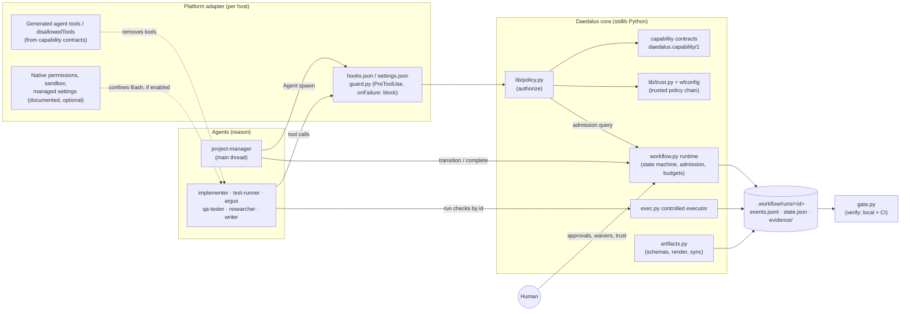

**Consolidation.** The brief's logical components (`workflow-engine.py`, `workflow-state.py`, `workflow-events.py`, `budget.py`, `policy-engine.py`, `guard.py`) collapse into **six entry points over one shared library**. A component gets its own entry point only when its caller or trust context differs:

| Entry point | Caller / trust context | Library modules it uses |
|---|---|---|
| `workflow.py` | The project-manager and commands. Subcommands: `init`, `admit`, `start`, `finish`, `fail`, `block`, `transition`, `complete`, `resume`, `reconcile`, `cancel`, `status`, `config resolve\|explain`, `classify`, `report`, `gc`, `migrate`, `doctor` | `state`, `journal`, `machine`, `budget`, `policy`, `trust`, `wfconfig`, `classify`, `fingerprint`, `artifacts` |
| `guard.py` | Host hook (`PreToolUse`, `UserPromptExpansion`/`UserPromptSubmit`, `SubagentStop`) | `policy`, `trust`, `state` (read-only plus usage and tool-call counters) |
| `exec.py` | Roles running profile commands | `trust`, `fingerprint`, `journal` |
| `gate.py` | Local verification and CI (untrusted tree, read as data) | `policy`, `classify`, `fingerprint`, `artifacts` |
| `artifacts.py` | Commands (`validate`, `render`, `check`, `sync`) | `artifacts` |
| `worktree.py` | Runtime and TDD regeneration | `fingerprint`, `gitutil` |

Existing scripts stay as they are: `detect-stack.py` (its unsafe vocabulary moves to `lib/unsafe.py`), `validate-profile.py` (becomes a wrapper), `argus-bundle.sh`, `daily-git-activity.sh`.

### 6.2 Workflow runtime and state machine (W4)

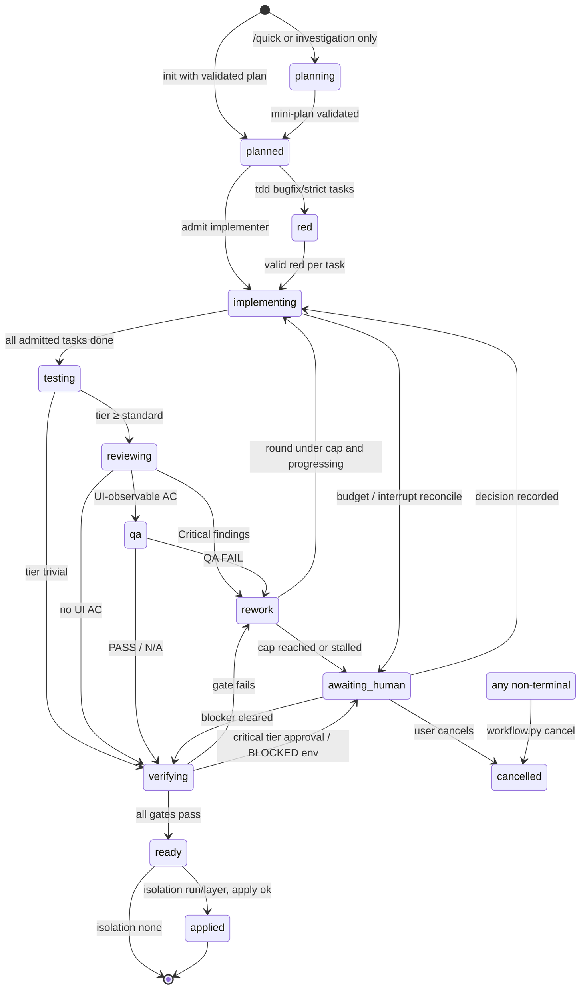

**Tier tables.** `lib/machine.py` holds one transition table per tier, and the workflow type can add states:
- **trivial:** `planned → implementing → testing → verifying → ready`.
- **standard:** adds `reviewing`; `qa` only when there are UI-observable AC.
- **full:** standard, plus `red` for bugfix-type tasks; `qa` is required for UI AC.
- **critical:** full, plus `red` for every non-waived task, `/argus-scan` on the touched paths inside `reviewing`, and a human approval event before `ready`.
- **investigation** (a type): `planning → investigating → reported`. Leaving `reported` needs a `transition --to feature|bugfix` issued by a user command and a validated plan.

**Escalation (AC-55).** `classify` runs after each implementation attempt. A higher tier switches the run to that tier's table at the current state, and the missing states are inserted ahead of `ready`.

**What is runtime-enforced and what is agent-followed.**

| Control | Enforced by | Strength |
|---|---|---|
| A role spawned out of phase, or past a cap or budget | Guard on `Agent` `PreToolUse` asks `policy.admit()`. **Fallback** when the spawn can't be identified (W0-b): the subagent's first tool call carries `agent_type` [D], and every tool call of an unadmitted agent is denied | Deterministic [C] |
| Invalid state transitions | `workflow.py transition` (code) | Deterministic |
| Completion (`ready`) | Only `workflow.py complete`, which re-evaluates gates. A `Stop` hook blocks **once** (`stop_hook_active` guard) when the final message claims production ready and the runtime disagrees | Deterministic for state; [C] for the prose check |
| The project-manager calling the runtime at all | Agent-followed. But without an admitted step, no role can be spawned or act, so skipping the runtime stalls the run rather than bypassing it | Agent-followed, safe by default |
| Main-thread implementation during a run | The guard asks (interactive) or denies (non-interactive) source edits by the main thread in orchestrator mode | Deterministic [D] for `UserPromptExpansion` mode detection |
| Engineering judgment (what to delegate, interpreting results) | The project-manager | Agent-owned by design |

**Reason codes.** Every rejection returns `{code, message, fix}`, for example `E_TRANSITION_GATE_OPEN_CRITICAL`, `E_ADMIT_BUDGET`, `E_ADMIT_PHASE`, `E_ARTIFACT_DIVERGED` or `E_NEEDS_HUMAN`. The project-manager relays `fix` to the user verbatim.

### 6.3 Run store, journal and locking (W4)

- **Write order:** take `flock(run.lock)` → append the event to `events.jsonl` (`O_APPEND`, then `fsync`) → write `state.json.tmp`, `fsync`, rename → release. A crash between the event and the snapshot leaves the snapshot behind by known `seq` numbers; `resume` replays them.
- **Journal integrity:** each event carries `prev_digest` (SHA-256 of the previous line). This catches truncation, reordering and naive edits; it doesn't stop an attacker who recomputes the chain (T14). A torn final line is truncated and recorded as `journal_repaired`.
- **Lease:** `manifest.json` holds `owner{session_id, pid, host, started}` and a heartbeat refreshed on each call. A lease is **stale** when the pid is gone on the same host, or when the heartbeat is older than `runtime.lease_ttl` (default 30 min). Taking over a stale lease is a `resume` and is journaled; taking over a live lease needs `--force` plus a user confirmation.
- **Concurrency:** all admission, reservation and transition logic runs inside the `flock`, and the critical sections never call out to agents. `fcntl` is POSIX; native Windows isn't supported (WSL works), consistent with the hub's Bash requirement.
- **Manifest:** run id (`<UTC ts>-<slug>`), Daedalus version, schema versions, plan path and digest, policy digest, tier and type, isolation mode, base revision.

### 6.4 Interrupted-run recovery (W4, AC-47)

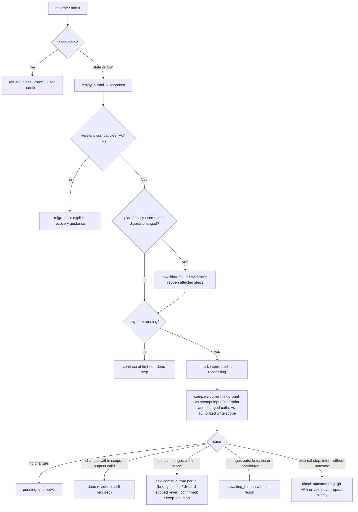

| Scenario | Behavior |
|---|---|
| Crash before any change | The fingerprint equals the input → `pending`, attempt +1. The reservation is released |
| Crash after a partial implementation | Changes are within scope → ask: continue (the new attempt's brief includes the partial diff), discard (scoped revert of only the attempt's paths, after confirmation), or hand to a human |
| Crash after implementation, before state was saved | The expected outputs (handoff JSON) are missing but source changed → treat as partial; if the handoff exists and validates, mark `done` |
| Crash during testing | Executor records with `intent` but no `outcome` are discarded; checks rerun. Any test-file edits by the test-runner are reconciled as above |
| Crash during review or QA | Review is read-only → rerun. QA mutations listed in the plan are external: never replayed without confirmation |
| External changes between sessions | Unattributed changed paths → `awaiting_human`: adopt as the new baseline (invalidates evidence) or abort |
| Plan changed after start | Plan digest mismatch → `E_ARTIFACT_DIVERGED` or invalidation; tasks whose AC changed are reopened |
| Policy changed after start | Policy digest mismatch → re-admission check; evidence bound to the old policy is stale for gates |
| Plugin upgraded mid-run | Runtime or schema version differs → `migrate` (N-1 → N), or guidance to finish on the old version or restart (AC-57) |

### 6.5 Trust hierarchy and configuration (W15)

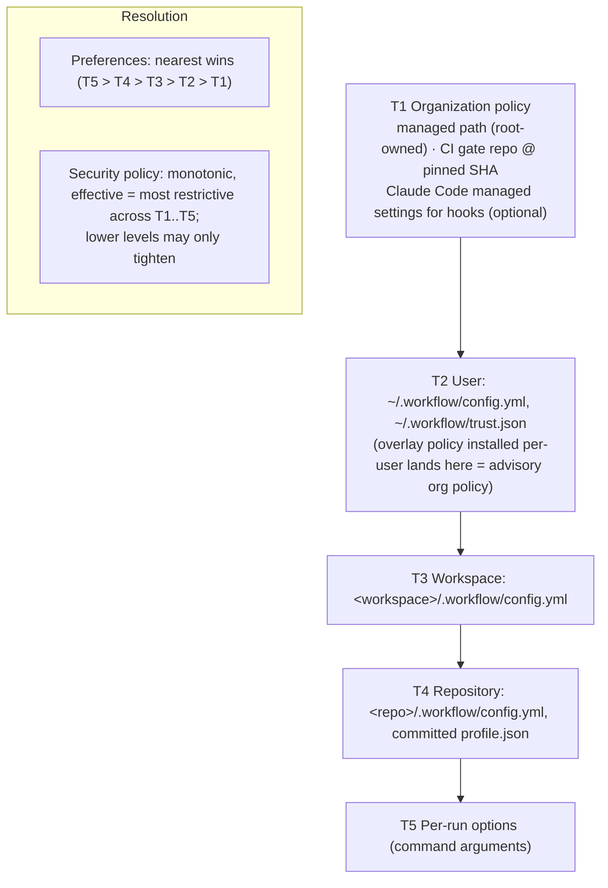

**Setting classes.** Each key in `templates/workflow-config.example.yml` gets a class in the config schema:

| Class | Examples | Who may set it | Merge |
|---|---|---|---|
| User preferences | `chat`, `review.header`, `qa.auth` notes | T2–T5 | Nearest wins |
| Project facts | `profile.json` roots, packs, detected commands | The detector (`/setup` for confirmations) | Regenerated; trust from T2 (AC-61) |
| Workflow preferences | `tickets.*`, `graph`, `stacks`, `tiers.default`, `isolation.mode`, `parallel.max_agents` | T1–T5 | Nearest wins, within T1 limits |
| Security policy | `guard.mode`, `budgets.*` ceilings, `tiers.floors`, `tiers.steps` (additive), `tdd.min`, `gate.require`, `gate.non_waivable`, `exec.env_passthrough`, `isolation.share_sensitive`, privileged allowlists | T1–T5, **monotonic** | Most restrictive wins |
| Organization governance | Trust roots, non-waivable findings, required approver role, risk signals for business-critical components | T1 only (T2 as advisory) | T1 is authoritative |
| Runtime state | `.workflow/runs/**` | Scripts only | n/a (not configuration) |

**Ordering rules for monotonic merges:**
- **Modes:** `enforce` > `warn` > `off`.
- **Ceilings:** take the minimum.
- **Required sets:** take the union.
- **Privileged allowlists:** take the intersection with the levels above (a lower level can't add entries).
- **Read-only allowlists:** only T1 and T2 can add.
- **Tier floors:** take the maximum.
- **Waivability:** the higher level's `non_waivable` always applies.
- **TDD:** take the maximum of `tdd.min`.

A T4 file that tries to weaken a key is ignored for that key and reported by `doctor` and `explain` (AC-44).

**Where T1 lives:**
1. a root-owned Daedalus policy file (`/Library/Application Support/Daedalus/policy.yml`, `/etc/daedalus/policy.yml`);
2. optionally, Claude Code managed settings that register the guard hooks with `allowManagedHooksOnly` [D], so a user or project can't remove them;
3. in CI, the organization's gate repository at a pinned SHA (§6.15).

Without any of these, organization policy installed through an overlay is **advisory (T2)** and labeled that way. The overlay format gains `policy.yml` and `risk.yml`; the installer can place them in the managed path when run by an admin.

**Repository trust (AC-61).** `~/.workflow/trust.json` stores `{repo_id (remote URL + root path), commands: {name: digest}, trusted_at}`. Committed `user` and `confirmed` entries count only when their digest is in the store. One `/setup` prompt confirms a teammate's committed set. `exec.py` and the guard both consult it.

### 6.6 Capability contracts (W15)

A contract (`daedalus.capability/1`), one per role, lives under `.claude/skills/workflow-contract/capabilities/`. Example:

```json
{"schema": "daedalus.capability/1", "role": "test-runner",
 "fs": {"read": ["**"], "write": ["@test_patterns"]},
 "commands": ["exec:profile-checks", "readonly-inspection"],
 "tools": ["Read", "Grep", "Glob", "Bash", "Edit", "Write", "Skill"],
 "integrations": [], "network": "none-declared",
 "delegation": [], "runtime_state": "none", "evidence": "via-exec-only",
 "policy_config": "none", "outputs": ["daedalus.test-report/1"],
 "enforceable": {"claude-script": {"fs.write": "hook", "tools": "native", "network": "sandbox-if-enabled"},
                 "claude-plugin": {"fs.write": "hook", "tools": "native", "network": "sandbox-if-enabled"},
                 "cursor": {"fs.write": "unverified", "tools": "unsupported", "network": "sandbox"},
                 "codex": {"fs.write": "session-sandbox-only", "tools": "unsupported", "network": "sandbox"}}}
```

| Role | Writes | Commands | Tools (native list) | Delegation | Notes |
|---|---|---|---|---|---|
| project-manager (main thread) | `docs/plans/**` (rework plans), `docs/qa/**` | Runtime and artifact CLIs, read-only inspection | Host default | All roles, through admission | Source edits → ask or deny during a run |
| implementer | Task `writes`, its tests, within the root or worktree | Any, except deny or unsafe or git-mutate; unknown → allow and audit (D20) | Read, Grep, Glob, Bash, Edit, Write, Skill | None | Least constrainable role: worktree, review and CI compensate |
| test-runner | `@test_patterns` | `exec:profile-checks` plus read-only | Read, Grep, Glob, Bash, Edit, Write, Skill | None | Evidence only through `exec.py` |
| argus | None | None (bundle provided) | Read, Grep, Glob, Skill | None | **Bash removed** (AC-3) |
| qa-tester | Screenshots in a run-scoped folder (written by the parent) | None | Read, Grep, Glob, pinned Playwright MCP tools | None | Navigation limited to localhost (AC-67) |
| tech-stack-researcher | None | None | Read, Grep, Glob, WebFetch, WebSearch, Skill | None | **Bash removed**; output is untrusted-framed |
| technical-writer | `docs/**`, `*.md`, `README*` | Read-only | Read, Grep, Glob, Edit, Write, Skill | None | **Bash removed** unless a doc build command is in the profile |

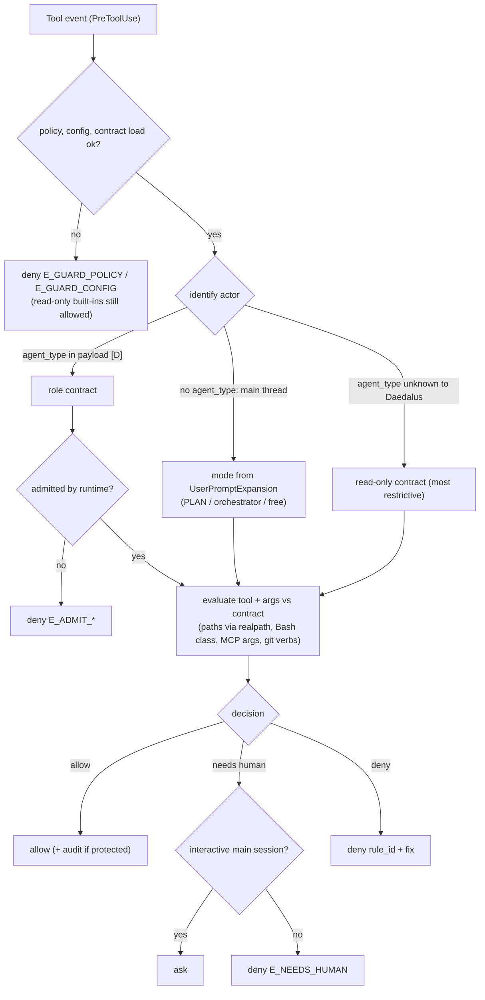

### 6.7 Guard and controlled executor (W1)

**Registration.** `PreToolUse`, `type: command`, `onFailure: "block"` [D, Claude Code ≥ the version P0 records], with matchers `Bash`, `Edit|Write|NotebookEdit`, `Agent`, `mcp__.*`, `WebFetch` and `WebSearch`. The guard also registers `UserPromptExpansion` (mode detection), `SubagentStop` (usage and reservation reconciliation) and `Stop` (the completion-claim check).

`session-init.sh` keeps failing open, because context injection must never brick a session. The guard is the only fail-closed hook.

**Bash classification** (`lib/policy.py`, `shlex` plus an operator split):

| Class | Examples | Read-only roles | test-runner | implementer | Main thread |
|---|---|---|---|---|---|
| readonly-inspection | `git diff\|log\|show\|status`, `grep`, `rg`, `ls`, `cat`, `find` (no `-exec` or `-delete`), `jq` | allow (fallback only, AC-3) | allow | allow | allow |
| executor | `exec.py run <root> <id>` | deny | allow | allow | allow |
| profile-command (raw) | `npm test` typed directly | deny | deny ("use exec.py") | allow if trusted; ask otherwise | ask if untrusted |
| git-mutate | commit, push, reset, clean, stash, checkout of paths, branch `-D`, `config` | deny | deny | deny | ask (interactive) / deny |
| unsafe | profile `unsafe`, deploy, migrate, publish, `terraform apply`, … | deny | deny | deny | ask / deny |
| indirect | `bash -c`, `sh -c`, `python -c`, `node -e`, `xargs`, `find -exec`, `env … cmd`, `npx`, `eval` | deny | deny | ask / deny | ask / deny |
| complex | `$(…)`, backticks, heredocs, redirection outside the root | deny | deny | allow if all targets are in scope; else ask | allow and audit |
| network | `curl`, `wget`, `nc`, `ssh`, `scp` | deny | deny | ask | ask |
| unknown | anything else | deny | deny | allow and audit (D20) | allow and audit |

**Self-protection paths** (deny writes for every agent; ask in the interactive main thread): `.workflow/runs/**`, `.workflow/config.yml`, `.workflow/profile.json` (except `detect-stack.py`), `.claude/settings*.json`, `.claude/hooks/**`, `.claude/scripts/**`, `${CLAUDE_PLUGIN_ROOT}/**`, `~/.claude/plugins/**`, `~/.workflow/**`, and the managed policy paths.

**Non-interactive detection:** the payload's `permission_mode` (`dontAsk` means non-interactive [D]), plus `DAEDALUS_NONINTERACTIVE=1`, which the benchmark and CI set. P0 confirms whether `-p` is detectable from the payload (AC-1f).

**Controlled executor (`exec.py`, AC-62).**
- Resolves `<root>:<name>` from the profile, plus the trust store.
- **No shell:** `shlex.split`. A command that contains shell operators is `shell: required` → needs repository trust, and is then run with `bash -c`.
- **Environment:** an allowlist (`PATH`, `HOME`, `LANG`, toolchain variables, plus `exec.env_passthrough`).
- **Limits:** `timeout`, output capped and redacted (token, key and password patterns).
- **Evidence:** records `intent` and then `outcome`, with structured test results when the pack declares a reporter (`test_report`).
- **Read-only operations** for removed-Bash roles: `exec.py ro git-log|git-blame|git-show <args>`, validated arguments, no shell.

### 6.8 Budgets and admission (W2)

| Limit class | What | Mechanism | Strength |
|---|---|---|---|
| Advisory | Soft token thresholds, context budgets per role | Ask in the interactive main thread; a warning otherwise | Advisory |
| Spawn admission | Run, phase and role token ceilings; rework and QA rounds; concurrent agents | `policy.admit()` under the lock; the guard denies the `Agent` call or the first tool call | Deterministic for **new** work |
| Enforceable execution | Tool calls per attempt, wall clock per attempt | The guard counts each attempt's tool calls and denies past the cap or deadline; the agent can only finish its reply | Deterministic at tool-call granularity |
| Host-controlled | `maxTurns` (frontmatter); `--max-turns` and `--max-budget-usd` (`-p` only; client-side estimate that can overshoot) [D] | Host | Host-enforced, approximate for cost |
| Not enforceable | Tokens generated inside a single model turn | — | [U]. Documented, not claimed |

```mermaid
sequenceDiagram
  participant PM as project-manager
  participant G as guard.py (PreToolUse Agent)
  participant RT as workflow.py (lock)
  participant SA as subagent
  participant SS as guard.py (SubagentStop)
  PM->>RT: admit step S (role, estimate)
  RT->>RT: flock; check phase, rounds, active below max_agents,<br/>remaining minus reserved ≥ estimate
  RT-->>PM: admitted (reservation id) or E_ADMIT_*
  PM->>G: Agent(spawn role)
  G->>RT: is S admitted and unspawned?
  RT-->>G: yes → allow (bind agent_id on first tool call)
  SA->>G: tool calls (agent_type, agent_id)
  G->>RT: count calls; deadline/turn caps
  SA-->>SS: stop (agent_transcript_path)
  SS->>RT: parse usage by category; reconcile reservation; release
```

### 6.9 Rework convergence (W2)

**Fingerprint:** `fp = sha256(fm_family | ac_id | component | normalized_title)`.
- `component` is the enclosing symbol when the pack's simple symbol regex finds one, otherwise the file path without line numbers.
- `normalized_title` is lowercase, with numbers, paths, quoted literals and stop-words removed.

Findings match when their fingerprints are equal, or when they have the same `fm_family`, the same component and a token Jaccard ≥ 0.6 on the normalized titles. Argus' own re-matching by `argus-finding` id stays the primary signal; the fingerprint is the deterministic fallback.

**Stall signals.** Any one of these marks round N as not progressing:
1. Critical fingerprints in N ⊇ those in N-1.
2. The same failing test ids in N and N-1.
3. The relevant source digest is unchanged between the starts of N-1 and N.
4. The remediation diff digest repeats an earlier round's.
5. Critical count in N > N-1 (divergence).

**On a stall:** the runtime writes `escalation.json` (`daedalus.escalation/1`) and `escalation.md` (rounds, attempts, unresolved fingerprints with evidence, options and the decision needed), then moves to `awaiting_human`.

### 6.10 Canonical artifacts and evidence provenance (W8)

**Canonical form.** JSON is the contract.
- **Reports** (handoff, test, review, QA, gate, escalation) are rendered to Markdown with `<!-- daedalus:json sha256=… -->`.
- **Plans** keep editable Markdown for prose; contract sections sit between `<!-- daedalus:contract:<section> -->` fences, parsed in a fixed format (`- **AC-n.** …`, task tables, File-change lists). `check` compares them with the JSON; `sync` resolves in either direction, then revalidates and invalidates.

**Source fingerprint** (`lib/fingerprint.py`):
1. Take the entries of `git ls-files -s` (mode, blob, path).
2. For each modified tracked file, replace the blob with `git hash-object` of the working-tree content. Deleted files become a tombstone (`000000`).
3. Add untracked, non-ignored files (`git ls-files -o --exclude-standard`) with `hash-object`. A symlink contributes its mode `120000` and the hash of its link text; it is never followed.
4. Remove paths under the **generated-report exclusions**: `docs/reviews/**`, `docs/qa/**` (reports and screenshots), `docs/traces/**`, `docs/scans/**`, `.workflow/runs/**`.
5. Sort by path, then `sha256` over `mode\0blob\0path\n`.

Per-root digests use the same steps restricted to each profile root. **Not excluded:** `docs/plans/**` (bound through `plan_digest`, and part of the source), `.workflow/config.yml` (bound through `policy_digest`), and `.workflow/profile.json` (bound through `commands_digest`). The result doesn't depend on the index (staged and unstaged count the same) and is reproducible in CI from the same tree.

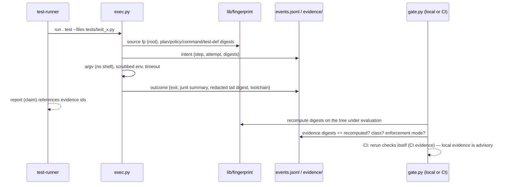

**Evidence classes:**
- `claim`: a role's JSON;
- `local`: written by the executor;
- `ci`: written by the gate's checks job;
- `human`: a GitHub-side action by an authorized user, or a local approval recorded in the journal. A local approval is advisory in CI.

### 6.11 Risk, tiers and workflow types (W10)

| Dimension | Example signals (packs, overlays, plan) | Tier floor |
|---|---|---|
| Authentication, authorization, tenant isolation, sensitive data, financial, secrets | Auth middleware, `tenant_id`, PII fields, payment SDKs, secret stores | **critical** |
| Schema migration, database mutation, irreversible change (no down migration) | `migrations/**`, `ALTER`, `DELETE FROM`, data backfills | full (critical when irreversible) |
| Public API contract, external integration, external side effects | OpenAPI or proto or GraphQL files, new HTTP clients, queues | full |
| Infrastructure, CI/CD, shared dependency | IaC, `.github/workflows/**`, lockfile major bumps | full |
| Low existing test coverage on changed files | No test file matches the changed module | +1 tier step (max full) |
| Business-critical components (overlay `risk.yml`) | Organization globs | Set by the organization (T1) |
| Size only | ≤ `trivial_max_files`, one layer, no dimension | trivial; otherwise standard |

`Security: critical` in the plan → **critical**. A declared tier can only raise the computed one.

**Type × tier.** `type` decides the sequence and the evidence; `tier` decides governance.

| Type | Sequence and evidence | Initial? |
|---|---|---|
| `feature` | Current cycle | Yes |
| `bugfix` | Reproduction test (red) before the fix, unless waived with a reason; regression green | Yes |
| `investigation` | Read-only roles only; output is a findings report; leaving it needs an explicit user transition plus a plan | Yes |
| `refactor`, `performance`, `migration`, `security-remediation`, `docs`, `hotfix` | Behavior-preserving checks; measure before optimizing (from `/code-optimize`); rollback and compatibility; and so on | Deferred until there's demand (§3.3) |

### 6.12 TDD evidence (W7)

A red record is **strong** only when the pack's reporter (`test_report`: JUnit XML, `go test -json`, TRX, and so on) shows the target test id was collected, ran and failed with an assertion-class outcome, and the failure doesn't match the environment taxonomy:
- import or module errors, compile errors outside the target files;
- connection refused or a missing service, fixture or setup errors;
- runner configuration errors, a missing executable;
- failures in tests other than the target.

When a run fails for one of those reasons, the record is `BLOCKED (env)`, not red. The red and green records share `test_id` and `test_def_digest` (the digest of the test files involved). Changing a test after red triggers regeneration on the original revision in a temporary worktree (`worktree.py`, P3 helper). Tasks map to AC through the plan JSON, and the gate checks each non-waived AC of bugfix-type and strict tasks for a red→green pair.

### 6.13 Isolation (W6)

| Kind | What it gives | Mechanism | Not provided |
|---|---|---|---|
| Source isolation | The developer's checkout is untouched while agents work | `worktree.py` detached worktree outside the repo (`<user cache>/daedalus/worktrees/<repo>-<run>[-<task>]`) | Any runtime confinement |
| Dependency isolation | Installs in the worktree don't mutate the developer's dependency folders | `clone` (APFS `cp -c`, `cp --reflink` where supported), `install` (trusted profile command), `link` (explicit, marked shared), `none` | Protection from post-install scripts |
| Execution isolation | Limits on filesystem and network for commands | Host sandbox only [D] | **Nothing Daedalus does itself** |

**Snapshot baseline.**
1. Create the worktree at HEAD.
2. Apply the developer's tracked diff (`git diff --binary HEAD`) and copy untracked, non-ignored files, excluding sensitive patterns.
3. Record the baseline tree with `git add -A && git write-tree` **inside the worktree's own index**. That creates no commit or ref, and the developer's index isn't touched (staged state isn't reproduced; this is documented).

**Applying back.**
1. Run `git diff --cached --binary -M <baseline-tree>` inside the worktree: renames, deletions, mode changes and binaries are included.
2. Run `git apply --check --3way` on the developer's checkout.
3. On any conflict, apply nothing, save `artifacts/apply.patch`, and report.
4. Otherwise apply. Paths the developer changed after the snapshot are 3-way merged or refused, and are never overwritten.

**Native host isolation** (Claude Code `isolation: worktree`) creates a `worktree-<name>` branch under `.claude/worktrees/` and blocks main-checkout writes from file tools [D]. It's usable when the user opts into branch creation, but Daedalus' helper is the default (D21).

### 6.14 Scheduling and parallel integration (W5)

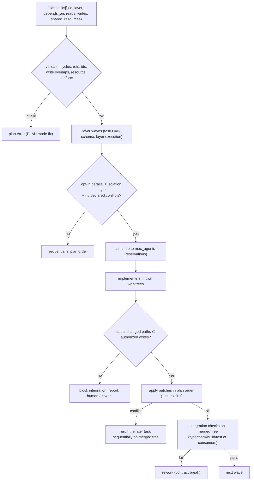

### 6.15 Independent CI governance (W9)

**Facts that shape the design** [D, GitHub docs, 2026-11]:
- Under `pull_request`, the workflow file comes from the PR's merge commit, so a PR can edit or delete a repository-level gate workflow. Pinning a called reusable workflow by SHA doesn't help, because the caller file is editable.
- Fork PRs get no secrets and a read-only token.
- `pull_request_target` runs with base-repository secrets and write tokens. It's blocked by default in public repos from 2026-12-02, and `actions/checkout` v7 refuses fork code under it.
- An organization ruleset that requires a workflow can pin the source repository, path and **SHA**. Its availability on the Team plan is unsettled, so P5 verifies it in the target organization.
- Required status checks can be pinned to an app through `integration_id`. Anyone with write access can set a status with the same name.
- Label events record the actor, but labels race with new pushes.
- Artifact attestations (`actions/attest`) can sign any file. Private repositories need Enterprise Cloud, and the signature proves which workflow produced the file, not that its content is true.

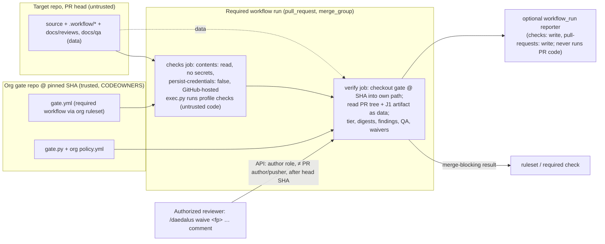

| Mode | How it's installed | What a PR can do | Claim |
|---|---|---|---|
| **Advisory** | A repository caller workflow (`/setup --ci`) that uses the reusable workflow at a pinned SHA | Edit or remove it | Reporting only; never described as enforcement |
| **Enforced (rulesets)** | An organization ruleset requiring `gate.yml` from the gate repository at a SHA [D, plan-dependent] | Nothing: the workflow and policy come from the gate repository; PR config can only tighten | Merge governance |
| **Enforced (app)** | A required check pinned to a dedicated GitHub App (`integration_id`) that runs the verify logic | Nothing, unless the app itself is compromised | Merge governance; more setup |

**Freshness.** A review or QA record is fresh only when its `source_fingerprint` (or the per-root digests of the roots it covered), `plan_digest`, `policy_digest` and `commands_digest` all equal the values the gate recomputes on the PR head, and its `head_sha` and `base_sha` are ancestors of the head. Revision 1's blanket "artifact-only" exemption is removed. Only the generated-report paths listed in §6.10 are excluded.

**Waivers (AC-54).**
- **Request:** a PR comment `/daedalus waive <fp-or-id> reason:"…" expires:<date> [ticket:<key>] [controls:"…"]`.
- **Checks:** the gate verifies through the API that the commenter's role is at least `gate.approver_role`, that they are neither the PR author nor the last pusher, that the comment is newer than the reviewed head, that the finding is waivable under the effective policy, and that the waiver hasn't expired.
- **Lapse:** a later change to the finding's component digest makes the waiver stale.
- **Agents:** they can't author waivers; local waiver files are advisory and ignored by enforced gates.

### 6.16 Context intelligence (W16)

- **Minimum, P2:**
  - **Manifest:** a context manifest is written with every handoff (AC-64).
  - **Untrusted delimiters:** `<untrusted source="ticket:ENG-1" trust="external">…</untrusted>`, plus one rule in every role prompt.
  - **Staleness:** a manifest digest that no longer matches flags stale context at admission.
  - **Measurement:** the benchmark counts repeated reads per agent with `PreToolUse` Read counters, in benchmark mode only.
- **Benchmark-dependent, P6:**
  - deduplicate pack sections across a role's briefs;
  - cache the profile and pack excerpts by digest;
  - per-role context budgets enforced at brief assembly;
  - graph-assisted orientation stays optional (graphify).

  No vector store or embeddings (§3.3).

### 6.17 Observability and retention (W8; absorbs W17)

- **Events:** `daedalus.event/1` in `events.jsonl` (AC-46) is the one telemetry source. `report.py` (`workflow.py report`) derives the AC-28 metrics.
- **Retention defaults:** `runs.keep_days: 30`, `runs.keep_failed_days: 90`, `evidence.keep_with_run: true`, `audit.keep_days: 30`. Transcripts are never copied, and usage is parsed and discarded. Enforced by `workflow.py gc` (manual, or the `doctor` suggestion).
- **Privacy:** metadata only by default. `telemetry.export` is `none`, and any exporter is opt-in and deferred.

### 6.18 Distribution lifecycle, migration and compatibility (W18)

| Concern | Strategy |
|---|---|
| Versions | Semver plugin version (`build-plugin.sh` VERSION) recorded in run manifests. Each persisted format has its own major version |
| Minimum platform | P0 records the minimum Claude Code version (`onFailure`, `UserPromptExpansion`, `agent_type`). `doctor` and the session banner check it; below it, the guard is labeled [C] |
| Schema and config migrations | `workflow.py migrate`: N-1 → N with backups. The profile keeps `rules_digest` regeneration plus the `SCHEMA_VERSION` bump. Config keys that are renamed are mapped and warned about for one major version |
| Old runs | Resume after migration, or guidance to finish on the old version or restart |
| Script install | `install.sh --upgrade` writes generation N+1 into a staging folder, verifies it (hook dry run, `validate`), swaps files with backups and swaps hook registration last. `--rollback` restores N |
| Plugin install | Marketplace versions. The docs cover pinning a version and rolling back by reinstalling the previous one |
| Reproducible build | Sorted traversal, no timestamps, `plugins/BUILD-MANIFEST.json` with file digests; `--check` in CI |
| Smoke tests | Per release, on the script (user and project) and plugin installs (and Cursor once W12 ships): session start, guard deny fixture, executor run, `workflow.py init/resume`, `doctor` |

### 6.19 Platform capability and guarantees matrix

Status as of 2026-11-25 from official docs [D]. P0 converts [D] to verified, or to [C] with a fallback. CC = Claude Code.

| Guarantee | CC script install | CC plugin install | Cursor | Codex | CI (GitHub) |
|---|---|---|---|---|---|
| Hook can deny a shell or MCP call | Yes [D] (`PreToolUse` deny, exit 2) | Yes [D] (plugin `hooks/hooks.json`) | Yes [D] (`beforeShellExecution`, `beforeMCPExecution`, `preToolUse`) | Yes [D] (`PreToolUse` deny, exit 2; no `ask`) | n/a |
| Hook can deny a file edit before it lands | Yes [D] (`Edit\|Write`) | Yes [D] | Implied only (`preToolUse` `Write`): **verify** | Implied (`apply_patch`): **verify** | n/a |
| Hook fails closed on a crash or timeout | `onFailure: "block"` [D] (min. version in P0) | Same [D] | `failClosed: true` [D] (not for dashboard hooks) | **Not documented** → [C] | n/a |
| Role identity on every tool call | `agent_id`, `agent_type` [D] | Same [D] | Only on `subagentStart` → per-role tool policy [U] | Tool hooks carry no agent identity → [U] | n/a |
| Native per-role tool removal | `tools` / `disallowedTools` [I] | Same (honored for plugin agents) [D] | `readonly: true` only [D]; no tool lists | None; subagents inherit the sandbox [D] | n/a |
| Per-agent hooks or permission mode | Supported [D] | **Ignored for plugin agents** [D] | n/a | Can't override sandbox or approval [D] | n/a |
| Org-locked policy | Managed settings, `allowManagedHooksOnly` [D] | Same | MDM `hooks.json`; team run-mode policy [D] | `requirements.toml`, `allow_managed_hooks_only` [D] | Org ruleset required workflow [D, plan-dependent] |
| Sandbox for commands | Bash and children, opt-in, macOS/Linux/WSL2 [D] | Same | macOS/Linux, network blocked by default [D] | read-only / workspace-write, network off by default [D] | Ephemeral runner |
| Network restriction for Bash | Sandbox only [D]; otherwise [U] | Same | Sandbox [D] | Sandbox [D] | Runner egress (org-controlled) |
| Turn cap per role | `maxTurns` [D] | `maxTurns` honored [D] | Not documented | Not documented (session-level) | n/a |
| Token usage per subagent | Transcript path on `SubagentStop` [D] (parse) | Same | Changelog only (stream-json) | `turn.completed.usage` [D] | n/a |
| Main-thread mode detection | `UserPromptExpansion.command_name` [D] | Same | `beforeSubmitPrompt` prompt text | `UserPromptSubmit` [D] | n/a |
| Worktree isolation | Daedalus helper [P]; native `isolation: worktree` [D] creates a branch | Same | Helper [P] | Helper [P] | n/a |

**Consequences:**
- Per-role deterministic enforcement is a **Claude Code** guarantee.
- On Cursor and Codex, Daedalus can enforce **session-level** policy (deny unsafe or git-mutating commands, protect paths, fail closed on Cursor), and relies on Cursor `readonly` or a whole-session sandbox for read-only roles.
- The guarantees guide (AC-60, AC-38) must say this per cell.

### 6.20 Benchmark methodology (W3)

- **Sets and categories:** a development set and a held-out evaluation set (AC-9), across small, medium, large, security-sensitive, adversarial and recovery tasks.
- **Execution boundary:**
  - one fresh clone per run, in a temporary directory;
  - held-out tests stored outside the clone (and denied to reads through the sandbox where available);
  - a local bare remote to detect pushes;
  - `DAEDALUS_NONINTERACTIVE=1`.
- **Arms** (AC-11), with versions recorded per result:
  - native Claude Code;
  - `daedalus@0.4.0`;
  - current Daedalus;
  - Superpowers (MIT; has mandatory design approval and commits on its own);
  - OpenSpec (MIT; CLI and skills, Node ≥ 22.20, telemetry on by default → disabled);
  - GitHub Spec Kit (MIT; `specify workflow run` drives `claude -p` with review gates on resume);
  - BMAD (MIT; v6 stable, v7 alpha: pick one per study).
- **Fairness:**
  - **Same model and effort for every agent:** subagent model overrides disabled or logged.
  - **Same permissions and same auto-approver:** a scripted "human" approves mandatory gates, and each approval counts as an intervention.
  - **Exclusions:** each arm's own artifacts (`docs/superpowers/`, `.specify/`, `specs/`, `_bmad*/`, `openspec/`, Daedalus `docs/plans|reviews|qa`) are excluded from scoring and from the unnecessary-change metric.
  - **Full cost counted:** planning, setup, implementation, testing, review and rework.
  - **Remaining differences:** written per arm in the results file.
- **Metrics:** the AC-10 list. The primary efficiency metric is cost per verified task (AC-56).
- **Statistics:** k = 3 for development; k ≥ 5 (or until the 95% interval on the pass rate is within ±10 points) before any release or comparative claim. Each result carries the median, the interquartile range and the noise band.
- **Where it runs:** first in a restricted maintainer environment, later on a private dedicated runner. Never in public PR CI.

### 6.21 Configuration keys (additions to `templates/workflow-config.example.yml`)

In the comments, **S** marks a security-class key (monotonic merge) and **P** a preference (nearest wins).

```yaml
guard:
  mode: enforce                 # S enforce | warn | off  (warn/off = NOT enforcing; recorded in evidence)
  readonly_bash_allow: []       # S extra read-only prefixes; T1/T2 only
budgets:
  rework_rounds: 3              # S ceiling (min wins)
  qa_rounds: 2                  # S
  run_tokens: {soft: null, hard: null}       # S admission ceilings; calibrated from P0 data
  attempt: {tool_calls: 200, wall_minutes: 45}   # S enforced via guard
  role_turns: {implementer: 60, test-runner: 40, argus: 40, qa-tester: 60}  # S → maxTurns
  price_table: null             # P optional; no built-in prices
tdd:
  mode: off                     # P off | bugfix | strict (promotion is benchmark-driven)
  min: off                      # S floor; org may set bugfix for critical tier
tiers:
  default: auto                 # P
  trivial_max_files: 3          # S (min wins)
  floors: {}                    # S dimension → minimum tier (max wins)
  steps: {}                     # S additive only
isolation:
  mode: none                    # P none | run | layer
  baseline: snapshot            # P snapshot | head
  dependencies: none            # P clone | install | link | none
  share_sensitive: []           # S per-path, T2 only
  root: null                    # P
  ttl_days: 7                   # P
parallel:
  enabled: false                # P (benchmark-driven)
  max_agents: 2                 # S (min wins)
exec:
  env_passthrough: []           # S (intersection below T2)
  timeout_minutes: 20           # S
gate:
  mode: advisory                # S advisory | enforce (enforce meaningful only with rulesets/app)
  require: [checks, review, qa] # S union
  non_waivable: []              # S union, e.g. [FM-13, FM-14]
  approver_role: maintain       # S (stricter wins)
specs:
  system: auto                  # P auto | openspec | none
runtime:
  lease_ttl_minutes: 30         # P
retention: {runs_days: 30, failed_runs_days: 90, audit_days: 30}   # P
telemetry: {export: none}       # S none unless T1/T2 opt-in
```

### 6.22 Artifact and run layout (target repository)

```
docs/plans/<slug>.md + <slug>.json                 committed: contract (JSON canonical, MD contract fences)
docs/plans/quick/<slug>.md + .json                 committed
docs/reviews/<repo>-<branch>-<sha7>.md + .json     committed: excluded from the source fingerprint
docs/qa/<slug>-qa-N.md + .json (+ screenshots)     committed: excluded from the source fingerprint
.workflow/profile.json, config.yml                 committed (D5); trust comes from ~/.workflow/trust.json
.workflow/.gitignore                               "runs/"
.workflow/runs/<UTC-ts>-<slug>/
  manifest.json  state.json  events.jsonl  usage.json
  handoffs/<step>.{md,json,context.json}
  evidence/<id>.json   checkpoints/<step>.json   artifacts/{apply.patch,escalation.*}
~/.workflow/config.yml, trust.json                 user (T2)
/etc/daedalus/policy.yml (or macOS equivalent)     organization (T1), root-owned
<user cache>/daedalus/worktrees/<repo>-<run>[-<task>]/   never inside the repo
```

---

## 7. Architecture decisions

D1–D8 (ARCHITECTURE §13) are unchanged. Revision 1's D9–D17 are revised as shown, and D18–D28 are new.

| ID | Decision | Instead of | Why | Status |
|---|---|---|---|---|
| D9 | **Fail closed** on protected operations: the guard uses `onFailure: "block"` [D] and returns deny with a rule id on any evaluation failure. `ask` is never a fallback for an error, and context hooks keep failing open | Rev 1: `ask` on internal error | An approval prompt after an error could turn a broken guard into an allowed call, and `ask` is denied or unanswered in `-p` and background runs [D] | Revised |
| D10 | Scripts write evidence, **bound to source, plan, policy, command and test digests** with an evidence class | Rev 1: evidence with a tree hash | Freshness needs to know *what* changed; a tree hash alone invalidates on any edit and misses policy changes | Revised |
| D11 | Stdlib only: a strict YAML subset reader **and a documented JSON Schema subset that rejects unknown keywords** | Rev 1: unstated subset | F4: the current validator silently accepts schemas it can't check | Revised |
| D12 | Run state is local and uncommitted. **Validated JSON is canonical**; Markdown is rendered (reports) or contract-fenced (plans) | Rev 1: Markdown plus JSON sidecars with no sync rule | Prevents silent divergence (AC-49) | Revised |
| D13 | Isolation is opt-in until the benchmark shows parity | Same | Unchanged rationale; dependency isolation added | Kept |
| D14 | CI reruns the checks **and loads gate code and mandatory policy from a trusted, pinned source**. A repository-level gate is advisory | Rev 1: CI reruns only | A PR can edit its own `pull_request` workflow [D] | Revised |
| D15 | Tier is re-derived from the real diff **across risk dimensions**. `Security: critical` → critical. Tier steps are additive only | Rev 1: path globs; `Security: critical` → full | Revision 1 under-tiered declared security work | Revised |
| D16 | The spec adapter is optional and goes **through the OpenSpec CLI (`--json`)**, pinned, with telemetry off | Rev 1: unspecified | Its skills and commands changed in 2.0 and its docs lag [D]; the CLI contract is stable | Revised |
| D17 | Cross-platform is **capability-based**: each platform cell is enforced, conditional, prompt-only or unavailable. Codex stays a spike | Rev 1: "matrix" | Cursor and Codex tool hooks lack agent identity [D], so per-role guarantees don't carry over | Revised |
| D18 | **The runtime is a CLI state machine with a write-ahead journal.** No daemon or DSL. The project-manager keeps the judgment and the runtime keeps the transitions | A service or a generic engine | Lightweight, crash-safe, testable as a table | New |
| D19 | **Security policy merges monotonically** across T1–T5. T1 needs a root-owned path, managed settings or the CI gate repository; overlay policy installed per user is advisory T2 | Nearest-wins for everything | F3: the repository overrides organization choices today | New |
| D20 | **"Unknown" Bash is relative to the role's capability.** The implementer's contract grants general build and dev commands (allow and audit; risky classes ask or deny). Every other role: deny as a subagent, ask in the interactive main thread | Brief: ask or deny everywhere | Asking on every `pytest -x` or `mkdir` would make the implementer unusable; the risky classes stay gated | New (adjusts the brief) |
| D21 | Daedalus' own `worktree.py` (detached, no commits or branches) is the default isolation helper. Native `isolation: worktree` is opt-in | Native isolation by default | Native isolation creates `worktree-<name>` branches [D], which conflicts with the no-branch rule | New |
| D22 | **Remove capabilities natively before inspecting them.** Argus, the researcher and the writer lose Bash; data comes from bundles or `exec.py ro` | Allowlist parsing as the primary control | Native tool lists are enforced by the host [I/D]; parsing is best effort | New |
| D23 | **Committed commands need user trust** (`~/.workflow/trust.json`, keyed by digest) | Trusting committed `user` and `confirmed` entries | F1: a repo can pre-authorize arbitrary commands | New |
| D24 | **TDD defaults to `off`.** `bugfix` becomes the default only on benchmark evidence | Rev 1: `bugfix` default | Brief recommendation; red validity needs pack reporters first | New (reverses rev 1) |
| D25 | **Gate enforcement needs an organization ruleset (pinned SHA) or an app-pinned required check.** Otherwise it's advisory | A gate in the repository's own workflow | [D] GitHub: the PR can rewrite caller workflows; anyone with write access can set a status with the same name | New |
| D26 | **Waivers are per finding,** from authorized GitHub-side comments, bound to digests, with expiry; never self-approved | Rev 1: `daedalus:waive` label | Labels are broad and race with pushes [D] | New |
| D27 | Merge W14 into W4, and W17 into W4 (events) and W8 (metrics) | Five new workstreams | Shared state store, lock and CLI; no duplicate owners | New |
| D28 | **Benchmark arms and fairness:** native, then 0.4.0, then current, then Superpowers, then OpenSpec, then Spec Kit, then BMAD. External arms are public definitions in `bench/` (never shipped); one auto-approver; same model; each arm's artifacts excluded | Rev 1: external arms local only | Public arms are reproducible and not organization-specific; `bench/` isn't in `.claude/`, so the plugin build never ships it | New |

**Decisions that depend on P0:**
- D9 (minimum host version for `onFailure`);
- D20 (identity in parallel spawns);
- D21 (native isolation behavior);
- D22 (what each role actually needs);
- D25 (ruleset availability on the organization's plan).

---

## 8. Phase sequencing

### 8.1 Workstream dependency graph

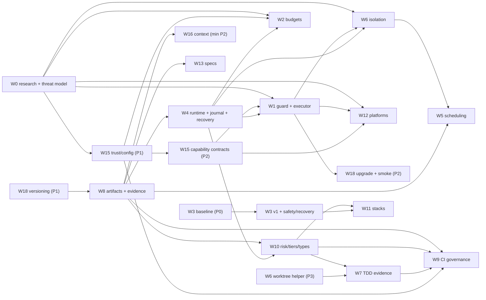

### 8.2 Phase roadmap and milestones

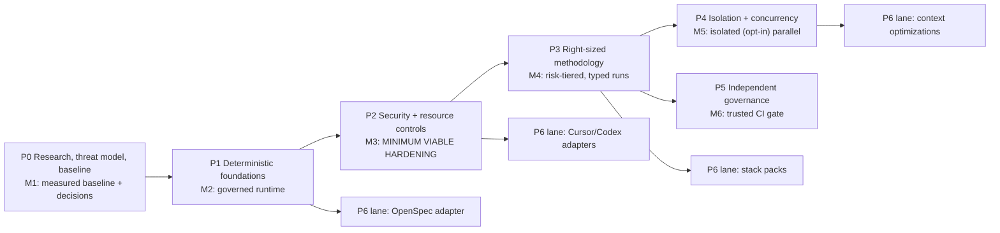

| Phase | Workstreams | Why here | Exit (milestone) |
|---|---|---|---|
| **P0** | W0, W3 baseline | Design depends on platform facts and the threat model; the baseline must come before any behavior change | **M1:** AC-1, AC-59; baseline results for arms 1–2 (AC-9–11 subset, AC-56); decision records for D9, D20–D22, D25 |
| **P1** | W8, W4, W15 trust and config, W18 versioning | Everything later reads canonical artifacts, run state, trusted config and evidence | **M2:** AC-13–15, 25–27, 43, 46–49, 57, 61 |
| **P2** | W15 contracts, W1, W2, W3 v1, W16 minimum, W18 upgrade, W12 Claude Code matrix | Critical controls on top of the foundations | **M3 = MVH (§3.4):** AC-2–8, 12, 28, 45, 50, 58, 60, 62, 64, 65, 67 |
| **P3** | W10, W7, W6 helper, pack fields (AC-36) | Needs the runtime (escalation), evidence (TDD) and the guard | **M4:** AC-22–24, 32–34, 36, 52, 55, 63 |
| **P4** | W6, W5 | Parallelism needs isolation and write-scope validation | **M5:** AC-16–21, 51 |
| **P5** | W9 | Needs artifacts, tiers, TDD evidence and trust. **Can overlap P4** (disjoint files) | **M6:** AC-29–31, 53, 54 |
| **P6** | W11, W12 (Cursor, Codex), W13, W16 advanced, W18 platform lifecycle | Ecosystem; never blocks M1–M6 | **M7:** AC-35, 37–41 |
| Every phase | Benchmark rerun, operational QA, hub hygiene | Measured promotion | AC-12, AC-42, AC-66 |

### 8.3 P6 is not fully independent

| Lane | Depends on | Files it shares | Rule |
|---|---|---|---|
| W12 Cursor and Codex | W1, W15 contracts, W18 (install lifecycle) | `install.sh`, `build-plugin.sh`, `check.yml`, `lib/policy.py` adapters | Owns packaging changes in P6; W18 platform work goes after it |
| W11 packs | **W10** (`risk_globs`, `risk_patterns`; P3), W3 (benchmark tasks) | `detect-stack.py` (new primary manifests: `pom.xml`, `build.gradle*`, `Gemfile`, `Cargo.toml` handling), `profile.schema.json`, `matrix.json` | New pack files can go in parallel; **detector and schema edits are serialized** with W13 |
| W13 OpenSpec | W8 (plan schema) | `detect-stack.py` (`integrations.specs`), `profile.schema.json`, `feature-plan.md`, `project-manager.md`, `argus/SKILL.md` | Its detector change lands before W11's detector change |
| W16 advanced | W3 data | `artifacts.py`, briefs in `project-manager.md` | After P4 (both edit `project-manager.md`) |
| All lanes | — | `README.md`, `ARCHITECTURE.md`, `CLAUDE.md`, `workflow-contract` | Each lane edits only its own section; a final docs pass resolves the tables |

**Parallel sessions** are allowed only on disjoint file sets: W11 pack bodies alongside W12, and W13's skill alongside W12. Detector, schema, build, install and doc tables go through one integration branch, in sequence.

---

## 9. Layer task blocks

### Layer: lib (python, ci-cd), root `.`

There is one root, so one block, split by phase. Contracts between phases are the schemas (W8), the `workflow.py` CLI (W4), the trust and config API (W15), the capability contracts (W15) and the policy API (W1).

**Commands:**
- test: `bash scripts/test-detector.sh` (script);
- lint: `bash -n .claude/hooks/session-init.sh` (script);
- also run: `scripts/lint-packs.sh`, `scripts/check-generic.sh`, `scripts/build-plugin.sh --check`.

**Gap:** there's no umbrella test command. P1 adds `scripts/test-all.sh` and registers it through `/setup`.

#### P0: Research, threat model, baseline → AC-1, 9–11 (subset), 56, 59
- [ ] `scripts/probes/` (a–k) with fixture capture into `scripts/probes/fixtures/`; run them on a script install and a plugin install; record results in `docs/plans/daedalus-hardening-phase0.md`.
- [ ] Probe each role's real tool needs (D22): replay Argus, research and writer briefs with Bash removed.
- [ ] Threat model document (AC-59), with an Argus `--local` review saved.
- [ ] Decision records for D9, D20–D22 and D25 in the phase-0 document.
- [ ] `bench/` skeleton: `run.py`, `arms/` (native, `daedalus@0.4.0`), development set v0 (6 build, 19 review, 10 safety, 3 recovery), held-out set v0 kept outside the repo; first results with k = 3.
- [ ] Operational QA P0: the probes themselves (AC-66).

#### P1: Deterministic foundations → AC-13–15, 25–27, 43, 46–49, 57, 61
- [ ] `lib/wfconfig.py` (YAML subset) and `lib/trust.py` (T1–T5 chain, setting classes, monotonic merge, `explain`), with `workflow.py config resolve|explain`. Replace the regex in `session-init.sh`.
- [ ] Trust store, plus the `detect-stack.py` changes: carry-over checks trust and recomputes `unsafe` (AC-61); `/setup` records trust.
- [ ] `lib/artifacts.py` plus `artifacts.py` (`validate`, `render`, `check`, `sync`); the schema subset with keyword rejection; schemas (§5.4 list); `validate-profile.py` as a wrapper.
- [ ] `lib/fingerprint.py` (§6.10) and `lib/journal.py`, `lib/state.py`, `lib/machine.py`, plus the `workflow.py` runtime subcommands; reconciliation (§6.4).
- [ ] `lib/migrate` and `workflow.py migrate`; a version field in every persisted format.
- [ ] Commands: `/feature-plan` and `/apply-ticket` write plan JSON with contract fences; `/argus` and `/manual-test` write canonical JSON and render Markdown; `/project-manager` runs through `workflow.py` (init, admit, transition, complete, resume, status, cancel).
- [ ] Roles return JSON blocks; the `feature-planning` skill documents the plan, task and workflow schema.
- [ ] Tests: `test-config.sh`, `test-trust.sh`, `test-artifacts.sh` (including conformance cases), `test-fingerprint.sh`, `test-state.sh` (state machine table), `test-recovery.sh` (crash injection per §6.4); `test-all.sh` wired into `check.yml`.
- [ ] Benchmark rerun (compare against baseline); operational QA P1.

#### P2: Security and resource controls → AC-2–8, 12, 28, 45, 50, 58, 60, 62, 64, 65, 67
- [ ] Capability contracts for 7 roles; generate agent `tools`/`disallowedTools` in `build-plugin.sh` and `install.sh`; remove Bash from Argus, the researcher and the writer (D22); provide `exec.py ro` operations and bundle fields.
- [ ] `lib/unsafe.py` extracted from the detector; `lib/policy.py` (classification, contracts, self-protection, admission); `guard.py` registered with `onFailure: "block"`, plus `UserPromptExpansion`, `SubagentStop` and `Stop` hooks; the plugin `hooks/hooks.json` generated with the same settings.
- [ ] `exec.py` (no-shell execution, environment scrub, redaction, evidence intent and outcome, `ro` operations); the test-runner limited to `exec.py`.
- [ ] Budgets: `lib/budget.py` (reservations, round caps, tool-call and wall-clock caps, usage parsing from `agent_transcript_path`); `maxTurns` in frontmatter; convergence fingerprints and escalation reports.
- [ ] Pin Playwright MCP; browser-navigation policy; WebFetch domain policy (AC-67).
- [ ] W16 minimum: untrusted delimiters in every role prompt and command that relays external content; context manifest per handoff.
- [ ] `report.py` metrics and retention through `workflow.py gc` (AC-28).
- [ ] `install.sh --upgrade` and `--rollback`; reproducible build manifest; real-install smoke script `scripts/smoke-install.sh` (AC-65).
- [ ] `docs/guides/platform-guarantees.md` for the Claude Code script and plugin installs (AC-60); ARCHITECTURE §3, §11 and §13 and the README.
- [ ] Tests: `test-policy.sh` and `test-guard.sh` (AC-58 list, the 10 real-install cases), `test-budget.sh` (concurrent admission), `test-exec.sh`.
- [ ] Benchmark v1: full development set and recovery probes; **executed safety violations = 0**; cost per verified task reported; operational QA P2.

#### P3: Right-sized methodology → AC-22–24, 32–34, 36, 52, 55, 63
- [ ] Pack fields `risk_globs` (with dimension), `risk_patterns`, `test_files` and `test_report`; `lint-packs.sh`; detector and schema bump plus migration; fill in the existing 10 packs.
- [ ] `lib/classify.py` (dimensions → floors, overlay `risk.yml`), `workflow.py classify`; tier tables and escalation in `lib/machine.py`; workflow types `feature`, `bugfix`, `investigation`.
- [ ] `/quick` (`.claude/commands/quick.md`) with scope checks and escalation.
- [ ] TDD: red, green and verify steps; red validity taxonomy per pack; strict admission rule; waivers and `tdd.min`; the `worktree.py` minimal helper (create detached, copy files, remove) for red regeneration.
- [ ] Tests: `test-classify.sh`, red-validity fixtures (JUnit samples per pack), escalation state-machine cases.
- [ ] Benchmark: trivial token ratio, TDD tasks; decision record on promoting `bugfix` (D24); operational QA P3.

#### P4: Isolation and concurrency → AC-16–21, 51
- [ ] Full `worktree.py`: snapshot baseline, dependency modes, sensitive-file exclusion, apply-back with `--check`, cleanup and TTL.
- [ ] Guard confinement to the active worktree (`realpath`); `isolation.mode` in the runtime; `--apply`, `--cleanup`.
- [ ] Plan task schema validation; layer waves; reservation-based parallel admission; actual-write validation; merge in plan order; integration checks; sequential fallback.
- [ ] Tests: `test-worktree.sh` (dirty checkout, binary, rename, delete, mode change, conflict, symlink escape), `test-schedule.sh`.
- [ ] Benchmark independent-layer tasks → D13 and AC-18 promotion decisions; operational QA P4.

#### P5: Independent governance → AC-29–31, 53, 54 (can overlap P4)
- [ ] `gate.py` (§6.15 checks; freshness by digest; ancestry; waivers through the API).
- [ ] `.github/workflows/daedalus-gate.yml` (reusable, `workflow_call`) with the checks and verify jobs; an optional `workflow_run` reporter template; pinned actions; `persist-credentials: false`.
- [ ] `/setup --ci` (advisory caller, after confirmation); `docs/guides/ci-gate.md` covering ruleset setup, the app-pinned check alternative, branch protection and plan caveats.
- [ ] `scripts/test-gate.sh` fixture repositories (AC-31 list); operational QA P5 in a sandbox organization.

#### P6: Ecosystem → AC-35, 37–41 (lanes per §8.3)
- [ ] **W12:** Cursor Phase C (`build-cursor.sh`, `cursor-overrides/`, `install.sh --cursor`) plus a Cursor guard adapter (`failClosed: true`, session-level policy) plus real-install probes; matrix rows for Cursor; Codex spike notes (AGENTS.md, `.agents/skills`, `.codex/hooks.json`, `requirements.toml`).
- [ ] **W13:** the `spec-adapters` skill over the OpenSpec CLI (`--json`), pinned version, telemetry off, plan ↔ change mapping, `validate --strict` gate, archive flow.
- [ ] **W11:** wave-1 packs (`ruby-rails`, `rust`, `jvm`) with matrix rows and benchmark tasks; detector manifests serialized after W13's detector change.
- [ ] **W16 advanced:** deduplication and caching only if the benchmark shows ≥ 15% of context spent on repeated reads.
- [ ] Operational QA P6 per platform.

**Per-block checklist:** root, packs and order stated ✔ · files listed (§11) ✔ · contracts between phases named ✔ · tests per AC (§5.19, §10) ✔ · commands available and the gap flagged ✔

---

## 10. Integration and testing

### 10.1 Test types → scripts → AC

| Test type | Where | Script or harness | AC |
|---|---|---|---|
| Unit | Public CI | `test-*.sh` (Python unittest under a Bash wrapper) | Most |
| Schema validation and conformance | Public CI | `test-artifacts.sh` (JSON-Schema-Test-Suite cases for the subset) | 25, 26, 49 |
| State-machine transitions | Public CI | `test-state.sh` (every state × event × tier) | 43, 55, 63 |
| Configuration trust precedence | Public CI | `test-trust.sh`, `test-config.sh` | 27, 44, 61 |
| Policy evaluation | Public CI | `test-policy.sh` (generated from contracts) | 2, 3, 45, 58 |
| Native platform capability probes | Maintainer environment, real installs | `scripts/probes/*` | 1, 60 |
| Guard integration (real payload fixtures) | Public CI (recorded fixtures) and maintainer (live) | `test-guard.sh`, `smoke-install.sh` | 2, 4, 58, 67 |
| Concurrent admission and reservations | Public CI | `test-budget.sh` (multiprocess) | 50 |
| Crash recovery and interrupted-step reconciliation | Public CI | `test-recovery.sh` (kill at injection points) | 13, 14, 46, 47 |
| Filesystem confinement and symlinks | Public CI | `test-guard.sh` (temporary trees with links) | 21, 58 |
| Indirect execution and untrusted config | Public CI | `test-policy.sh`, `test-trust.sh` | 58, 61 |
| Prompt-injection safety probes | Maintainer environment | Benchmark safety set | 5, 12, 64 |
| Evidence integrity and fingerprints | Public CI | `test-fingerprint.sh`, `test-exec.sh` | 48, 62 |
| TDD red and green validation | Public CI | Red-validity fixtures | 22–24, 52 |
| Worktree integration and dirty-checkout recovery | Public CI | `test-worktree.sh` | 19–21 |
| Parallel integration | Public CI and benchmark | `test-schedule.sh` | 16–18, 51 |
| CI gate and waivers | Public CI (fixture repos) and a sandbox organization | `test-gate.sh` | 29–31, 53, 54 |
| Installation smoke, upgrade and rollback | Maintainer environment (real) and public CI (temporary HOME) | `smoke-install.sh` | 65 |
| Backward compatibility and migrations | Public CI | `test-migrate.sh` (N-1 fixtures) | 57 |
| End-to-end benchmark | Maintainer environment or private runner | `bench/run.py` | 9–12, 18, 34, 56 |
| Operational QA | Maintainer environment | Per-phase checklist and headless scenarios | 66 |

### 10.2 Rules

- **Critical guarantees are proven on real installs.** Recorded payloads are captured from P0 probes, not hand-written. Every guard rule has at least one fixture taken from a real host payload.
- **Conditional stays conditional.** If a probe fails or is unverified, the dependent AC is reported as [C] with its fallback, never as passing.
- **Critical paths:**
  - guard ↔ runtime (admission, caps, strict TDD);
  - trust ↔ guard, executor and gate (policy digest);
  - fingerprint ↔ executor ↔ gate (freshness);
  - classifier ↔ runtime ↔ gate (escalation, re-derived tier);
  - detector ↔ policy (shared `unsafe.py`).

---

## 11. File changes (root `.`)

**Create**
- `.claude/scripts/lib/{__init__,wfconfig,trust,policy,state,journal,machine,budget,fingerprint,artifacts,classify,unsafe,gitutil,migrate}.py`
- `.claude/scripts/{workflow,guard,exec,gate,artifacts,worktree}.py`
- `.claude/skills/workflow-contract/capabilities/{project-manager,implementer,test-runner,argus,qa-tester,tech-stack-researcher,technical-writer}.json`
- `.claude/skills/workflow-artifacts/SKILL.md` and `schemas/{plan,task,handoff,test-report,review,qa,run-manifest,event,evidence,gate,waiver,escalation,bench,capability,policy,context}.schema.json`
- `.claude/commands/quick.md` (P3); `.claude/skills/spec-adapters/SKILL.md` (P6)
- `.claude/skills/stacks/{ruby-rails,rust,jvm}.md` (P6)
- `bench/{README.md,run.py}`, `bench/arms/*.json`, `bench/tasks/**`, `bench/review/**`, `bench/safety/**`, `bench/recovery/**`, `bench/results/`
- `.github/workflows/daedalus-gate.yml`, `templates/ci/{caller,reporter}.yml` (P5)
- `scripts/test-{all,config,trust,artifacts,fingerprint,state,recovery,policy,guard,budget,exec,classify,worktree,schedule,gate,migrate}.sh`, `scripts/smoke-install.sh`, `scripts/probes/**`
- `scripts/build-cursor.sh`, `cursor-overrides/**` (P6)
- `overlays/_template/{policy.yml,risk.yml}`
- `docs/guides/{benchmarks,ci-gate,platform-guarantees,trust-and-policy,recovery}.md`
- `docs/plans/daedalus-hardening-phase0.md`, `docs/plans/daedalus-hardening-threat-model.md` (P0); `docs/qa/daedalus-hardening-p<N>-qa.md` (each phase); `docs/validation/bench-<date>.md`

**Modify**
- `.claude/settings.json` (guard hooks with `onFailure`; `UserPromptExpansion`, `SubagentStop`, `Stop`), `.claude/hooks/session-init.sh` (resolver, banner: guard mode, host version, active run), `.claude/hooks/audit.sh` (log classes)
- `.claude/scripts/detect-stack.py` (`lib/unsafe.py`, trust-aware carry-over, pack fields, `integrations.specs`, new manifests), `.claude/scripts/validate-profile.py` (wrapper)
- `.claude/skills/project-profile/{SKILL.md,profile.schema.json}`
- `.claude/commands/{project-manager,feature-plan,apply-ticket,argus,argus-scan,manual-test,setup,scaffold,test-gen,code-cleanup,code-optimize}.md`
- `.claude/agents/*.md` (tool lists generated from contracts, `maxTurns`, JSON returns, untrusted-content rule; Playwright pinned)
- `.claude/skills/{feature-planning,workflow-contract,test-strategy,argus,manual-qa,ticket-adapters}/SKILL.md`, `.claude/skills/argus/review-template.md` (fingerprints), `.claude/skills/stacks/{SKILL,_template}.md` plus the 10 existing packs (new fields)
- `.claude/rules/{compounding-dev-cycle,claude-code,stack-knowledge}.md`
- `templates/workflow-config.example.yml` (§6.21, with S and P classes)
- `scripts/build-plugin.sh` (contracts → frontmatter, hooks with `onFailure`, pinned Playwright, build manifest, `VERSION`), `scripts/lint-packs.sh`, `install.sh` (`--upgrade`, `--rollback`, contracts, policy placement, `--cursor`)
- `.github/workflows/check.yml` (`test-all.sh`, `build-cursor.sh --check`), `.gitignore` (benchmark raw results, held-out set path)
- `README.md`, `ARCHITECTURE.md` (§3, §4.4, §5, §10, §11, §13 D9–D28, §14), `CLAUDE.md`
- Generated: `plugins/**`, `.claude-plugin/marketplace.json`

---

## 12. Dependencies and environment

- **Runtime:** nothing new. Python 3.8+ standard library, Bash, `git`, plus `jq` and `gh` as today. `fcntl` means POSIX only (macOS, Linux, WSL2), the same as today's Bash requirement.
- **Host versions:** the Claude Code version that supports `onFailure: "block"` and `UserPromptExpansion` (P0 records the exact minimum; per the docs, `onFailure` needs v2.1.295+ [D]).
- **Benchmark only:** a signed-in Claude Code CLI or API key; the task repositories' toolchains; for external arms, Node ≥ 22.20 (OpenSpec), Python ≥ 3.11 with `uv` (Spec Kit, BMAD), as documented [D]; optionally the host sandbox. Never in public CI.
- **CI gate (target repos):** Python 3.8+, `git`, the project's toolchain. Permissions: `contents: read`, `pull-requests: read` (plus `issues: read` for comments and events); the optional reporter needs `checks: write` and `pull-requests: write` in a separate `workflow_run`. Enforce mode needs an organization ruleset (plan-dependent [D]) or a dedicated GitHub App.
- **Organization policy (optional):** root-owned `/etc/daedalus/policy.yml` (or `/Library/Application Support/Daedalus/policy.yml`); optionally Claude Code managed settings to lock the guard hooks [D].
- **Environment variables:** `DAEDALUS_NONINTERACTIVE` (benchmark and CI), `DAEDALUS_POLICY_DIR` (tests only; ignored unless root-owned in production).

**Design reference:** no visual change. **Manual QA:** browser QA is N/A (the hub has no UI), but **operational QA (AC-66)** replaces it: real-session CLI and installation scenarios each phase.

---

## 13. Non-functional requirements

| Area | Requirement | Target or measure | AC |
|---|---|---|---|
| Security | Explicit trust boundaries | Threat model and §4.2 statement reviewed | 59, 5 |
| | Least-privilege agents | Contracts; Bash removed from read-only roles | 45, 3 |
| | Fail closed on protected operations | Every guard failure path denies (tests) | 2, 58 |
| | Untrusted input | Delimiters and data-not-instructions; trust store for committed commands | 64, 61 |
| | Sensitive-data protection | Environment scrub, redaction, sensitive files never shared by default, no content in logs | 62, 20, 28 |
| | Independent verification | Trusted gate source; CI reruns | 53, 29 |
| Reliability | Atomic state, concurrent access | `flock` plus atomic rename; concurrency tests | 13, 50 |
| | Interrupted execution | 9 reconciliation scenarios pass | 47, 14 |
| | Idempotent transitions | A duplicate `event_id` is ignored; replay is deterministic | 43, 46 |
| | Evidence freshness | Digest binding; stale evidence is rejected | 48, 29 |
| | Graceful blockers | BLOCKED (env) and `awaiting_human` carry a reason and a fix | 43, 52 |
| Performance | Low hook overhead | Guard p95 ≤ 100 ms; `workflow.py` call p95 ≤ 150 ms; session start stays within today's budget (warm ≤ 0.2 s + 50 ms) | 4 |
| | Bounded execution | Round, tool-call, wall-clock and turn caps | 6–8 |
| | Configurable concurrency | `parallel.max_agents` with reservations | 17, 50 |
| | Context efficiency | Context per verified task tracked; repeated reads < 15% before optimizing | 64, 10 |
| | Cost | Cost per verified task, reported, never traded for correctness | 56 |
| Maintainability | Shared logic | One `lib/policy.py` for guard, runtime and gate; one `lib/unsafe.py` for detector and guard | 45, 58 |
| | Versioned schemas, compatibility | N and N-1 readers; migrations | 25, 57 |
| | Consistent distributions | Build `--check`; reproducible manifest | 42, 65 |
| Extensibility | Platform-neutral capabilities | Contracts with per-install enforceability | 45, 38 |
| | Modular knowledge, optional integrations | Pack fields; specs adapter; external arms | 36, 40, 11 |
| | Organization governance | T1 policy and overlay `policy.yml` / `risk.yml` | 44, 32 |
| Developer experience | Actionable errors | Every rejection has `{code, message, fix}` | 43, 2 |
| | Minimal mandatory configuration | 0 required keys; all new keys have defaults | 27 |
| | Transparent consumption | Usage summary per run | 8, 28 |
| | Easy recovery | `--resume`, `--status`, `doctor`, `--rollback` | 14, 65 |
| | Low friction | False-block rate ≤ 2% of protected decisions on the benchmark, before `enforce` becomes the default for path rules | 10, 4 |

---

## 14. Effort estimates

Estimates are engineering days of reviewed, tested output by one engineer working with AI assistance. AI-session counts are a secondary indicator: about one focused session per 1–2 engineering days.

| Phase | Relative complexity | Engineering days | Sessions (secondary) | Confidence | Key dependencies | Main uncertainty | Reliable before P0? |
|---|---|---|---|---|---|---|---|
| P0 | M | 4–8 | 3–6 | Medium | Access to both install types; benchmark compute | Probe surprises; harness stability | Mostly |
| P1 | XL | 12–20 | 8–14 | Medium | P0 decisions; command rewrites in 6 commands | Recovery edge cases; plan Markdown contract parsing | Partly |
| P2 | XL | 12–22 | 8–15 | **Low until P0** | Contracts; hook identity; `onFailure` version spread | Removing Bash from roles may need bundle rework; host behavior in parallel spawns | **No** |
| P3 | L | 8–14 | 5–9 | Medium | Pack reporters for 10 packs | Accuracy of the red taxonomy | Partly |
| P4 | L | 8–15 | 5–10 | Low–medium | Worktree helper; reservations | Filesystem copy-on-write support; apply-back conflicts | Partly |
| P5 | L | 8–14 | 5–9 | Medium | Artifacts, tiers, trust | Ruleset availability on the organization's plan; App alternative | **No** (plan) |
| P6 | L–XL | 10–25 | 7–16 | Low | Cursor and Codex probes; OpenSpec churn | Platform drift; number of packs | **No** |
| **Total** | | **62–118** | 41–79 | | | | |
| **MVH (P0–P2)** | | **28–50** | 19–35 | | | | |

- **Risk-adjusted order:** P0 → P1 → P2 (MVH) → P3 → (P4 ∥ P5) → P6 lanes.
- **Parallelizable:**
  - P1 runs as three tracks (schemas and artifacts; trust and config; runtime and journal) once `lib/` interfaces are fixed in its first two days;
  - in P2, benchmark task authoring runs beside the guard work;
  - P4 ∥ P5;
  - P6 lanes per §8.3.
- **Deferrable without hurting MVH:** all of P6, the W5 and W6 defaults, W16 beyond the minimum, extra workflow types, attestations (§3.3).
- Revision 1's "15–18 sessions" covered roughly a third of this scope and assumed platform facts now known to differ (fail-open hooks, plugin agents ignoring hooks). It is superseded.

---

## 15. Risks

1. **Hosts change quickly, or behave differently from their docs.** *Mitigation:* P0 probes with captured fixtures; fixtures re-captured each release; a minimum-version check; [C] labels; nothing claimed without a probe.
2. **Over-blocking hurts the developer experience.** *Mitigation:* D20 (capability-relative "unknown"); `warn` rollout for path rules; the false-block metric; reason codes with fixes.
3. **Complexity creep** (6 entry points, 16 schemas). *Mitigation:* consolidation (§6.1), scope classes, MVH first, the §3.3 deferrals, and every component tied to an AC and a metric.
4. **The project-manager bypasses the runtime.** *Mitigation:* admission-gated spawns and tool calls, so skipping the runtime stalls the run instead of bypassing it; the `Stop` completion check.
5. **Local evidence or state is tampered with.** *Mitigation:* stated as not tamper-proof; CI is the authority (D14, D25).
6. **Benchmark cost, noise or contamination.** *Mitigation:* separate development and held-out sets; k rules; budget caps; a restricted environment; pinned versions for each arm (Superpowers 7.0.2, Spec Kit 1.4.4, BMAD 6.12.4, OpenSpec 2.2.0 at the time of writing [D]).
7. **Worktree and dependency edge cases.** *Mitigation:* opt-in; BLOCKED (env) rather than FAIL; the `test-worktree.sh` matrix; never overwrite.
8. **Organization rulesets unavailable on the target plan.** *Mitigation:* the app-pinned check alternative; advisory mode labeled honestly.
9. **Schema churn across phases burdens users.** *Mitigation:* N-1 readers, `migrate`, one version bump per phase, upgrade and rollback.
10. **Prompt fatigue from the repository trust check.** *Mitigation:* one confirmation per command-set digest; teams share trusted digests through T1 policy.
11. **Platform divergence misleads users.** *Mitigation:* the generated guarantees matrix; session banner per platform.
12. **Hook latency** (Python startup on every call). *Mitigation:* lazy imports; a policy cache keyed by digest in the plugin data folder; the p95 test.

---

## 16. Open questions

### 16.1 Defaults proposed in the brief, as adopted

| Question | Brief's recommendation | Adopted | Note |
|---|---|---|---|
| Benchmark arms | Native, original, current, Superpowers first | **Yes** (D28) | Then OpenSpec, Spec Kit, BMAD |
| Unknown Bash commands | Ask or deny in enforce mode; audit in warn | **Adjusted** (D20) | Relative to the role's capability: the implementer is allowed and audited, others deny or ask |
| CI gate default | Advisory, organization-controlled enforce | **Yes** (D25) | Enforce needs a ruleset or an app |
| TDD default | Opt-in, promote `bugfix` later | **Yes** (D24) | Reverses revision 1 |
| Benchmark execution | Restricted maintainer environment, later a private runner | **Yes** | |
| Workflow runtime | Lightweight CLI | **Yes** (D18) | |
| Security configuration | Lower trust can't weaken | **Yes** (D19) | |
| Canonical artifacts | Validated JSON plus Markdown | **Yes** (D12) | Plans keep editable prose with contract fences |
| Telemetry | Local by default | **Yes** | |
| Worktree isolation | Opt-in until verified | **Yes** (D13, D21) | |
| Parallel execution | Opt-in until thresholds | **Yes** (AC-18) | |
| Cross-platform enforcement | Capability-based | **Yes** (D17) | |
| External specifications | Optional OpenSpec | **Yes** (D16) | Through the CLI |

### 16.2 Still open

1. **Host version floor:** is requiring the Claude Code version with `onFailure` acceptable, with older hosts labeled [C]? (Before P2.)
2. **Benchmark budget and custody:** what is the cost ceiling per study, and who holds the held-out set? (Before P0 ends.)
3. **Organization gate:** does the target organization's GitHub plan support rulesets that require workflows, and who owns the gate repository and T1 policy? (Before P5.)
4. **Waiver approver role:** `maintain` (proposed) or `admin`?
5. **Native worktree isolation:** offer it at all, given that it creates branches (D21)?

---

## 17. Next steps

1. Review this revision. `README.md` and `ARCHITECTURE.md` are committed (`71a3214`), so P1–P2 can edit them.
2. Answer §16.2 items 1–2, which P0 needs.
3. `/clear` → `/daedalus:feature-plan daedalus-hardening-p0` (citing §9 P0 and AC-1, 9–11, 56, 59) → `/clear` → `/daedalus:project-manager docs/plans/daedalus-hardening-p0.md`.
4. After P0, update this roadmap: convert [D] tags to verified or [C], record D9 and D20–D22, and re-estimate P2–P6 (§14).
5. Then P1 → P2 (MVH), then P3, then P4 ∥ P5, then the P6 lanes per §8.3.

---

## 18. Revision summary

### 18.1 Overview

- **Preserved:**
  - all of revision 1's architecture: detected profile, packs, overlays, optional graphify, the six roles, the QA companion, both install types, a generic hub, no automatic commit or push, FAIL vs BLOCKED;
  - the 7-phase structure; AC-1–42 identifiers;
  - "prompts describe; hooks and scripts decide"; benchmark-driven promotion;
  - D1–D8, D13.
- **Modified:**
  - D9 (fail closed), D10 (digest-bound evidence), D11 (strict subsets), D12 (JSON canonical), D14 (trusted CI source), D15 (risk dimensions; security → critical), D16 (CLI integration), D17 (capability-based platforms);
  - all 42 AC (§5.20);
  - phase contents (§8.2); effort (§14); the configuration keys, now classed as security or preference.
- **Added:**
  - threat model and trust boundaries (§4); capability status tags;
  - W15 trust and capability model, W16 context intelligence, W18 distribution lifecycle;
  - AC-43–67; D18–D28;
  - runtime state machine, journal and recovery (§6.2–6.4); the controlled executor;
  - platform guarantees matrix (§6.19); benchmark methodology with fairness rules (§6.20);
  - operational QA; MVH (§3.4); scope classes; the 12 diagrams.
- **Removed or consolidated:**
  - W14 into W4; W17 into W4 and W8;
  - the proposed separate engine, state, events, budget and policy CLIs into 6 entry points plus `lib/`;
  - the `daedalus:waive` label; the blanket artifact-path exemption; `ask` on guard error; brief-level caps presented as limits; symlinked dependencies as an isolation default.

### 18.2 Why the major decisions changed

| Decision | What drove it |
|---|---|
| D9 | Claude Code docs: hooks fail open unless `onFailure: "block"`, and `ask` doesn't reach anyone in `-p` or background runs |
| D14, D25 | GitHub docs: a PR can rewrite its own `pull_request` workflow, and statuses can be spoofed by anyone with write access |
| D17 | Cursor and Codex tool hooks carry no agent identity |
| D19, D23 | Repository findings F1 and F3 |
| D12, AC-25 | F4 and the risk of Markdown and JSON diverging |
| D21 | Native isolation creates branches |
| D24 | The brief's default, plus red validity needing pack reporters first |

### 18.3 Decisions that depend on P0

D9 (minimum version), D20 (identity under parallel spawns), D21 (native isolation behavior), D22 (actual role needs), D25 (ruleset plan availability), and AC-8's `maxTurns` behavior in plugin installs.

### 18.4 Brief recommendations rejected or adjusted

| Recommendation | Outcome | Reason |
|---|---|---|
| Separate `workflow-engine`, `workflow-state`, `workflow-events`, `budget` and `policy-engine` files | Consolidated | One state store and lock; separate entry points only where the trust context differs |
| W14 and W17 as new workstreams | Merged | Duplicate ownership of the same files |
| Unknown Bash → ask or deny for every role | Adjusted (D20) | It would make the implementer unusable; risky classes stay gated |
| Per-edit AC authorization in strict TDD | Replaced by per-task admission | Tool events carry no AC |
| Hard token caps on running agents | Not claimed | No host can interrupt a model turn; only tool-call denial and `maxTurns` |
| Native worktree isolation | Opt-in only | Creates branches |
| Signed attestations | Deferred | They prove the producer, not correctness; need Enterprise Cloud for private repos |

### 18.5 Deferred to avoid overengineering

See §3.3: task-level DAG execution, attestations, mutation testing, telemetry export and dashboards, the Codex build, context caching, vector retrieval, and extra workflow types.

### 18.6 Inconsistencies resolved

| Reference (brief §7) | Resolution |
|---|---|
| AC-2 / D9: approval fallback on error | Fail closed, `onFailure: "block"`, `E_GUARD_*` (D9, AC-2) |
| AC-2 / AC-4: logging allows | Three log classes (AC-4) |
| AC-6: unstable finding ids | Stable fingerprints and five stall signals (§6.9) |
| AC-7: spawn denial doesn't stop consumption | Admission-scoped ceilings, explicitly not hard caps (AC-7) |
| AC-8: brief caps are advisory | Labeled advisory; `maxTurns` plus guard tool-call and wall-clock caps (AC-8) |
| AC-14: rerun without reconciling | AC-47 and §6.4 |
| AC-17: declared vs actual writes | AC-51 |
| AC-19: baseline omits uncommitted changes | Snapshot baseline (AC-19, §6.13) |
| AC-23: tool events lack the AC | Per-task admission (AC-23) |
| AC-25: custom schema subset | Documented subset, rejection, conformance tests |
| AC-26: Markdown and JSON diverge | AC-49 contract fences, `check` and `sync` |
| AC-29 / §4.5: broad exemptions | Digest freshness; only generated report paths excluded (§6.10, §6.15) |
| AC-32: security → full | → critical (AC-32, D15) |
| AC-33: config weakens tiers | Additive-only, monotonic (AC-33, D19) |
| AC-34: quick without escalation | AC-34, AC-55 |
| §9: QA N/A | Operational QA (AC-66) |
| §12: W11 after P2 | W11 depends on W10 (P3) and W3 (§8.3) |
| §12: P6 shares files | Lanes and serialized detector, schema, build and docs edits (§8.3) |
| **Also found:** a committed profile pre-authorizes commands (F1) | AC-61, D23 |
| **Also found:** org config at the lowest precedence (F3) | AC-44, D19 |
| **Also found:** validator ignores unknown keywords (F4) | AC-25 |
| **Also found:** unpinned Playwright MCP; prompt-only localhost (F5) | AC-67 |
| **Also found:** no untrusted-content handling (F6) | AC-64 |
| **Also found:** no upgrade path (F8) | AC-65 |
| **Also found:** regex config parsing (F9) | AC-27 |
| **Also found:** plugin agents ignore `hooks` and `permissionMode` (F11) | The guard lives at plugin level (§6.7) |
| **Also found:** revision 1 isolation `link` shared dependencies by default | Dependency modes (AC-20, T9) |
| **Also found:** revision 1 kept external arms local only, for genericity | Public definitions in the unshipped `bench/` (D28) |
