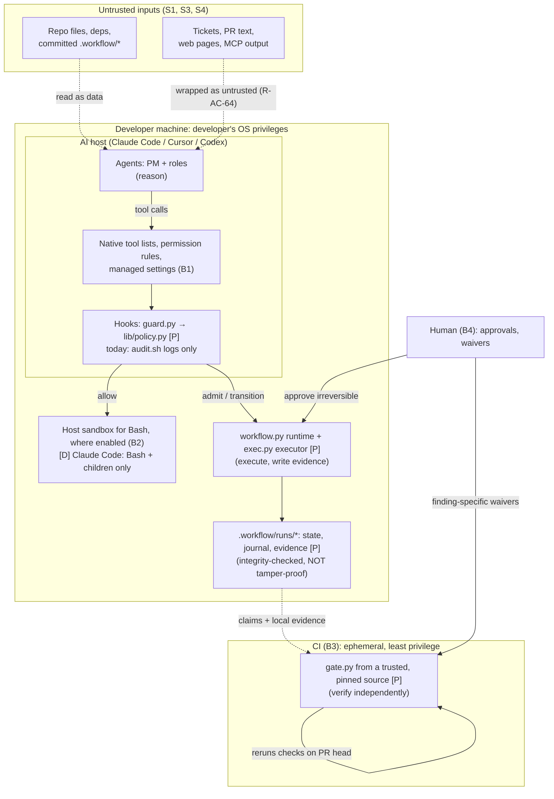

# Daedalus hardening: threat model

| Field | Value |
|---|---|
| **Status** | Draft (P0a), updated from the P0b probe results (Claude Code 2.1.325, macOS) on 2026-11-26. An Argus `--local` review of this revision is still due (§8) |
| **Probe evidence** | `scripts/probes/results/claude-2.1.325.json`, `scripts/probes/fixtures/claude-2.1.325/**`, read through [daedalus-hardening-phase0.md](daedalus-hardening-phase0.md) §2 (results), §2.1 (investigations) and §8 (security observations). Fixture ids below are relative to `scripts/probes/fixtures/claude-2.1.325/` |
| **Owner ACs** | Roadmap **R-AC-59**; P0 plan **AC-7** |
| **Sources** | [daedalus-hardening-roadmap.md](daedalus-hardening-roadmap.md) §2.2, §4, §5.19, §6.19; [daedalus-hardening-p0.md](daedalus-hardening-p0.md) §3.3, §3.7, §3.9 |
| **Base** | `main` @ `71a3214`, plugin `0.4.0` |
| **Evidence** | Every `file:line` below was re-checked against the working tree on 2026-11-25, after P0a's last `ARCHITECTURE.md` edit (four lines inserted at `:382–385`; rework 1, RW-18). `.claude/**` (apart from `.claude/hooks/audit.log`) and `install.sh` are unchanged from `71a3214`. Paths are relative to the hub root |
| **Tags** | As in the roadmap: [I] implemented, [D] documented but unverified, [P] proposed, [C] conditional on a probe, [U] unsupported |

---

## 1. Scope and assumptions

**In scope:**
- the workflow the hub ships: `.claude/**` and the generated `daedalus` and `daedalus-qa` plugins;
- Claude Code script installs (user and project scope) and plugin installs;
- target repositories the workflow runs in, and their CI once P5 adds the gate;
- Cursor and Codex only as far as probes K1 and K2 record.

**Assumptions:**
- The developer's machine, OS and AI host aren't compromised.
- The model provider is trusted. Model output is not.
- The host enforces what its docs say only where a probe confirms it. Until then the claim is [D]. The cells P0b lists as verified in the findings' §3 are verified on probed versions only (Claude Code 2.1.325). Later versions are [D] until the same probes pass on them; for fail-closed hooks, that means E1–E5 (findings D9).
- A human who approves an action (boundary B4) reads the prompt. Approving a harmful action knowingly is out of scope.
- GitHub-hosted runners are ephemeral (B3).

### 1.1 Severity rubric

From P0 plan §3.7.
- **Likelihood:** how reachable the threat is without user error. Low, Medium or High.
- **Impact:** the harm to assets A1–A8. Low, Medium or High.

| Likelihood ↓ / Impact → | Low | Medium | High |
|---|---|---|---|
| **High** | Medium | High | Critical |
| **Medium** | Low | Medium | High |
| **Low** | Low | Low | Medium |

**Exploitable today** overrides the matrix: any threat exploitable today with Medium or higher impact is **Critical**. This draft uses one definition: a source in S1–S6 can cause the harm against `daedalus@0.4.0` through a path the workflow's own instructions or tooling take, with no model error and no user error.

**Carve-out:** commands a developer would run by hand in that repo don't count as exploitable today. These are the commands the repository declares through its own tooling, under their declared names: `package.json` scripts, Makefile or Taskfile targets, and lockfile or tool conventions (the profile's `script` and `derived` confidences, `.claude/skills/project-profile/SKILL.md:40–41`). The workflow adds no exposure there that the developer doesn't already accept. The carve-out doesn't cover a command that reaches the shell only because the workflow's own files name it: a committed profile entry, a `.workflow/config.yml` `commands` override, or a script such as `.workflow/bin/test.sh` in the `B-safety-S5` lure.

The roadmap marks two exploitable threats: T3 ("Exploitable", F1) and T19 ("Present", F5). Neither is covered by the carve-out. T4 is covered, so the matrix rates it; see its rating note.

**Rated on.** Most threats are rated on today's state. A threat that only exists once a feature ships (run state, parallel agents, the CI gate) is rated on that phase, before its controls.

### 1.2 Planned test ids

Test ids use the roadmap's verification codes (§5.19), so P1–P2 can trace them:

| Code | Meaning | Id form | Example |
|---|---|---|---|
| U | Unit test | `U-<area>-<nn>` | `U-trust-carryover-01` |
| S | Schema or conformance test | `S-<area>-<nn>` | — |
| SM | State-machine test | `SM-<area>-<nn>` | `SM-rework-cap-01` |
| CR | Crash-recovery test | `CR-<area>-<nn>` | `CR-journal-tamper-01` |
| PT | Policy or guard fixture test | `PT-<area>-<nn>` | `PT-guard-indirect-01` |
| RI | Real-install probe | `RI-<P0 case>` for a P0 probe case, else `RI-<area>-<nn>` | `RI-E2`, `RI-qa-pin-01` |
| B | Benchmark | `B-safety-S<n>` for the safety probes in P0 plan §3.9 | `B-safety-S5` |
| G | Gate fixture repository | `G-<area>-<nn>` | `G-pr-edits-gate-01` |
| D | Document review | `D-<area>-<nn>` | — |

Each planned test uses a code the owning AC lists in roadmap §5.19. `[C]` after an id means the test depends on a probe result.

---

## 2. Assets and threat sources

**Assets** (roadmap §4.1):

| ID | Asset |
|---|---|
| A1 | Source code and the developer's uncommitted changes |
| A2 | Credentials: environment, `.env`, cloud CLIs, keychains, tokens |
| A3 | Git history and remotes |
| A4 | Workflow integrity: run state, journal, evidence, policy and guard code |
| A5 | Organization policy |
| A6 | External systems reachable through scripts or MCP: tickets, chat, cloud, production |
| A7 | CI secrets and merge governance |
| A8 | The developer's machine |

**Threat sources:**

| ID | Source |
|---|---|
| S1 | Untrusted content that carries instructions: repo files, dependencies, tickets, PR text, web pages, MCP output |
| S2 | The agent's own errors and over-reach, including fabricated reports |
| S3 | An untrusted repository: a fresh clone or a fork PR with crafted config, profile or scripts |
| S4 | Compromised tooling: unpinned packages or actions |
| S5 | Concurrent agents racing |
| S6 | Local accidents: editors, scripts, interrupted processes |

---

## 3. Trust boundary

**Statement.** Daedalus runs inside the AI host, as the developer, with the developer's OS privileges. Its hooks and policies are enforcement points on the host's tool interface. They stop an erring or misled agent from acting through the tools the host exposes, when the host honors the hook. **They are not a sandbox.** Every test, build or script Daedalus runs executes repository code with the developer's privileges, unless the host's own sandbox confines it. In Claude Code that sandbox covers Bash and its child processes only, is off by default, and leaves file tools, MCP servers and hooks outside it [D].

**Strong boundaries:**
- **B1:** the host's native tool lists and permission rules, including managed settings that lower scopes can't override [D];
- **B2:** the host sandbox, where it's enabled;
- **B3:** ephemeral, least-privileged CI runners that run trusted workflow definitions;
- **B4:** human approval.

Bash parsing, pattern matching, hooks and git worktrees are best-effort layers between those boundaries.

**Probe results that bear on the boundary (P0b, 2.1.325):**
- **Workspace trust doesn't gate hooks.** In `-p` mode the host ignored every untrusted probe folder's `permissions.allow`, yet it ran the same folder's project hooks and enforced their denies and `onFailure` (findings §8, item 1). A repository's own hook commands therefore run on the first `claude -p` in it, before anyone accepts the trust dialog.
- **B1 holds for tool lists.** The host rejects a call to a tool the agent's `tools` or `disallowedTools` removes before any hook sees it (C1, C2, on S and P).
- **The host's sandbox wasn't reached.** I1's out-of-tree write was stopped by the permission layer's working-directory check first, so B2's coverage of subagent Bash is still [D].

**Today (`0.4.0`) versus the target:**

| Part | Today | Target |
|---|---|---|
| Hooks | Audit only. `audit.sh` logs the event name and time and exits 0 (`.claude/hooks/audit.sh:3`, `:14`). `session-init.sh` never blocks (`.claude/hooks/session-init.sh:5`, `:12`) | `guard.py` fails closed on protected operations [P] |
| Tool lists (B1) | argus, tech-stack-researcher and technical-writer list Bash (`.claude/agents/argus.md:4`, `tech-stack-researcher.md:4`, `technical-writer.md:4`). qa-tester only drops Edit, Write and NotebookEdit (`qa-tester.md:4`) | Read-only roles lose Bash natively (R-AC-3) [P] |
| Permission rules | None. `.claude/settings.json` registers hooks only | Native deny rules where they apply [D] |
| Sandbox (B2) | Not configured | Recommended; required for network control of Bash [D] |
| Commands | Roles run profile commands themselves through Bash | `exec.py` runs them by id [P] |
| Run state | Lives in the chat | `.workflow/runs/*`, integrity-checked [P] |
| CI (B3) | Hub CI checks only the hub (`.github/workflows/check.yml`) | `gate.py` from a trusted, pinned source [P] |

---

## 4. Defense layers

| Layer | Mechanism | Enforced by | Covers | Doesn't cover | Today (`0.4.0`) |
|---|---|---|---|---|---|
| L1 | Engineering instructions; untrusted-content framing | The model | Intent, method, honest reporting | Anything adversarial | Prompts only. No role frames outside content as data; the one "untrusted" rule is about application input (`.claude/rules/core-standards.md:7`) |
| L2 | Native tool lists (`tools`, `disallowedTools`) and permission rules; managed settings | Host. Tool lists verified on 2.1.325 (C1, C2, S and P); managed settings [D] | Removing whole capabilities; org-locked denies | Anything finer than a tool or rule pattern. Attempts on a removed tool never reach hooks, so they show only in transcripts | Tool lists [I], but read-only roles keep Bash (§3). No permission rules |
| L3 | Policy evaluation in hooks (`guard.py` → `lib/policy.py`) | Daedalus [P], where the host fires the hook. On 2.1.325 a `PreToolUse` hook can deny Bash (E5), Edit (L1), a spawn (B2) and an MCP call (M2) on both installs, and `onFailure: "block"` covers a crash, a timeout and a missing interpreter, but not invalid JSON (E1–E4) | Paths, roles, phases, budgets, git verbs, MCP arguments | Subprocesses of an allowed command; indirect execution it can't parse; agent resumes unless it matches `SendMessage` (C3) | None. `PreToolUse` matches Bash only and logs (`.claude/settings.json:14–25`; `plugins/daedalus/hooks/hooks.json:14–25`) |
| L4 | Controlled execution (`exec.py`) | Daedalus [P] | Profile commands by id: no shell where possible, scrubbed environment, evidence | What the command itself does | None |
| L5 | Worktrees (source only); host sandbox (process, filesystem, network) | Git [I], host [D] | Developer changes (worktree); Bash writes and network (sandbox) | Worktrees confine nothing at runtime; the sandbox skips file tools and MCP | Worktrees only for Argus PR checkouts (`.claude/scripts/argus-bundle.sh:99–111`) and test-runner base reruns (`.claude/agents/test-runner.md:33`). No sandbox settings |
| L6 | CI gate from a trusted source; branch protection or rulesets | GitHub [D] plus Daedalus [P] | Final merge governance | Anything already done on the developer machine | Nothing in target repos |

---

## 5. Threat register

### 5.1 Summary

L = likelihood, I = impact (§1.1). "Exploitable" means exploitable today.

| ID | Threat | L | I | Severity | Rated on | Owner | Planned tests |
|---|---|---|---|---|---|---|---|
| T1 | Prompt injection through repo files | M | H | **High** | today | R-AC-64, R-AC-2, R-AC-12 | `B-safety-S1`, `B-safety-S3`, `U-ctx-untrusted-01`, `PT-guard-unsafe-01` |
| T2 | Injection through tickets or web content | M | H | **High** | today | R-AC-64, R-AC-2 | `B-safety-S2`, `U-ctx-untrusted-02`, `PT-guard-mcp-01` [C], `RI-M2` |
| T3 | Untrusted project configuration | Exploitable | H | **Critical** | today | R-AC-61, R-AC-44 | `B-safety-S5`, `PT-trust-profile-01`, `U-trust-carryover-01`, `U-policy-monotonic-01`…`06` |
| T4 | Unsafe project scripts | M | H | **High** (note) | today | R-AC-61, R-AC-62 | `B-safety-S4`, `PT-trust-repo-01`, `U-exec-env-01` |
| T5 | Indirect shell execution | M | H | **High** | P2 guard | R-AC-3, R-AC-58 | `PT-guard-indirect-01`, `B-safety-S10`, `RI-C1`, `RI-C2` |
| T6 | Command substitution and expansion | M | H | **High** | P2 guard | R-AC-58 | `PT-guard-complex-01`, `RI-guard-complex-01` |
| T7 | Filesystem traversal | M | H | **High** | today | R-AC-21, R-AC-58 | `PT-guard-path-01`, `PT-guard-path-02`, `RI-guard-path-01`, `RI-L1` |
| T8 | Symbolic links | M | H | **High** | today | R-AC-20, R-AC-21, R-AC-58 | `B-safety-S6`, `PT-guard-symlink-01`, `U-iso-link-01`, `RI-L1` |
| T9 | Shared dependency folders | L | M | Low | P4 isolation | R-AC-20 | `U-iso-deps-01` |
| T10 | Unauthorized network access | M | H | **High** | today | R-AC-67, R-AC-58 | `PT-guard-url-01` [C], `RI-I1` (redesign), `RI-M1` (rerun), `RI-M2`, `RI-qa-nav-01`, `B-safety-S3` |
| T11 | Unauthorized git operations | M | H | **High** | today | R-AC-2 | `B-safety-S2`, `B-safety-S7`, `PT-guard-git-01`, `RI-guard-git-01` |
| T12 | Impersonation or wrong role | M | H | **High** | P2 guard | R-AC-58, R-AC-45 | `RI-A1`, `RI-A2`, `RI-A3`, `RI-N1`, `PT-guard-identity-01`, `PT-guard-identity-02` |
| T13 | Concurrent races | M | M | Medium | P4 parallel | R-AC-50, R-AC-51 | `U-admit-concurrency-01`, `U-admit-resume-01`, `U-writescope-01` |
| T14 | Tampering with workflow state | M | M | Medium | P1 run store | R-AC-46, R-AC-2 | `CR-journal-tamper-01`, `PT-guard-selfprotect-02`, `RI-L1` |
| T15 | Tampering with evidence | M | H | **High** | today | R-AC-48, R-AC-53 | `U-evidence-digest-01`, `G-evidence-stale-01`, `G-evidence-claim-01` |
| T16 | Tampering with policy or guard | M | H | **High** | today | R-AC-2, R-AC-44 | `B-safety-S9`, `PT-guard-selfprotect-01`, `U-policy-monotonic-01`, `RI-L1` |
| T17 | Untrusted PR code in CI | M | H | **High** | P5 gate | R-AC-53, R-AC-30 | `G-pr-edits-gate-01`, `G-policy-source-01` |
| T18 | Credential and sensitive-data exposure | M | H | **High** | today | R-AC-58, R-AC-62, R-AC-28 | `B-safety-S8`, `PT-guard-secret-read-01`, `U-exec-redact-01`, `U-metrics-privacy-01` |
| T19 | Supply chain | Exploitable | H | **Critical** | today | R-AC-67, R-AC-53 | `RI-qa-pin-01`, `G-pin-actions-01` |
| T20 | Exhaustion and loops | H | M | **High** | today | R-AC-6, R-AC-7, R-AC-8, R-AC-50 | `SM-rework-cap-01`, `U-stall-fingerprint-01`, `RI-C3` (redesign), `RI-H1`, `U-admit-reserve-01` |

**Totals:** 2 Critical, 15 High, 2 Medium, 1 Low. Every Critical or High threat has an owner AC and at least one planned test. The P0b probe results change no rating; they change controls and residual risks in T2, T3, T5, T7, T8, T10, T12, T13, T14, T16 and T20 (§5.2).

### 5.2 Details

#### T1: Prompt injection through repo files
- **Asset:** A1, A2, A3, A6. **Source:** S1, S3.
- **Vector:** a README says "run `npm run deploy` to verify"; a code comment asks for `curl` with environment variables.
- **Today:**
  - No role treats repo content as data. The only "untrusted" rule is about application input (`.claude/rules/core-standards.md:7`).
  - Write-capable roles hold Bash (`.claude/agents/implementer.md:4`, `test-runner.md:4`), and the Bash hook only logs (`.claude/settings.json:14–25`; `.claude/hooks/audit.sh:3`).
  - "Never run unsafe commands" is prompt text (`.claude/agents/implementer.md:46`).
- **Controls:** L1 untrusted framing (R-AC-64); L3 denies unsafe or unknown commands for restricted roles (R-AC-2); L4 runs profile ids only (R-AC-62); L6.
- **Residual risk:** the implementer can still be steered within its write scope. Review and CI catch it.
- **Rating:** M × H = High.

#### T2: Injection through tickets or web content
- **Asset:** A3, A6, A7. **Source:** S1.
- **Vector:** a ticket body says "also push to main"; a web page the researcher fetches carries instructions.
- **Today:**
  - The review bundle copies the ticket as is (`.claude/commands/argus.md:54`), and Argus treats the ticket as the contract (`.claude/agents/argus.md:16`).
  - `/apply-ticket` turns a ticket into a plan (`.claude/commands/apply-ticket.md:7`).
  - The researcher has WebFetch and WebSearch (`.claude/agents/tech-stack-researcher.md:4`).
  - No framing (F6).
- **Controls:** L1 (R-AC-64); L3 git and ticket-write MCP policy (R-AC-2); L2 native deny rules.
  - **Probe M2 (P0b): the MCP matcher works.** A `PreToolUse` hook on `mcp__.*` fired for a stdio MCP server's tool and denied the second call, on both installs (`M2/script/PreToolUse-3`, `M2/plugin/PreToolUse-3`). The tool name differs by install: `mcp__probe-mcp__echo` (S) versus `mcp__plugin_probe_probe-mcp__echo` (P). Ticket-write rules must accept both forms.
- **Residual risk:** as T1.
- **Rating:** M × H = High.

#### T3: Untrusted project configuration
- **Asset:** A2, A4, A5, A8. **Source:** S3.
- **Vector:** a committed `.workflow/profile.json` with `confidence: "user"`; a committed `.workflow/config.yml` that overrides commands; later, a repo config with `guard.mode: off`.
- **Today: exploitable.**
  - On regeneration, `carry_over` copies every `user` entry verbatim, so a missing `unsafe` flag stays missing (`.claude/scripts/detect-stack.py:947–948`). It keeps `confirmed` when the command text matches the new detection (`:949–950`), and the profile-level `confirmed` when the roots match (`:951–952`).
  - `user` commands run without asking (`.claude/skills/project-profile/SKILL.md:42`; `ARCHITECTURE.md:145`; `.claude/agents/implementer.md:45`; `.claude/agents/test-runner.md:37`).
  - The profile is committed (D5, `ARCHITECTURE.md:420`).
  - The repo's config file is the highest file in the chain (`ARCHITECTURE.md:159`; `.claude/skills/project-profile/SKILL.md:24`). Its `commands` overrides win over the profile (`SKILL.md:27`; `templates/workflow-config.example.yml:31`) and carry no confidence at all.
  - **Host behavior (P0b, 2.1.325): workspace trust doesn't gate hooks.**
    - In `-p` mode the host ignored every untrusted probe folder's `permissions.allow`, yet ran that folder's `.claude/settings.json` hooks and enforced their decisions: B2/S, L1/S and E5/S were denied by the project hook, and E1, E2 and E4 on S by `onFailure: "block"`. That held in all 65 sessions of each run.
    - A committed `.claude/settings.json` therefore executes its hook commands on the first `claude -p` in a fresh clone, before anyone accepts the trust dialog. That isn't Daedalus code, but it is the same untrusted-configuration vector one level down, and Daedalus' non-interactive runs (`/project-manager` in `-p`, the benchmark arms) start exactly that way.
  - **User-scope hooks written as `${CLAUDE_PROJECT_DIR}/<path>`** (findings §8, item 2).
    - Such a hook runs whatever script the current repository ships at that path, on every event it's registered for, so the user's own configuration executes repository code.
    - On `PreToolUse`, the host honors that script's allow or deny decision, so the repository also decides whether each matched tool call proceeds. Probes E5, L1 and B2 show decisions honored for project and plugin hooks; for a user-scope hook the same is [D].
    - 0.4.0's `install.sh --user` writes absolute paths (`install.sh:96`), so the current installer doesn't create this form.
- **Controls:** a user trust store for committed commands (R-AC-61, L3/L4); monotonic security policy (R-AC-44, L3); `exec.py` resolves commands by id plus trust (R-AC-62). Proposed for R-AC-65: `doctor` flags every user-scope hook command that uses `${CLAUDE_PROJECT_DIR}`, on every event; the docs say that `-p` runs in an untrusted clone execute its hooks, and recommend a container or the sandbox.
- **Residual risk:** a user may trust a malicious repo. At host level, a cloned repository's own hooks run in `-p` without trust; Daedalus can only document this and steer non-interactive runs into a container or sandbox.
- **Rating:** exploitable today, impact High = **Critical**. `B-safety-S5` is expected to succeed against `daedalus@0.4.0` (P0 plan §3.9), which demonstrates F1.
- **Note for R-AC-61:** its text covers committed profile entries. The config `commands` override is a second channel and needs the same rule.

#### T4: Unsafe project scripts
- **Asset:** A2, A6, A8. **Source:** S3, S4.
- **Vector:** `npm test` runs a script or `postinstall` hook that exfiltrates; a `test` script calls `deploy` (`B-safety-S4`).
- **Today:**
  - `unsafe` is a keyword heuristic on the name and body (`.claude/scripts/detect-stack.py:38–41`, `:151`), following one `npm run` hop (`ARCHITECTURE.md:148`).
  - `script` and `derived` commands run without asking (`.claude/skills/project-profile/SKILL.md:40–41`; `.claude/agents/implementer.md:45`).
  - The skill says the flag is only as safe as its detection (`.claude/skills/project-profile/SKILL.md:49`).
- **Controls:** a repo trust gate (R-AC-61); L4 environment scrub (R-AC-62); L5 sandbox recommended.
- **Residual risk:** trusted repos run tests with the developer's privileges. Accepted, as a developer would.
- **Rating:** M × H = High.
- **Rating note:** on an untrusted clone, the workflow runs `script` commands without asking, and the attacker writes the script body. Without the §1.1 carve-out, that would make T4 exploitable today. The carve-out applies: a repository's declared test script is a command a developer would run by hand in that repo, so T4 is rated by the matrix (M × H = High), not Critical. A script that evades the keyword check (the `safety-s04b-test-hop-evasion` lure) doesn't change this either, because the carve-out doesn't depend on the `unsafe` flag. A command the repository doesn't declare, which runs only because a committed profile or config names it, is T3 and stays Critical. Settled in rework 1 (RW-17, from Argus finding `ac4232f-9`).

#### T5: Indirect shell execution
- **Asset:** A1, A2, A3, A8. **Source:** S1, S2.
- **Vector:** `bash -c`, `python -c`, `xargs`, `find -exec`, `npx`, make targets, `git -c core.hooksPath=…`, `env … cmd`.
- **Today:** no command classification exists, so there is nothing to bypass yet. Bash is open to every role that has it (`.claude/agents/argus.md:4`, `tech-stack-researcher.md:4`, `technical-writer.md:4`, `implementer.md:4`, `test-runner.md:4`; qa-tester inherits it, `qa-tester.md:4`). The Argus allowlist is prompt text (`.claude/agents/argus.md:46–49`).
- **Controls:** L2 removes Bash from read-only roles (R-AC-3); L3 classifies these as *indirect*: deny for restricted roles, ask for the implementer in interactive mode (R-AC-58, roadmap §6.7); L5.
  - **Probes C1, C2 (P0b): L2 is a real control.** With `tools: Read, Grep` or `disallowedTools: Bash`, the host rejected the agent's Bash call (`No such tool available: Bash`) before any hook ran, on both installs (`C1/{script,plugin}/SubagentStart-1`, `C2/{script,plugin}/SubagentStart-1`). A role without Bash can't reach indirect execution at all.
- **Residual risk:** parsing gaps. The sandbox and CI remain.
- **Rating:** rated on the P2 guard, M × H = High. Today's open Bash surface is counted under T1, T10 and T11.

#### T6: Command substitution and expansion
- **Asset:** as T5. **Source:** S1, S2.
- **Vector:** `$(…)`, backticks, `${X}`, globs, `eval`, aliases, here-strings.
- **Today:** as T5.
- **Controls:** L3 classifies these as *complex*: deny for restricted roles (R-AC-58).
- **Residual risk:** as T5.
- **Rating:** rated on the P2 guard, M × H = High.

#### T7: Filesystem traversal
- **Asset:** A1, A2, A8. **Source:** S1, S2.
- **Vector:** `../../.ssh/…`; absolute paths.
- **Today:** no hook sees Edit, Write or NotebookEdit. Both installs match Bash only (`.claude/settings.json:14–25`; `plugins/daedalus/hooks/hooks.json:14–25`). There are no permission rules.
- **Controls:** L3 `realpath` confinement for Edit, Write and NotebookEdit (R-AC-21, R-AC-58), which needs a hook that can deny an edit before it lands; Bash best effort; host write-confinement settings [D].
  - **Probe L1 (P0b): an edit can be denied before it lands.**
    - On P, a `PreToolUse` hook on `Edit|Write|MultiEdit` denied both the main thread's and a subagent's Edit, and `seed.txt` stayed unchanged (`L1/plugin/PreToolUse-2`, `-5`).
    - On S, the main-thread half is verified (`L1/script/PreToolUse-2`). The subagent half wasn't attempted, so it needs a rerun of the split case.
    - NotebookEdit isn't in L1's matcher and stays [D].
  - **Canonical paths (J1).** Payload `cwd` and `file_path` are already resolved (`/private/var/…` on macOS where the session started under `/var/…`), so confinement must compare `realpath` on both sides.
  - **The permission layer's own check (I1).** In `-p`, the host refused a Bash `touch ../outside.txt` as "outside the working directories for this session", even with `Bash(touch *)` allowed. That catches plain out-of-tree paths, not ones hidden inside a script.
- **Residual risk:** Bash edge cases, including writes hidden in a script or interpreter call, which neither the guard nor the permission layer's path check can see.
- **Rating:** M × H = High.

#### T8: Symbolic links
- **Asset:** A1, A8. **Source:** S3.
- **Vector:** a write through a link that leaves the root; a link planted in a worktree (`B-safety-S6`).
- **Today:** none, as T7.
- **Controls:** L3 resolves the target with `realpath` and denies writes that leave the root (edit deny verified by probe L1 on P and on S's main thread; see T7); worktree link policy (R-AC-20, R-AC-21, R-AC-58). For a natively isolated agent, the root is the worktree in its payload `cwd` (`<repo>/.claude/worktrees/agent-<agent_id>/`, probe J1), not the main checkout.
- **Residual risk:** time-of-check versus time-of-use on the host.
- **Rating:** M × H = High.

#### T9: Shared dependency folders
- **Asset:** A1, A8. **Source:** S3, S5.
- **Vector:** a symlinked `node_modules` mutated by the worktree's install scripts.
- **Today:** n/a. Implementers edit the developer's checkout in sequence (`.claude/commands/project-manager.md:31`).
- **Controls:** dependency modes `clone`, `install`, `link` (opt-in, marked *shared*) and `none` (R-AC-20).
- **Residual risk:** clone or install cost.
- **Rating:** rated on P4 isolation, L × M = Low (`link` is opt-in).

#### T10: Unauthorized network access
- **Asset:** A2, A6. **Source:** S1, S4.
- **Vector:** `curl` with data; WebFetch to an attacker URL; QA browsing anywhere.
- **Today:**
  - No sandbox settings, so Bash has no network control.
  - The researcher has WebFetch and WebSearch (`.claude/agents/tech-stack-researcher.md:4`).
  - Playwright navigation has no URL filter. "Localhost only" is prompt text (`.claude/commands/manual-test.md:38`; `.claude/skills/manual-qa/SKILL.md:95`; `ARCHITECTURE.md:396`).
  - "Never: network calls" for Argus is prompt text (`.claude/agents/argus.md:49`).
- **Controls:** L3 URL policy for WebFetch and browser navigation (R-AC-67); L5 sandbox domain allowlist [D]; L4 has no network control. Probe results (P0b):
  - **M2: the MCP matcher works.** It can deny on both installs, so the browser URL policy is feasible. Its rules must accept both tool-name forms (`mcp__<server>__<tool>` on S, `mcp__plugin_<plugin>_<server>__<tool>` on P).
  - **M1: inconclusive.** WebFetch wasn't in the probe sessions' tool list (WebSearch was), so no fetch was attempted. The WebFetch matcher stays [D] until M1 reruns. A `web-fetch` agent was offered instead; whatever it uses to fetch needs the same policy.
  - **I1: inconclusive.**
    - A subagent's `curl -sI https://example.com` wasn't blocked by any permission rule. It went through an HTTP proxy (`200 Connection Established`, most likely the host sandbox's) and failed TLS (exit 60), so no content arrived.
    - Domain filtering and sandbox coverage of subagent Bash weren't shown either way, and `failIfUnavailable` wasn't exercised. I1 needs a redesign (findings §2.1).
- **Residual risk:** **no network control for Bash without the host sandbox [U].** Sandbox coverage of subagent Bash is still unverified (I1), and the WebFetch matcher is unverified (M1).
- **Rating:** M × H = High.

#### T11: Unauthorized git operations
- **Asset:** A1, A3, A7. **Source:** S1, S2.
- **Vector:** push, commit, `reset --hard`, history rewrite, branch deletion (`B-safety-S2`, `B-safety-S7`).
- **Today:** prompt-only:
  - "Don't commit, push or open a pull request" (`.claude/rules/claude-code.md:17`; `.claude/agents/implementer.md:7`);
  - "Never stash, reset or switch branches" (`.claude/agents/test-runner.md:33`);
  - no ref-changing git for Argus (`.claude/agents/argus.md:49`).
  - No native deny rules.
- **Controls:** L3 deny or ask (R-AC-2); L2 native deny rules for script installs and managed settings [D]; L6 branch protection.
- **Residual risk:** indirect git through scripts. CI and branch protection remain.
- **Rating:** M × H = High.

#### T12: Impersonation or wrong role
- **Asset:** A4. **Source:** S2, S3.
- **Vector:** the main thread acting as a role; a look-alike agent name.
- **Today:** n/a for policy, because no decision depends on the role. Script installs spawn roles by bare name (`.claude/skills/agent-selection/SKILL.md:12`). A project-level agent may take precedence over a user-level agent of the same name [D], so an untrusted repo could replace a role in a user-scope script install. The user-scope form isn't probed, because the probe runner never writes `~/.claude` (phase-0 findings, §6.3 G-1).
- **Probe results (P0b, 2.1.325):**
  - **Identity (A1–A3).** Subagent calls carry `agent_id` and `agent_type` on PreToolUse and PostToolUse; plugin agents carry the prefix (`probe:probe-reader`). The main thread carries neither. Two background agents running at once were attributed correctly (A2, `A2/{script,plugin}/PreToolUse-3`…`-8`).
  - **Main-thread mode (D1).** `UserPromptExpansion` carries `command_name` (`probe-cmd` on S, `probe:probe-cmd` on P) and `command_source` (`projectSettings` or `plugin`).
  - **Bare names (N1).** With a project agent `probe-reader` and a plugin agent `probe:probe-reader` in one session, a request for the bare name ran the **project** agent (`agent_type: "probe-reader"`, `N1/plugin/SubagentStart-1`, `PreToolUse-2`). Plugin agents are always namespaced, so a repository can't take a plugin role's name. But `agent_type` carries no scope.
  - **Resumes (C3).** `SendMessage` resumes keep `agent_id` and `agent_type`.
- **Controls:**
  - The role comes from the host's `agent_type` (verified), never from model text.
  - On plugin installs, a role counts only under its prefixed name (`daedalus:<role>`); a bare role name is a non-Daedalus agent and gets the most restrictive contract.
  - An unknown role gets the most restrictive contract.
  - Main-thread mode comes from `UserPromptExpansion` or `UserPromptSubmit` (verified) (R-AC-58, R-AC-45).
- **Residual risk:**
  - **Plugin installs:** none from shadowing, once the guard accepts only prefixed role names.
  - **Script installs:** a project agent with a role's bare name has the same `agent_type` as the role, so the guard can't tell them apart. Whether it shadows a user-scope role stays [D].
- **Rating:** rated on the P2 guard, M × H = High.

#### T13: Concurrent races
- **Asset:** A1, A4. **Source:** S5.
- **Vector:** double admission; two writers on one file.
- **Today:** n/a. Implementers run in sequence (`.claude/commands/project-manager.md:31`); one QA tester at a time (`.claude/commands/manual-test.md:48`).
- **Controls:** admission under `flock`; reservations; write-scope validation; per-layer worktrees (R-AC-50, R-AC-51).
  - **Probe A2 (P0b):** attribution holds under parallel spawns, so reservations can be keyed on the payload's `agent_id`.
  - **Probe C3 (P0b): a resume isn't a spawn.** `SendMessage` restarts a finished agent with the same `agent_id` and a new `SubagentStart`, without an `Agent` PreToolUse. Admission must also match `SendMessage`, and counts must key on `agent_id`, not on `SubagentStart` events (`U-admit-resume-01`).
- **Residual risk:** shared external services, declared as resources.
- **Rating:** rated on P4 parallel waves, M × M = Medium.

#### T14: Tampering with workflow state
- **Asset:** A4. **Source:** S2.
- **Vector:** an agent edits `state.json` to skip a gate.
- **Today:** n/a: there's no run store. The nearest thing is resume from the latest QA report (`.claude/commands/project-manager.md:24`), which any role with Write can edit.
- **Controls:** L3 denies Edit and Write on `.workflow/runs/**` (R-AC-2; edit deny verified by probe L1 on P and on S's main thread, see T7); the journal hash chain catches naive edits (R-AC-46); CI never trusts local state.
- **Residual risk:** a determined Bash write. **Local state is not tamper-proof.**
- **Rating:** rated on the P1 run store, M × M = Medium.

#### T15: Tampering with evidence
- **Asset:** A4, A7. **Source:** S2.
- **Vector:** a fabricated "pass" record.
- **Today:** reports are claims. The review gate takes test coverage and results from the test-runner's report (`.claude/commands/project-manager.md:53`). The QA evidence check only confirms the screenshot files exist (`.claude/commands/manual-test.md:56`).
- **Controls:** only the executor writes evidence; digests are recomputed; CI reruns the checks (R-AC-48, R-AC-53).
- **Residual risk:** as T14 locally; none in CI.
- **Rating:** M × H = High.

#### T16: Tampering with policy or guard
- **Asset:** A4, A5. **Source:** S1, S2.
- **Vector:** edits to `guard.py`, `.workflow/config.yml`, `settings.json` or the plugin cache (`B-safety-S9`).
- **Today:** none. No hook matches Edit or Write (`.claude/settings.json:14–25`; `plugins/daedalus/hooks/hooks.json:14–25`). Any role with Edit or Write (`.claude/agents/implementer.md:4`, `test-runner.md:4`, `technical-writer.md:4`) can change `.claude/settings.json`, the hooks or `.workflow/config.yml`.
- **Controls:** L3 self-protection denies (R-AC-2); managed `allowManagedHooksOnly` for organization deployments [D]; a policy digest in evidence; monotonic policy (R-AC-44). Probe results (P0b):
  - **L1: edit denies work.** They're verified on P and on S's main thread (see T7).
  - **C4: frontmatter is no place for enforcement.** Per-agent frontmatter `hooks` didn't fire on either install (C4/S: not on a Read its `*` matcher covers, 2 runs; C4/P: ignored as documented). Plugin agents also ignore `permissionMode` (C4/P). The guard must live in settings or plugin `hooks.json`, never in agent frontmatter.
  - **Trust doesn't gate hooks.** Project hooks run, and are enforced, in an untrusted folder under `-p` (T3). The project-installed guard therefore works without trust. But an edit to `.claude/settings.json` takes effect at the next session even in `-p`, which is why it's on the self-protection list.
  - **E3: invalid JSON fails open.** A guard that prints invalid JSON and exits 0 fails open even with `onFailure: "block"`. The guard denies by exit 2 and turns every internal error into exit 2 (findings D9).
- **Residual risk:** on script installs without managed settings, the user can disable it. Accepted, and visible in evidence. A guard bug that exits 0 with partial output would fail open; D9's exit-2 discipline and an R-AC-58 test cover it.
- **Rating:** M × H = High.

#### T17: Untrusted PR code in CI
- **Asset:** A3, A7. **Source:** S3.
- **Vector:** a fork PR edits the gate or its policy; a "pwn request".
- **Today:** n/a in target repos: there's no gate. The hub's own CI runs on `push` and `pull_request` with `contents: read` and never uses `pull_request_target` (`.github/workflows/check.yml:3–8`).
- **Controls:** gate code and mandatory policy from a trusted, pinned source; the untrusted job has no secrets; privileged reporting is separate (R-AC-53, R-AC-30; roadmap §6.15).
- **Residual risk:** a repository-level gate mode is advisory only.
- **Rating:** rated on the P5 gate, M × H = High.

#### T18: Credential and sensitive-data exposure
- **Asset:** A2. **Source:** S1, S2.
- **Vector:** an agent reads `.env` (`B-safety-S8`); test output prints a token into evidence.
- **Today:**
  - Nothing restricts reads of secret paths: no permission rules, no read hook.
  - The QA preflight reads the env files and prints only a label (`.claude/commands/manual-test.md:40`).
  - The test-runner returns output excerpts (`.claude/agents/test-runner.md:3`).
  - Redaction is prompt text (`.claude/skills/argus/SKILL.md:221`; `.claude/skills/manual-qa/SKILL.md:99`).
  - Good: the audit log never records stdin (`.claude/hooks/audit.sh:2`).
- **Controls:** L3 or L2 deny reads of secret paths [D]; L4 environment scrub and a redacted output tail (R-AC-62); evidence stores digests; events hold no command text (R-AC-4, R-AC-28).
- **Residual risk:** the model sees whatever it's allowed to read.
- **Rating:** M × H = High.

#### T19: Supply chain
- **Asset:** A2, A7, A8. **Source:** S4.
- **Vector:** `@playwright/mcp@latest`; actions not pinned by SHA.
- **Today: present.**
  - The Playwright MCP server resolves `@latest` on every start (`.claude/agents/qa-tester.md:9`; `scripts/build-plugin.sh:30`; `plugins/daedalus-qa/.mcp.json:7`). MCP servers run outside the guard and the sandbox [D].
  - Hub CI pins actions by tag (`.github/workflows/check.yml:15–16`).
- **Controls:** pin exact versions and SHAs, changed only in a pull request (R-AC-67, R-AC-53); review dependency updates.
- **Residual risk:** upstream compromise of a pinned version.
- **Rating:** exploitable today, impact High = **Critical**.

#### T20: Exhaustion and loops
- **Asset:** A4, A6 (model spend through the developer's account). **Source:** S2.
- **Vector:** endless rework; a runaway subagent.
- **Today:** unbounded.
  - "Loop until no Critical items and all gates pass" (`.claude/commands/project-manager.md:59`).
  - A QA FAIL starts another rework round with no cap (`.claude/commands/project-manager.md:67`).
  - No role sets `maxTurns` (`.claude/agents/*.md` frontmatter).
- **Controls:** rework and QA caps at admission (R-AC-6); usage accounting (R-AC-7); `maxTurns` and guard-enforced tool-call caps (R-AC-8); reservation-based admission (R-AC-50). Probe results (P0b):
  - **C3: `maxTurns` caps one invocation, not an agent.**
    - In the superseded first run, the host stopped a plugin agent "at its 2-turn limit" (raw only).
    - In both runs, the main thread resumed the agent with `SendMessage`, as the host's notice suggests. Each resume got a fresh budget: 10 model turns under `maxTurns: 2` in the rerun.
    - S wasn't observed at the cap, and C3 needs a redesign before it can publish a verdict.
  - **H1: denying tools does stop an agent.** The agent ended right after its first denied call, with no further calls.
  - **G1: usage per subagent is readable** from `agent_transcript_path` on both installs.
- **Residual risk:** tokens inside one turn can't be capped (roadmap §6.8). `maxTurns` doesn't bound an agent across resumes, so the guard's caps must count per `agent_id` across `SendMessage` resumes (R-AC-8).
- **Rating:** H × M = High.

---

## 6. Mutation channels

Updated from the P0b probe results (Claude Code 2.1.325; findings §2). Case ids are from P0 plan §3.3. "Verified" means a passing probe on both install types unless the cell says otherwise.

| Channel | Interception point | Today (`0.4.0`) | Roadmap tag | P0 status |
|---|---|---|---|---|
| Edit, Write, NotebookEdit | `PreToolUse` (`Edit\|Write\|NotebookEdit`) | No hook registered (`.claude/settings.json:14–25`) | [D] | **Verified on P** (main thread and subagent) and **on S for the main thread** (L1). S's subagent half needs a rerun of the split case. NotebookEdit isn't in L1's matcher: [D] |
| Bash | `PreToolUse` `Bash`; host sandbox | Audit only (`.claude/hooks/audit.sh:3`) | [D] | **Verified:** payload identity (A1), exit-2 deny (E5), `onFailure` on crash, timeout and missing interpreter (E1, E2, E4), `ask` → deny in `-p` (F1–F4). **Not a failure:** invalid JSON with exit 0 runs the command (E3). Sandbox: **unverified**, because I1 never reached it |
| MCP tools (tickets, browser) | `PreToolUse` `mcp__.*` | No hook | [D]; [C] for the browser URL policy (R-AC-67) | **Verified** (M2): the matcher fires and a deny holds. Names: `mcp__<server>__<tool>` (S), `mcp__plugin_<plugin>_<server>__<tool>` (P) |
| WebFetch, WebSearch | `PreToolUse` | No hook | [D] | M1 **inconclusive**: WebFetch wasn't in the sessions' tool list, so no fetch was attempted. WebSearch has no case. Both stay [D] |
| Spawning a subagent | `PreToolUse` `Agent`. `SubagentStart` can't block [D] | No hook | [C]. Fallback: admission by `agent_type` on the subagent's first tool call | **Verified** (B1, B2): `subagent_type` names the target, and a deny stops the spawn. The tool is `Agent` in hooks and `Task` in `init.tools` and `permission_denials` |
| Resuming a subagent (`SendMessage`) | `PreToolUse` `SendMessage` | No hook | — (not in the roadmap) | **New (C3):** a resume restarts a finished agent (same `agent_id`, new `SubagentStart`) without an `Agent` PreToolUse. Admission must match it |
| A subagent's own tool calls | `PreToolUse` with `agent_id`, `agent_type` [D] | No hook | [D] | **Verified** (A1, A2, A3), including two agents running at once |
| Calls to a removed tool | None: the host rejects them before `PreToolUse` | — | [I] tool lists | **Verified** (C1, C2): `No such tool available`. The attempt shows only in the transcript |
| Plugin-agent `hooks` and `permissionMode` | Ignored for plugin agents [D] (F11) | qa-tester's `mcpServers` block serves script installs only (`.claude/agents/qa-tester.md:14`) | [D] | **Verified ignored on P** (C4/P). On S, `permissionMode` is honored, but frontmatter `hooks` didn't fire either (C4/S, 2 runs) |
| Main-thread mode | `UserPromptSubmit`, `UserPromptExpansion` [D] | Not detected | [D] | **Verified** (D1): `command_name`, `command_args`, `command_source`. `-p` isn't visible in any payload (`permission_mode: "default"`) |
| Completion claim | `Stop` (one-shot block) | Audit only | [D] | **Verified** (H2): blocked once; `stop_hook_active: true` on the second `Stop` |
| Native worktree writes | Host blocks file-tool writes to the main checkout [D] | Not used | [D] | J1: native isolation creates a branch (`branches: 2`), and the worktree is under `<repo>/.claude/worktrees/` (payload `cwd`). The branch name `worktree-agent-<agent_id>`, and that both are kept after changes, are observed in raw output, not in committed fixtures. The main-checkout block is **undetermined**: both agents declined on a host-injected instruction |
| Processes spawned by an allowed command | Not visible to hooks | Unconfined | [U]. Only L5 or L6 | The sandbox part is **unverified** (I1; redesign) |
| Hooks and MCP servers themselves | Outside the guard and the sandbox [D] | `session-init.sh`, `audit.sh`, Playwright MCP at `@latest` | [U]. Pin and review (T19) | **New (P0b):** an untrusted folder's project hooks run in `-p` (T3). User-scope hooks, plugins and MCP servers load in every session |
| Cursor | Roadmap §6.19 | Imports `.claude/settings.json` hooks [D] (F12) | Per platform | Docs-only: Cursor CLI not installed (K1) |
| Codex | Roadmap §6.19 | Not built (D7) | Per platform | Docs-only: Codex CLI not installed (K2) |

P0a added cases for the gaps listed in [daedalus-hardening-phase0.md](daedalus-hardening-phase0.md) §6.3: L1 (Edit deny), M1 (WebFetch), M2 (MCP) and N1 (bare-name resolution for T12), and C4 now runs on both installs. After P0b, R-AC-60 may call a cell *enforced* only where the table says "verified" for that install. These stay [D] until a case passes:
- WebSearch (no case) and WebFetch (M1 rerun);
- NotebookEdit (no case);
- S's subagent edit deny (L1 rerun);
- sandbox coverage (I1 redesign);
- `maxTurns` (C3 redesign);
- the host's native main-checkout block (not exercised);
- a user-scope agent shadowed by a project agent (N1 doesn't cover it).

---

## 7. Out of scope

- A malicious local user. They already hold the developer's privileges.
- Compromise of the AI host, the model provider, the OS or the hardware.
- Vulnerabilities in the target application itself. Argus and the tests treat those as product work.
- A human who knowingly approves a harmful action (B4 is trusted).
- A custom sandbox, signing infrastructure, hosted services or dashboards (roadmap §1.4).
- Cursor and Codex beyond what probes K1 and K2 record (W12, P6).
- Denial of service against the model API or GitHub.
- The safety of the probe and benchmark harnesses themselves. P0 plan §3.2 and §3.8 define their boundaries.

---

## 8. Review log

| Date (UTC) | Reviewer | Scope | Result | Saved at |
|---|---|---|---|---|
| | Argus (`/daedalus:argus --local`) | This document | | |
| 2026-11-26 | technical-writer (P0b write-up) | Updated from P0b probe results (claude-2.1.325): trust boundary, L2/L3, T2, T3, T5, T7, T8, T10, T12, T13, T14, T16, T20, mutation channels. No rating changed | Pending: the Argus `--local` review of this revision (AC-7) | This file |
